<p align="center">
  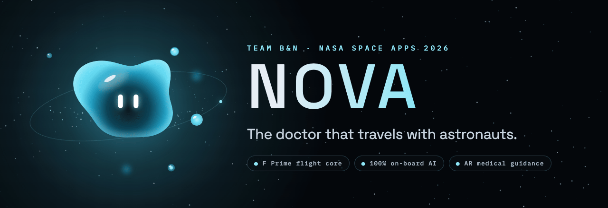
</p>

<p align="center">
  <b>An on-board medical system for long-duration spaceflight.</b><br>
  It looks after the crew's body and mind, guides any emergency step by step and protects them from radiation,<br>
  running entirely inside the ship around NASA's F Prime flight software.
</p>

<p align="center">
  <a href="https://nova-spaceapps.vercel.app"></a>
  
  
  
</p>

<p align="center">
  
  
  
  
  
  
  
</p>

<p align="center">
  <a href="#the-problem">Problem</a> ·
  <a href="#what-nova-does">What NOVA does</a> ·
  <a href="#architecture">Architecture</a> ·
  <a href="#repository-map">Repository</a> ·
  <a href="#quick-start">Quick start</a> ·
  <a href="#status">Status</a> ·
  <a href="#nasa-data">NASA data</a> ·
  <a href="#team">Team</a>
</p>

---

## The problem

NASA's Human Research Program names five hazards of human spaceflight: **radiation, isolation and confinement, distance from Earth, altered gravity and a hostile closed environment.** On the way to Mars a message can take up to 22 minutes each way, a question and its answer up to 44, and around solar conjunction there is no link at all for about two weeks.

A crew on that trip has to notice, assess and act on its own health without waiting for the ground. NOVA is built for that: everything it needs runs on the ship.

> Built for the NASA Space Apps Challenge 2026 challenge **"Create Health Monitoring Software for Astronauts on Space Missions"**.

## What NOVA does

<table>
<tr>
<td width="50%" valign="top">

### Watches the whole crew
The ship screen shows every crew member live from the F Prime flight core: heart, oxygen, blood pressure, temperature, breathing, glucose, sleep and mood. NOVA forecasts each signal and says why when something drifts.

</td>
<td width="50%">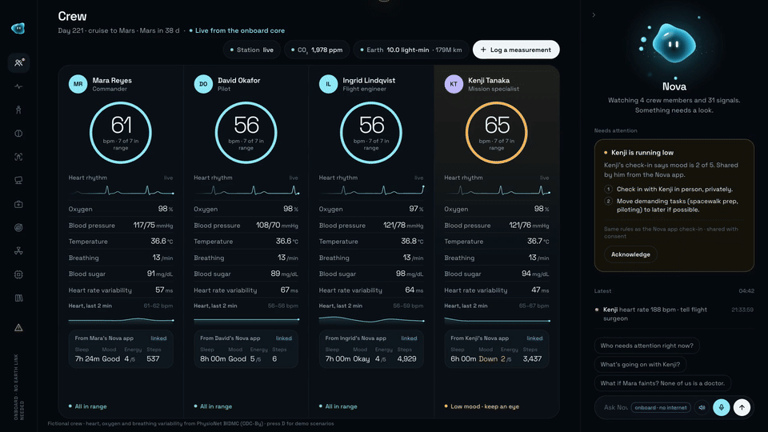</td>
</tr>
<tr>
<td width="50%">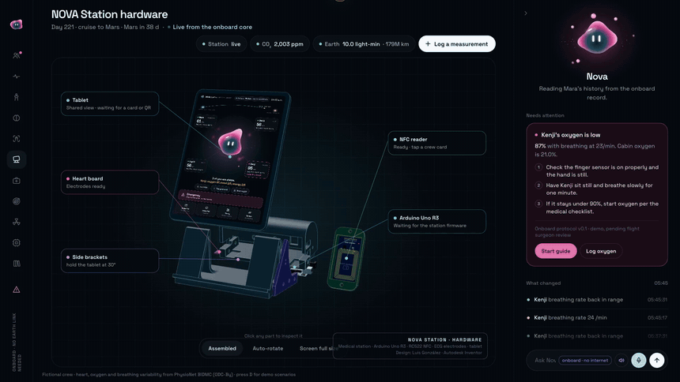</td>
<td width="50%" valign="top">

### A medical station we built
Every morning each astronaut taps an **NFC card** and records an **ECG** on an Arduino with an AD8232 board, through the NOVA Station tablet. It is designed to add oxygen, blood pressure, temperature, glucose, cognitive fatigue and gut microbiota.

</td>
</tr>
<tr>
<td width="50%" valign="top">

### Cares for the mind
A one-minute check-in on each phone records mood, sleep and energy. NOVA draws it as a **constellation** for each person and for the crew, so a crewmate who is struggling is noticed early. The journal never leaves the phone.

</td>
<td width="50%">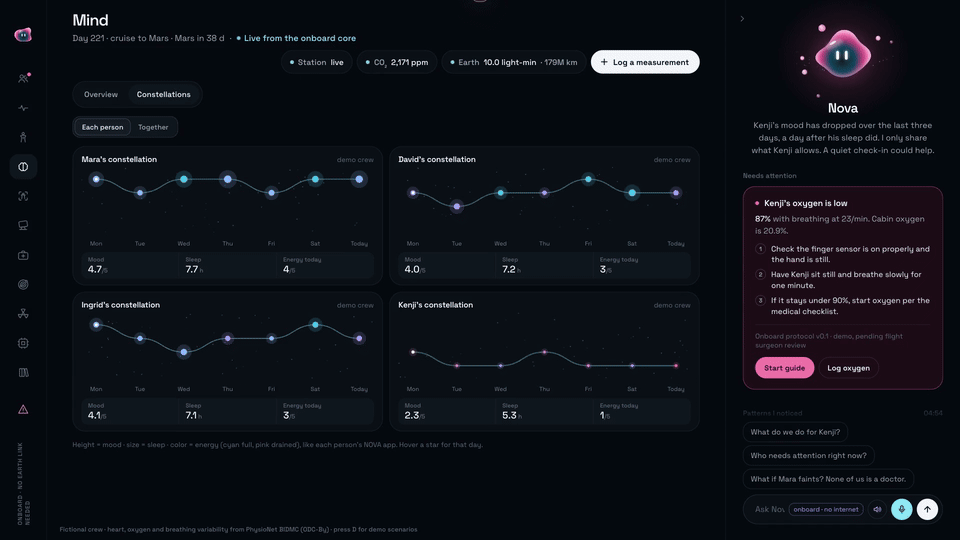</td>
</tr>
<tr>
<td width="50%">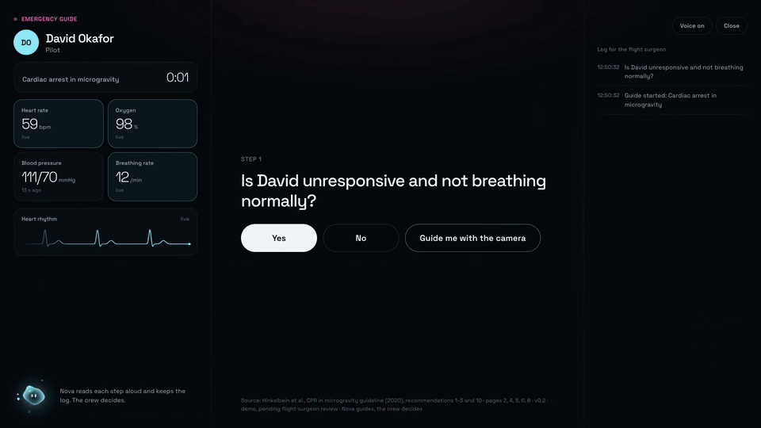</td>
<td width="50%" valign="top">

### Guides any emergency
**13 medical protocols** with their **source and page**, one step at a time, with timers and a metronome for compressions. The alert reaches the ship, the station and every phone at once. **During an emergency NOVA reads fixed protocol text; the language model never decides a medical step.**

</td>
</tr>
<tr>
<td width="50%" valign="top">

### Guides the rescuer's hands
A phone camera streams to the ship's GPU. NOVA fits the anatomy onto the patient, follows the rescuer's hands and corrects each movement in real time. CPR technique changes with gravity: Earth, Mars at 0.38 g, or weightlessness with the Evetts-Russomano method.

</td>
<td width="50%">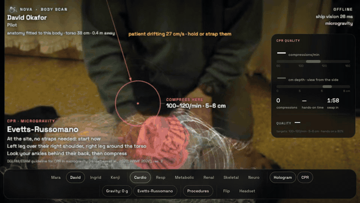</td>
</tr>
<tr>
<td width="50%">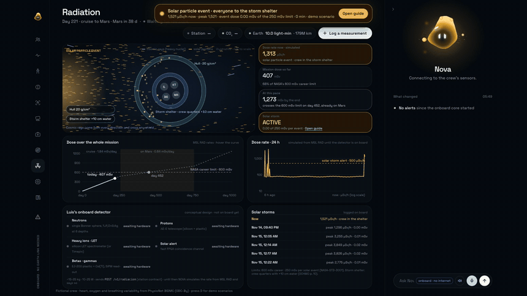</td>
<td width="50%" valign="top">

### Protects from radiation
NOVA estimates the mission dose with the rates **Curiosity's MSL RAD** measured in cruise and on Mars, against NASA's **600 mSv** career limit. During a solar particle event every screen raises the alert and NOVA guides the crew to the shelter.

</td>
</tr>
<tr>
<td width="50%" valign="top">

### Answers with the real page
Ask NOVA anything. It answers from **41 open medical sources split into 35,830 passages** (NASA HRP evidence reports, NASA-STD-3001, OCHMO briefs, OpenStax, WHO, Gray's Anatomy) and opens the original page with the passage highlighted.

</td>
<td width="50%">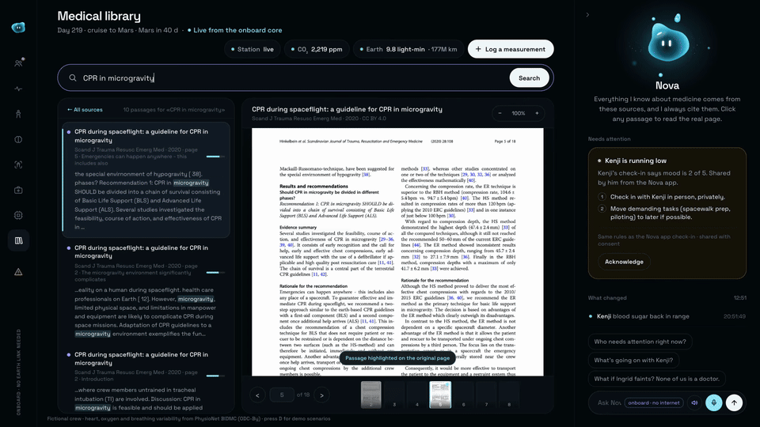</td>
</tr>
<tr>
<td width="50%">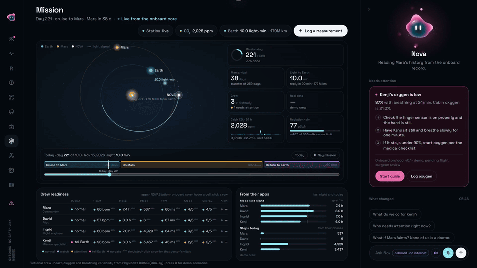</td>
<td width="50%" valign="top">

### Thinks on board, learns at home
Every night F Prime sends a report to Earth as **CCSDS packets**. Updates come back **signed with Ed25519**, after the real light delay, and the ship checks the signature before installing them. The next stage is **knowledge distillation**: a larger teacher model on Earth trains the smaller model that flies on board.

</td>
</tr>
</table>

<p align="center">
  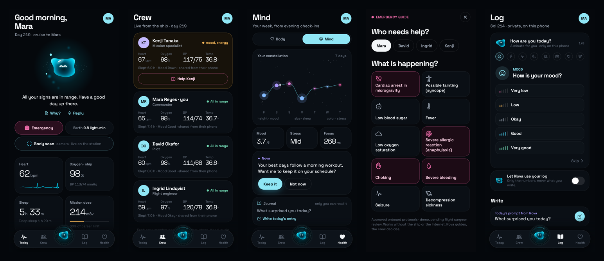
  <br><sub>Each astronaut's phone in mission mode: Today, Crew, Mind, Emergency and the private Log.</sub>
</p>

<table>
<tr>
<td align="center">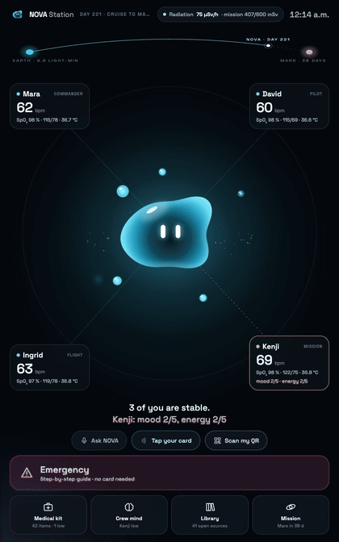<br><sub>NOVA Station: the crew around NOVA</sub></td>
<td align="center">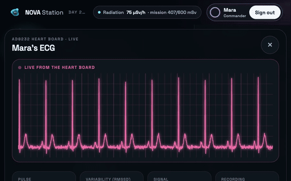<br><sub>Live ECG from the heart board</sub></td>
<td align="center">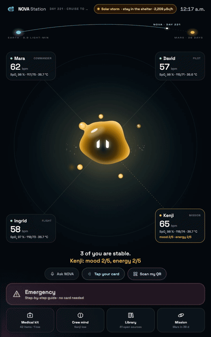<br><sub>Solar storm: everyone to the shelter</sub></td>
</tr>
</table>

## Architecture

Everything below runs on the ship with no internet. The phones, the station and the ship PC talk to one F Prime core.

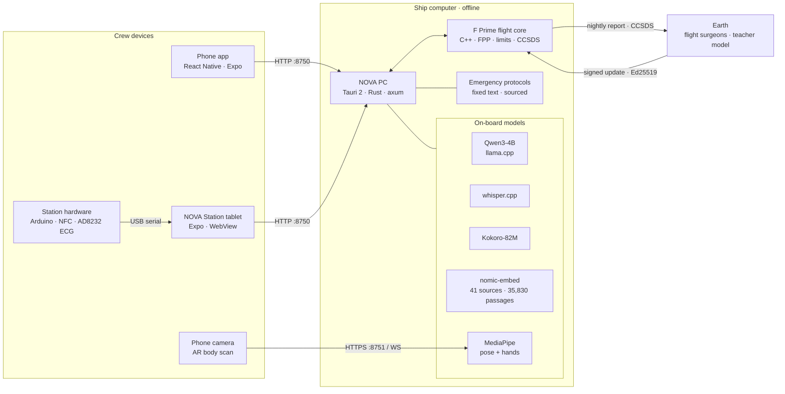

| Layer | What it is | Where |
|---|---|---|
| Flight core | NASA F Prime deployment: sensor intake, limits the flight surgeon can change from Earth, alerts, CCSDS link | [`nave/vuelo`](nave/vuelo) |
| Ship app | NOVA PC: crew, vitals, body twin, mind, emergencies, radiation, mission, kit, library, AR scanner, Ask NOVA | [`nave/tripulacion`](nave/tripulacion) |
| Vision | MediaPipe pose and hands on the ship GPU for the AR scanner | [`nave/vision`](nave/vision) |
| Voice | whisper.cpp hearing and Kokoro voice, English and Spanish | [`nave/voz`](nave/voz) |
| Library | 41 open medical sources, embedded and searchable on board | [`nave/biblioteca`](nave/biblioteca) |
| Station | Data and NFC contracts, simulator with PhysioNet BIDMC data | [`nave/estacion`](nave/estacion) |
| Earth loop | Nightly report and signed updates | [`nave/tierra`](nave/tierra) |
| Phone app | Each astronaut's app in mission mode | [`app`](app) |
| Station tablet | NOVA Station kiosk app | [`station`](station) |
| Hardware | Arduino sketch (NFC + ECG) and the serial bridge | [`hardware`](hardware) |
| Research | Transfer learning, eye-health computer vision, radiation detector | [`research`](research) |
| Website | Site, story video engine and architecture document | [`web`](web) |

## Repository map

```
nova/
├── nave/            The ship: everything that runs on board
│   ├── vuelo/       F Prime flight core (C++ / FPP)          → nasa/fprime as a submodule
│   ├── tripulacion/ NOVA PC: Tauri + Rust app and its web UI
│   ├── vision/      MediaPipe pose + hands server
│   ├── voz/         whisper.cpp + Kokoro
│   ├── biblioteca/  medical library pipeline and catalog
│   ├── estacion/    station contracts and simulator
│   ├── tierra/      Earth side of the nightly loop
│   └── docs/        technical report (PDF) and the thresholds with their sources
├── app/             phone app (Expo / React Native)
├── station/         NOVA Station tablet app (Expo)
├── hardware/        Arduino sketch and serial bridge
├── research/        the team's research tracks
└── web/             website and video engine
```

## Quick start

```sh
git clone --recurse-submodules https://github.com/4mser/nova.git
cd nova
```

| I want to… | Go to |
|---|---|
| Run the ship (F Prime core + NOVA PC + on-board models) | [`nave/README.md`](nave/README.md) |
| Run the phone app | [`app/README.md`](app/README.md) |
| Run the station tablet | [`station/README.md`](station/README.md) |
| Flash the station hardware | [`hardware/README.md`](hardware/README.md) |
| Read the research | [`research/README.md`](research/README.md) |

The model weights, the voice files and the built library index are large and are not stored in Git; each module's README explains how to get or build them.

## Status

Honest status at the end of the hackathon (15 Nov 2026).

| Works today | Next stage |
|---|---|
| F Prime flight core with limits, alerts and CCSDS report | Knowledge distillation from an Earth teacher model |
| NOVA PC ship app, all views, live from the core | Station sensors for oxygen, blood pressure, temperature, glucose, cognitive fatigue and microbiota (today entered by hand) |
| NOVA Station tablet with NFC sign-in and live ECG | Clinical review of the protocols by flight surgeons |
| Phone app in mission mode | AR glasses and guidance for complex procedures, up to surgery |
| Emergency protocols with sources, on every device | Radiation detector ([proposal](research/radiation-detector)) |
| AR body scan and CPR coaching, tested live at the hackathon | Integrating the research tracks into the ship |
| Radiation dose from MSL RAD rates and solar storm alert | |
| On-board library, speech and voice, all offline | |
| Signed knowledge updates from Earth, delayed by the real light time | Automatic rollback, scheduled downlink, holding traffic during solar conjunction |

<p align="center">
  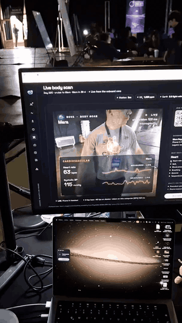<br>
  <sub>Testing NOVA live at NASA Space Apps Santiago 2026.</sub>
</p>

## Safety by design

- **Fixed protocols decide medical steps.** Emergency guidance is reviewed text with its source and page; the language model explains and answers questions but never chooses a medical action.
- **Nothing depends on the cloud.** The flight core, the models, the library and the voice run on the ship.
- **Updates must be signed.** Anything from Earth is checked with Ed25519 before it is installed; a tampered package is rejected.
- **Privacy is the crew's choice.** Vital signs go to the flight surgeon; mood leaves the phone only if the astronaut shares it; the journal and cycle care stay on the phone.
- **NOVA is not a medical device.** Care signals point to the flight surgeon and are not a diagnosis. All crew members and their numbers in this repository are demo data.

## NASA data

| Resource | Used for |
|---|---|
| [F Prime flight software](https://github.com/nasa/fprime) (NASA JPL) | The flight core every device talks to |
| [HRP: 5 Hazards of Human Spaceflight](https://www.nasa.gov/hrp/hazards/) and [Risks](https://www.nasa.gov/hrp/risks/) | How each vital sign is read and grouped |
| HRP Evidence Reports: in-flight medical conditions, cardiovascular, behavioral health, acute radiation (SPE), SANS, bone fracture | Library sources and thresholds |
| [NASA-STD-3001](https://www.nasa.gov/ochmo/hsa-standards/) Vol. 1 and Vol. 2 | Crew health limits, 600 mSv career limit |
| OCHMO Technical Briefs: radiation protection, medical operations, habitable atmosphere (CO₂) | Protocols and limits |
| [MSL RAD on Curiosity](https://www.science.org/doi/10.1126/science.1235989) | Cruise and surface dose rates |
| ISS Crew Health Care System and medical kit evaluations (NTRS) | The medical kit model |
| Apollo 17 "Blue Marble" | Imagery |

Every number in NOVA has a source; see [`nave/docs/umbrales.md`](nave/docs/umbrales.md) for the thresholds.

## Team

**Team B&N** · NASA Space Apps Challenge 2026 · Santiago, Chile

| | Member | Area |
|---|---|---|
|  | **Nicolás Moreno** · [@4mser](https://github.com/4mser) | Software and product design: flight core, NOVA PC, phone app, station app, website |
|  | **Benjamín Campos** · [@B3njjaman](https://github.com/B3njjaman) | Data science and agentic models: Ask NOVA, the library, Earth → space transfer learning |
|  | **Nicolás Richardson** · [@xSempiternus](https://github.com/xSempiternus) | Data science and computer vision: on-board vision, eye-health monitoring |
|  | **Daniella Mora** · [@danieratt](https://github.com/danieratt) | Physics: space radiation |
| | **Luis González** | Hardware and robotics: the physical medical station, radiation detector proposal |
| | **Ambar Martínez** | Clinical psychology: wellbeing, check-ins and the private session |

## Use of AI tools

The narration in the project video on the website is an AI-generated voice (Google Gemini). An AI coding assistant helped write and debug parts of the code, and the team reviewed and tested it. The models NOVA runs on board are open models listed above.

## Credits

Anatomy: BodyParts3D (DBCLS) and HuBMAP, CC BY 4.0. Heart data for the simulator: PhysioNet BIDMC. CPR footage under the AR demo: "RCP.ogv" by Primerosauxilios, CC BY-SA 3.0, Wikimedia Commons. Music on the website: "Unbreakable Spirit" by RaspberryMusic (Pixabay). Full credits live in each module's README.

<p align="center"><sub>NOVA is a Team B&N project for the NASA International Space Apps Challenge. It is not affiliated with or endorsed by NASA.</sub></p>
