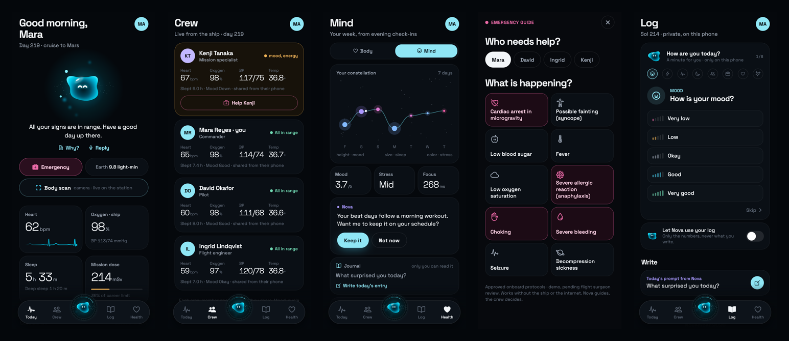
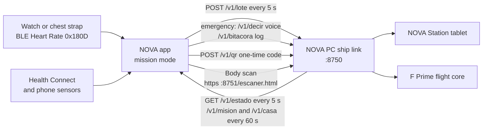

<div align="center">

# NOVA · Astronaut App

**Each crew member's phone, linked to the ship. Their day, their crew, their mind and the emergency guide, in one hand.**

<p>


</p>

</div>

<p align="center"></p>

<p align="center"><sub>Mission mode with the fictional demo crew (Mara, David, Ingrid and Kenji). From left: Today, Crew, Mind, Emergency, Log.</sub></p>

---

## What it does

Every astronaut carries NOVA. In **mission mode** the phone joins the ship's local network and talks to NOVA PC, the
on-board core built around NASA's F Prime. Nothing on this path goes through Earth or the internet: to the flight
core, a phone is one more medical station that speaks the same data contract.

| Screen | What the astronaut sees |
|---|---|
| **Today** | A greeting from NOVA built from the ship's own reading of their vitals, an **Emergency** button, the live light delay to Earth (or "Solar conjunction · no Earth link"), the **Body scan** launcher, and a grid with heart rate, oxygen and blood pressure from the ship, sleep and mission radiation dose against the career limit. |
| **Crew** | The whole crew live from the flight core, showing only what each person chooses to share. Whoever needs attention is listed first, with a **Help ⟨name⟩** button that opens the emergency guide for that person. |
| **Health · Body** | Live heart trace, three vital signs, training rings, bone and muscle. |
| **Health · Mind** | The week as a constellation built from evening check-ins (height = mood, size = sleep, color = stress), three averages and what NOVA noticed. |
| **Health · Cycle** | Opt-in cycle tracking or menstrual suppression, private by default. It never reaches the crew screen; a summary goes to the flight surgeon only if she decides. |
| **Log** | A one-minute check-in, one question at a time (six 1 to 5 scales, emotions and "the good thing today"), plus written entries with NOVA's prompt of the day. The journal stays on the phone. |
| **Emergency** | "Who needs help?" then "What is happening?", then one step at a time in large type with yes/no answers, timers for waits and a haptic metronome for compressions. Works with no ship and no internet. |
| **From home** | Photos and messages from family, arriving with the real light delay. Replies wait in the ship's downlink queue until the next contact with Earth. Also available as an Android widget. |
| **You** | Profile and pronouns shown on the ship, the NOVA Station pass (a one-time QR), ship status (flight core, Earth link, last uplink), the session with the psychologist on Earth and who receives each kind of data. |

NOVA herself floats over the app, drawn in real time with Skia. Tap her to talk.

**Rule from the spec:** NOVA only makes a health statement when it has evidence behind it (`src/engine/contratos.ts`:
an empty `evidenceRefs` means no claim). Emergency steps come from a reviewed file with source and page, never from a
model. NOVA is a prototype, not a medical device.

## How the phone, the ship and the station connect



What leaves the phone, and when (`src/cuenta/nave.ts`):

| Data | Cadence | Rule |
|---|---|---|
| Heart rate and HRV from the watch or strap, SpO2, steps, light, noise | every 5 s, while the app is open | Numbers only |
| Last night's sleep and resting heart rate | every minute, only if changed | Numbers only |
| Mood and energy from the check-in | every minute, only if changed | Only with **Share my day** on. Nothing written ever leaves the phone. |

Each batch carries the seat (`T1` to `T4`), the source `nova-movil` and, if set, the name and pronouns the ship shows
on every screen. The ship applies the same contract it uses for the medical station.

The phone also reads back from the ship (`src/cuenta/naveEstado.ts`): crew status every 5 s, and every minute the
mission state (day, phase, light delay, conjunction), the crew roster, ship systems and the "From home" inbox, which is
cached so it can be read without the link.

## Run it

Requirements: Node 22+, the Android SDK for native builds, and an account on the NOVA API (sign-in is required).

```bash
cd app
npm install
```

**1. Start the API** (accounts and sign-in; SQLite, no other dependencies besides `ws`):

```bash
cd api && npm install
DATOS=./datos SECRETO=<any-random-string> ADMIN=<admin-key> node --no-warnings servidor.mjs   # :8140

# create an account for yourself
curl -X POST http://localhost:8140/v1/admin/cuentas -H "x-admin: <admin-key>" \
  -H 'content-type: application/json' -d '{"email":"you@example.com","nombre":"Mara","clave":"at-least-8-chars"}'
```

In development the app finds the API on the same host as Metro (port 8140). `EXPO_PUBLIC_API_URL` overrides it.

**2. Run the app.** The native features (Bluetooth heart rate, Health Connect, widgets, assistant overlay) need a
development build; the interface also runs in a browser.

```bash
npx expo run:android        # development build on a device or emulator
npx expo start              # Metro, then open the development build
npx expo start --web        # the interface in a browser, without native sensors
```

**3. Link the ship.** Start NOVA PC (see [`../nave/README.md`](../nave/README.md), `cd nave/tripulacion && npm run enlace`
serves the ship link on `:8750`). On the phone: **You → App settings → Labs → Mission mode**, then **Ship link**: type the
ship's address (`192.168.1.20`, `ship.local:8750` or a full URL; port 8750 is added if missing) and pick your seat.
Today switches to live data from the ship.

**4. Voice (optional).** NOVA talks in real time in the language you speak, with her own voice (Aoede), through a small
bridge that keeps the Gemini key off the phone:

```bash
cd servidor && npm install
GEMINI_API_KEY=<your-key> node voz.mjs      # ws://<host>:8132/vivo
```

The app looks for the bridge on the Metro host, or at `EXPO_PUBLIC_VOZ_URL` with `EXPO_PUBLIC_VOZ_TOKEN` when it runs
in the cloud (the bridge then requires `NOVA_TOKEN`). Without the bridge, NOVA falls back to her on-board rules.

### Secrets you supply yourself

Nothing secret is committed. `google-services.json` (Firebase, Android push notifications) and the voice token are
placeholders; see [`google-services.README.md`](google-services.README.md). For an APK build, use your own EAS project
and set `EXPO_PUBLIC_VOZ_URL`, `EXPO_PUBLIC_VOZ_TOKEN` and `EXPO_PUBLIC_API_URL` in the `preview` profile of `eas.json`:

```bash
npx eas-cli build --profile preview --platform android
```

## Emergency on the phone

`src/app/emergencia.tsx` uses the same approved protocol file as the ship (`src/emergencia/protocolos.json`, version
0.2, marked *demo, pending flight surgeon review*). The phone copy holds 12 protocols, 10 of them with step-by-step
guides: cardiac arrest in microgravity, possible fainting, low blood sugar, fever, low oxygen saturation, severe
allergic reaction, choking, severe bleeding, seizure and decompression sickness. Sources include the microgravity CPR
guideline (Hinkelbein et al. 2020), WHO/ICRC Basic Emergency Care (2018) and NASA HRP evidence reports, with page
numbers.

When the ship is linked, each step is spoken with NOVA's on-board voice (Kokoro, via `/v1/decir`), the patient's live
vitals appear beside the step, and every step is written to the ship's log for the flight surgeon (`/v1/bitacora`,
kept in English). Without the link the guide still works, silently: it never falls back to the phone's robotic voice.

## Body scan and NOVA Station

- **Body scan** opens the ship's augmented-reality scanner over HTTPS on port 8751 (browsers only grant the camera to
  secure pages), with the astronaut's seat already selected. The phone is the camera and NOVA Station shows the
  scan live.
- **Station pass**: the ship issues a one-time code (`POST /v1/qr`) that expires in 60 s; the app requests a new one
  every 30 s, so a photo or screenshot of the QR stops working almost at once. The tablet scans it to open that
  astronaut's space when no NFC card is at hand. See [`../station/README.md`](../station/README.md).

## Sensors

- **Heart rate over Bluetooth** (`src/sensores/reloj.ts`): the standard Heart Rate profile (`0x180D` / `0x2A37`). It
  works with watches that broadcast heart rate and with the Polar H10 chest strap planned for stage 2.
- **Health Connect** (`src/sensores/salud.ts`): sleep, resting heart rate, HRV, SpO2, steps, temperature, respiratory
  rate, with explicit consent per source (`src/sensores/fuentes.ts`).
- **Phone sensors**: steps, motion, pressure, light, noise and battery.

Real readings carry their source and are kept apart from simulated ones. The recovery model in `src/engine/motor.ts`
is a prototype: a personal baseline with robust z-scores and abstention when signal quality is below threshold.

## Supporting pieces in this folder

| Folder | What it is |
|---|---|
| [`api/`](api) | NOVA API: accounts, crew, daily photos, shared tasks and challenges, with a realtime WebSocket that only says "something changed". One Node 22 process with `node:sqlite`; deployable on Fly.io (`fly.toml`). |
| [`servidor/`](servidor) | Voice bridge: WebSocket between the phone and the Gemini Live API (native audio, voice Aoede). Holds the key so the app never does. |
| [`mac/`](mac) | NOVA on the Mac desktop (Electron): a transparent, always-on-top window with NOVA following the cursor. ⌥Space talks to her through the voice bridge; the account token is encrypted with the macOS Keychain. Configured with `mac/.env` (`VOZ_URL`, `VOZ_TOKEN`, `API_URL`). `npm start`. |
| [`modules/`](modules) | Native Android modules (Kotlin): home-screen widgets, the assistant overlay with phone controls, and phone usage stats. All load as optional modules, so the JavaScript runs without them. |

With mission mode off, the same codebase works as an everyday personal assistant (habits, focus, crew photos and
widgets); the API and the Mac companion mostly serve that mode.

## File map

| Path | Contents |
|---|---|
| `src/app/(tabs)/` | Ring of swipeable tabs: `index` Today · `crew` · `journal` Log · `salud` Health (Body, Mind, Cycle) · `perfil` You |
| `src/app/emergencia.tsx` | Emergency guide, full-screen, gestures disabled |
| `src/app/casa.tsx` | From home: family inbox and replies |
| `src/app/qr-nave.tsx` | Station QR in large format |
| `src/pantallas/` | Mission and everyday versions of Body, Mind, Cycle and Crew |
| `src/cuenta/nave.ts` | Ship link: batches to `/v1/lote`, seat, Body scan URL |
| `src/cuenta/naveEstado.ts` | What the phone reads from the ship: crew status, mission, From home, systems |
| `src/engine/` | Evidence contracts, baseline and recovery prototype, check-in and journal logic, cycle care, crew wellbeing rules |
| `src/emergencia/protocolos.json` | Copy of the ship's approved protocols |
| `src/nova/` | NOVA drawn in Skia: silhouette, eyes and orbs as worklets |
| `src/sensores/` | Bluetooth heart rate, Health Connect, phone sensors, history |
| `src/voz/` | Realtime voice client (PCM streaming, playback queue, amplitude drives NOVA's body) |
| `src/i18n/` | English and Spanish; keys are the English text |
| `src/widgets/` | Android widgets: From home, Crew, Body, Habits, Check-in, Your day |
| `publicar.sh` | Over-the-air update to installed APKs (JavaScript and assets only) through EAS Update |

## Status

| Works today | Demo or next stage |
|---|---|
| Mission mode screens, in English and Spanish | Readiness, sleep and mission dose on Today are demo data, and the app says so on screen |
| Live link with the ship: vitals out every 5 s, crew and mission back | The recovery model is a prototype, not a validated model |
| Emergency guide offline, with ship voice, live vitals and log when linked | Protocols are version 0.2, pending flight surgeon review |
| Heart rate from Bluetooth watches; Health Connect | Polar H10 chest strap: same standard profile, planned for stage 2 |
| Body scan launcher and one-time station QR | Conversational voice uses the Gemini Live API through the bridge, so it needs internet; the ship's own voice and hearing run locally |
| From home with real light delay, Android widget | Android is the target platform; widgets, Health Connect and native modules are Android-only |

## Credits

Built by Team B&N for the NASA International Space Apps Challenge 2026. Fonts: Space Grotesk and IBM Plex Mono
(SIL Open Font License). The crew, names and numbers in the screenshots are fictional demo data. NOVA is not
affiliated with or endorsed by NASA.

<p align="center"><a href="../README.md">← Back to the NOVA repository</a></p>
