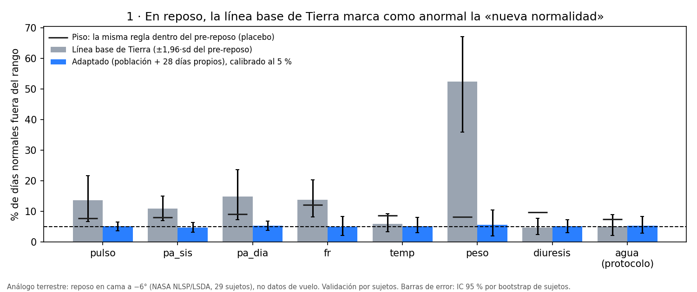
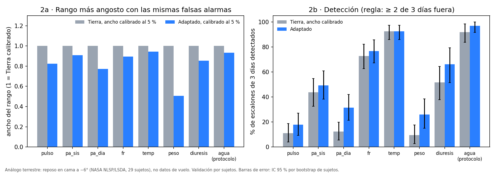
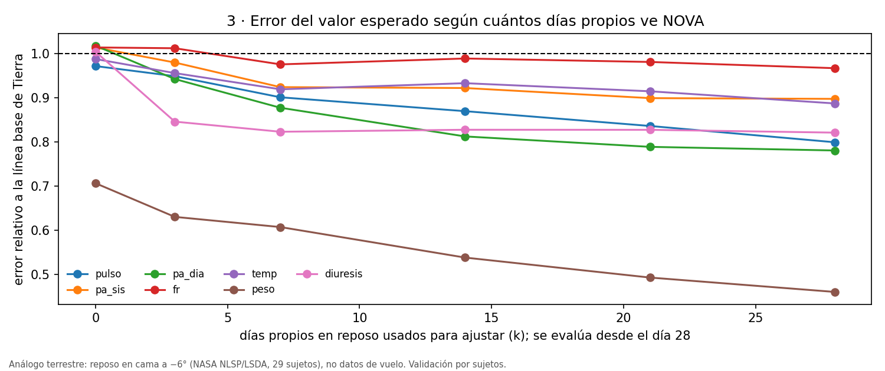
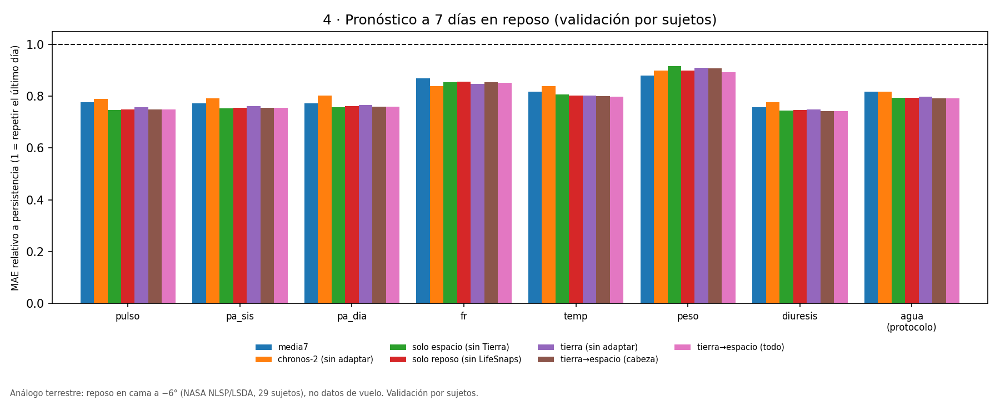

# Transfer learning Tierra → espacio

Rama `transfer-learning` · Benjamín Campos · ciencia de datos

NOVA aprende cómo es cada persona en la Tierra y se adapta a su «nueva normalidad» con los pocos días que se juntan en
la misión. Aquí se prueba con 8 variables diarias (pulso, presión sistólica y diastólica, respiración, temperatura,
peso, diuresis y agua ingerida) y con datos reales de reposo en cama de la NASA, el análogo terrestre de la
microgravedad. **No son datos de vuelo.**

El entrenamiento corre en Kaggle (GPU T4) y los modelos quedan en Hugging Face, en repos privados.

## Estado (14-11-2026)

Funciona de punta a punta: datos → Kaggle → Hugging Face, con 27 tests en verde. Las cifras de este README salen del
tercer run del kernel. El primero tenía mal la escala de la pérdida. El segundo pasó por `ecc:python-reviewer` y
`ecc:mle-reviewer`, que encontraron una fuga del pre-reposo en el pronóstico y una comparación injusta en el rango
esperado. El tercero corrige las dos cosas. Nada de esto está commiteado ni subido a `4mser/nova` todavía.

| Archivo | Qué es |
|---|---|
| [`PLAN.md`](PLAN.md) | objetivo, datos, diseño del experimento y qué prueba que quedó listo |
| [`PREGUNTAS.md`](PREGUNTAS.md) | 22 decisiones; cada una dice qué se hace si no hay respuesta |
| [`NOVA_CONTEXT.md`](NOVA_CONTEXT.md) | el brief de partida |
| `nova_tl/` | datos, ventanas, rango esperado, PatchTST, intervalos y gráficos |
| `kaggle/correr.py` | el kernel completo |
| `resultados/` | los 4 gráficos y `metricas.json` del tercer run |

## Lo principal

**El resultado fuerte no usa PatchTST ni LifeSnaps.** Sale del corrector del rango esperado: la línea base de cada
persona, más lo que se aprende del reposo de *otros* sujetos, más sus primeros 28 días en cama. El pronóstico con
PatchTST de Hugging Face sí funciona, pero el pre-entrenamiento en Tierra no le gana de forma medible a entrenar desde
cero con los datos del reposo.

Datos: 29 sujetos de reposo en cama a −6° (NASA NLSP/LSDA: campañas 1 y 3 y CFT70 de la UTMB), con 11 a 21 días de
pre-reposo y 42 a 90 en cama. Desde el día 28 en cama, en las mismas personas, el peso baja 1,31 kg (IC 95 % ±0,52;
unas 2 veces su variación de un día a otro) y el pulso sube 2,6 lpm (±1,9). Las demás variables cambian poco.

## 1 · Rango esperado

El monitor de Tierra usa la media del pre-reposo ± 1,96 desviaciones del pre-reposo. El adaptado le suma un corrector
ridge por día en cama, aprendido con otros sujetos, y la media de los primeros 28 días propios. Su ancho se calibra al
5 % con residuos fuera de muestra. Todo se evalúa desde el día 28 en cama, con validación por sujetos y IC 95 % por
bootstrap de sujetos.

| Variable | Falsas alarmas, monitor de Tierra | Piso de esa regla (placebo) | Ancho con 5 % de falsas alarmas, adaptado / Tierra | Escalones de 3 días detectados, Tierra → adaptado |
|---|---|---|---|---|
| peso | 52 % [36; 67] | 8 % | 0,51 (1,9 kg contra 3,8 kg) | 10 % → 26 % (+16 pp [5; 30]) |
| pa_dia | 15 % [7; 24] | 9 % | 0,77 | 12 % → 31 % (+19 pp [9; 30]) |
| pulso | 14 % [7; 22] | 8 % | 0,82 | 11 % → 18 % (+7 pp [−1; 16]) |
| diuresis | 5 % [2; 8] | 10 % | 0,85 | 52 % → 66 % (+15 pp [0; 29]) |
| fr | 14 % [8; 20] | 12 % | 0,89 | 73 % → 77 % (+4 pp [0; 10]) |
| pa_sis | 11 % [7; 15] | 8 % | 0,91 | 44 % → 49 % (+5 pp [−4; 16]) |
| temp | 6 % [3; 9] | 9 % | 0,94 | 92 % → 92 % |
| agua (meta del protocolo) | 5 % | 7 % | 0,93 | 92 % → 97 % |

Cómo leer la tabla:
- **Columna 2.** El monitor de Tierra deja fuera 52 % de los días normales de peso en cama.
- **Columna 3.** Es la misma regla aplicada dentro del pre-reposo, dejando fuera el día evaluado, donde no hay ningún
  efecto de la cama. Ya da entre 8 y 12 % de falsas alarmas, porque 11 a 21 días no alcanzan para estimar bien la
  variación de una persona. Solo el peso queda claramente por encima de su piso; en pulso y presión el exceso es de
  unos 3 a 6 puntos y sus intervalos se cruzan con el piso.
- **El 5 % del adaptado sale por construcción**, porque el ancho se calibra a esa tasa. No es en sí un hallazgo.
- **Columnas 4 y 5: la comparación justa.** Si al monitor de Tierra también se le calibra el ancho al 5 % (modelo
  `tierra (ancho calibrado)`), el adaptado logra lo mismo con un rango más angosto y detecta más escalones. En el
  peso, el rango queda a la mitad y la detección sube de 10 a 26 %.
- **Los escalones.** Son anomalías sintéticas inyectadas sobre los datos reales, con signo al azar: la presión sube
  o baja 15/10 mmHg, el peso 1,5 kg, la respiración 4 rpm, la temperatura 0,8 °C, la diuresis 1.000 g y el pulso
  10 lpm. Solo la del pulso viene de `nave/docs/umbrales.md`; las demás son SUPUESTO. Una alarma cuenta cuando ≥ 2 de
  3 días seguidos quedan fuera, y esa misma regla se usa para las falsas alarmas.




**¿Cuántos días propios necesita NOVA?** En el peso, el error del valor esperado baja a 0,70 del de Tierra solo con
el corrector de otros sujetos (k = 0), y a 0,46 con 28 días propios. En pulso y presión diastólica llega a ~0,80.
Esta curva se evalúa siempre desde el día 28, así que mide cuánto sirve para predecir lo que viene después, no qué
tan rápido se adapta en las primeras semanas.



## 2 · Pronóstico a 7 días (PatchTST de Hugging Face)

PatchTST de `transformers`, univariado y compartido entre variables, con 14 días de contexto. El modelo de Tierra se
entrena en cada grupo de validación con LifeSnaps (71 personas, reloj Fitbit, CC BY 4.0) y el pre-reposo de los
sujetos de entrenamiento. Después se adapta al reposo ajustando solo la cabeza o todo el modelo. La métrica es el MAE
relativo a persistencia (repetir el último día), promediado sin el agua:

| Modelo | MAE relativo |
|---|---|
| media de los últimos 7 días | 0,807 |
| Chronos-2 sin adaptar | 0,820 |
| solo reposo, desde cero | 0,797 |
| pre-reposo + reposo desde cero, sin LifeSnaps | 0,796 |
| Tierra sin adaptar | 0,799 |
| Tierra → espacio, solo la cabeza | 0,796 |
| Tierra → espacio, ajuste completo | 0,793 |

Diferencias pareadas por sujeto (IC 95 %):
- **Tierra → espacio contra la media de 7 días:** −0,011 [−0,016; −0,005] ajustando solo la cabeza y −0,014
  [−0,019; −0,008] ajustando todo. La mejora es real pero chica: cerca de 1,5 % del error de persistencia.
- **Tierra → espacio contra el modelo entrenado desde cero en el reposo:** −0,001 [−0,004; 0,002]. Es un empate, y
  quitar LifeSnaps tampoco cambia nada. Con estos datos, **el pre-entrenamiento en Tierra no aporta al pronóstico.**
- **Chronos-2 sin adaptar contra la media de 7 días:** +0,013 [0,007; 0,019]. Le va peor, aunque recibe el contexto
  con los huecos rellenados, así que es solo una referencia.



## Cómo se evitó hacerse trampa

- **Validación por sujetos.** 5 grupos estratificados por campaña; los sujetos de prueba nunca entran a ningún ajuste.
- **Sin fuga en el pronóstico.** El modelo de Tierra se entrena de nuevo en cada grupo, sin el pre-reposo de los
  sujetos de prueba.
- **Ancho calibrado fuera de muestra.** Sale de validación cruzada por sujetos dentro de los de entrenamiento.
- **Centro y ancho separados.** Los cruces `tierra (ancho calibrado)` y `adaptado (ancho de Tierra)` permiten ver
  cuánto es centro y cuánto es solo calibrar.
- **Placebo dentro del pre-reposo.** Da el piso de falsas alarmas de la regla de Tierra.
- **Escalones con signo al azar.** Así no van siempre a favor de la deriva del reposo; la detección a favor y en
  contra se reporta aparte en `rango_esperado.csv`.
- **Bootstrap de sujetos.** Se remuestrean personas, no días.

## Limitaciones

- Es un análogo: reposo en cama a −6°, no vuelo. Con las tablas de la NASA que hay en la carpeta no se puede validar
  con vuelo real (pregunta 5).
- 29 sujetos, una sola semilla de entrenamiento y constantes fijadas a mano, sin barrido: el día 28, KAPPA = 3, el
  alpha del ridge y las magnitudes de los escalones.
- 2 de los 3 sujetos del CFT70 hicieron ejercicio como contramedida, y la campaña 3 tiene grupos A y B. El corrector
  poblacional los mezcla.
- El pulso, la respiración y la temperatura de LifeSnaps vienen de un reloj (la temperatura es de piel); en el reposo
  los mide enfermería.
- El agua sigue una meta del protocolo. Se muestra aparte y no entra en los promedios.

## Modelos en Hugging Face (privados)

- `Benjjaman/nova-tierra`: PatchTST entrenado en Tierra con LifeSnaps y el pre-reposo de 25 sujetos.
- `Benjjaman/nova-espacio`: el anterior, con la cabeza adaptada al reposo. Trae además `corrector_poblacion.json`,
  los coeficientes del corrector del rango esperado con los 29 sujetos.

Ninguna cifra de este README sale de esos pesos publicados: todas salen de modelos entrenados dentro de cada grupo de
validación.

## Reproducir

```
python -m nova_tl.datos --reposo <carpeta nlsp_tablas> --lifesnaps <daily .csv|.parquet> --salida <carpeta>
python -m pytest tests
kaggle datasets version -p <carpeta con nova_tl/ y los parquet> -m "..." --dir-mode zip
kaggle kernels push -p kaggle --accelerator NvidiaTeslaT4
kaggle kernels output benjacampos/nova-transfer-learning -p <salida>
python -m nova_tl.graficos <salida>/salida      # rehace los gráficos desde las tablas, sin redes
```

El rango esperado (tarea 1) es ridge en CPU y se puede correr en el PC. Las redes corren solo en Kaggle.

## Cómo se conecta con la nave

Está diseñado, pero no construido:
- Las variables usan los nombres y unidades de `nave/estacion/CONTRATO.md`. `diuresis` y `agua` todavía no están en
  el contrato (pregunta 18).
- El rango adaptado puede ser el `ESPERADO_VUELO` que `nave/docs/umbrales.md` deja pendiente. Los umbrales fijos de
  emergencia no se tocan.
- El corrector son unos pocos coeficientes por variable y se puede reajustar a bordo cada día. Las mejoras del modelo
  base llegarían desde la Tierra como paquete firmado (`aprende.rs`).

Datos de Tierra: LifeSnaps, de Yfantidou et al., *Scientific Data* 2022 (doi:10.1038/s41597-022-01764-x, CC BY 4.0).
Análogo: NASA Life Sciences Data Archive, estudios de reposo en cama de la UTMB.
