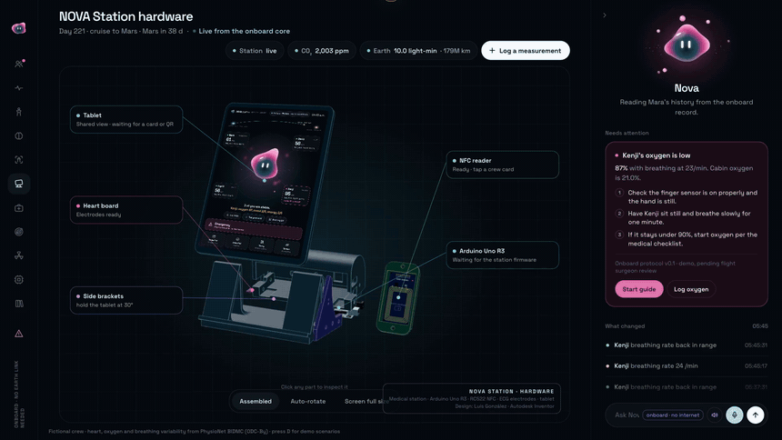
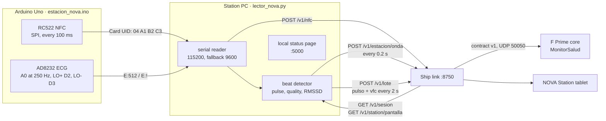
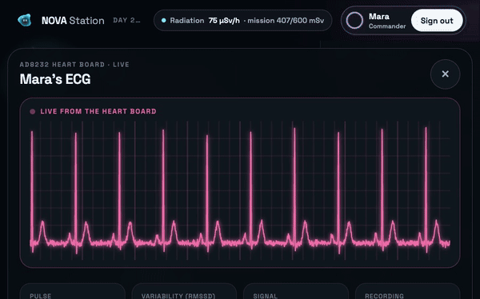
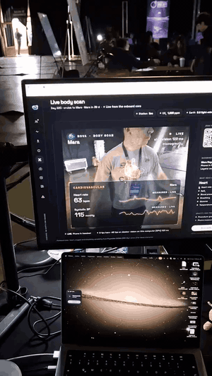

<div align="center">

# NOVA Station Hardware

**A heart board and an NFC reader that turn the shared tablet into a personal medical station.**


**Hardware and robotics: Luis González**

</div>

<p align="center"></p>

The NOVA Station is the shared tablet on the ship. This folder is the physical side of it, designed and built by
**Luis González**: an Arduino Uno that reads crew NFC cards with an RC522 and records a single-lead electrocardiogram
with an AD8232, and a Python bridge on a nearby computer that turns the Arduino's serial output into calls to the ship.
A crew member taps their card, the tablet opens their personal space, they place the electrodes, and their pulse and
heart rate variability are computed from the ECG.

## What it does

- **Identifies who is at the station.** The RC522 reads the card UID and the bridge posts it to the ship's NFC
  endpoint; the ship opens, switches or closes that person's session on the tablet
  ([NFC contract](../nave/estacion/NFC.md)).
- **Samples the ECG at a steady 250 Hz.** Timing comes from `micros()`, so every sample is 4 ms apart instead of
  "whenever the loop gets there". The card reader is polled every 100 ms so it never stalls the ECG.
- **Knows when an electrode is off.** The AD8232 lead-off pins (LO+, LO−) mark a detached electrode as `E:!`; the
  bridge also detects it from the signal itself when those pins are not wired.
- **Turns the waveform into vitals.** The bridge detects beats, computes pulse, a quality score and HRV (RMSSD), and
  streams the live waveform for the tablet and the PC to draw.
- **Saves data only with consent and context.** Pulse and HRV are written to the crew member's record only while that
  person has an open session and the ECG sheet is on screen, and only when the beats are clean (quality ≥ 0.5).

## Architecture



## How it works

### The sketch: [`estacion_nova/estacion_nova.ino`](estacion_nova/estacion_nova.ino)

| Item | Value |
|---|---|
| Board | Arduino Uno |
| Serial | 115200 baud (at 9600 no more than ~190 samples per second fit) |
| ECG | AD8232 `OUTPUT` → A0, `LO+` → D2, `LO-` → D3, 3.3 V and GND; one sample every 4000 µs (250 Hz) |
| NFC | RC522 `SDA(SS)` → D10, `SCK` → D13, `MOSI` → D11, `MISO` → D12, `RST` → D9, 3.3 V and GND; polled every 100 ms |
| Library | `MFRC522` (plus `SPI`) |
| Option | `USAR_LO 0` if LO+ and LO− are not wired; the PC still detects a loose electrode from the signal |

Serial output, one line per event:

```
E:512                 one ECG sample (10-bit ADC value)
E:!                   lead off: an electrode is detached
Card UID: 04 A1 B2 C3 a card was read
```

### The bridge: [`lector_nova.py`](lector_nova.py)

1. **Opens the serial port** and tries 115200, then 9600 baud (the earlier sketch ran at 9600), keeping the first
   speed at which at least 10 lines parse. If the USB cable is unplugged it retries every 2 s.
2. **Cards.** `Card UID: …` becomes `POST /v1/nfc {"uid": "04 A1 B2 C3", "lector": "station"}`. The ship normalizes the
   UID and answers with the session state, which the bridge shows on its status page.
3. **Beats.** A simple detector suited to pulse and RMSSD (it is not a medical device): squared first difference,
   smoothed; an adaptive threshold at 35 % of the peak energy over the last ~3 s; a 0.28 s refractory period;
   RR intervals kept between 0.3 and 2.0 s. The sampling rate is measured on the PC clock.
4. **Vitals.** Pulse is 60 / median of the last 8 RR intervals. Quality is `1 − 2 × CV` of those intervals, clipped to
   0–1. RMSSD needs at least 5 successive differences. No reading is produced if the last beat is more than 3 s old
   or fewer than 4 intervals are available.
5. **Lead off.** Either the sketch says `E:!`, or more than half of the last 400 samples are saturated (below 5 or
   above 1018), or their standard deviation is under 2.
6. **Sending.** Every 0.2 s the pending samples go to `POST /v1/estacion/onda` with the sampling rate, contact flag,
   pulse, RMSSD and quality. The ship does not store the waveform: it relays it on its live stream so the tablet's ECG
   sheet and the PC draw it (at most 400 samples per call). The bridge learns which sheet the tablet is showing from
   `GET /v1/station/pantalla`, which the tablet itself keeps up to date. Every 2 s, if a crew member holds the tablet session, the ECG sheet is open, the
   electrodes are on and quality is at least 0.5, the bridge posts to `/v1/lote`:

```json
{"trip":"T2","fuente":"estacion-luis","mediciones":[{"sensor":"pulso","valor":64.2,"unidad":"lpm","calidad":0.91},{"sensor":"vfc","valor":48.7,"unidad":"ms","calidad":0.91}]}
```

The ship link turns that batch into [contract v1](../nave/estacion/CONTRATO.md) messages for the F Prime core, where
`MonitorSalud` applies the same thresholds as for every other source, and records them as a real source so the
simulator stops inventing that person's pulse and HRV.

<p align="center">
  
  
</p>

## Run it

1. Flash [`estacion_nova/estacion_nova.ino`](estacion_nova/estacion_nova.ino) to an Arduino Uno with the Arduino IDE
   (install the `MFRC522` library) and wire it as in the table above.
2. On the computer the Arduino is plugged into:

```sh
pip install flask pyserial
NOVA_NAVE=http://<ship>:8750 NOVA_PUERTO=COM8 python lector_nova.py
```

| Variable | Default | Meaning |
|---|---|---|
| `NOVA_NAVE` | a LAN address in the script | ship link URL |
| `NOVA_PUERTO` | `COM8` | serial port (`/dev/ttyACM0` or `/dev/cu.usbmodem…` on Linux and macOS) |
| `NOVA_BAUDIOS` | tries 115200 then 9600 | force one speed |
| `NOVA_LECTOR` | `station` | reader name; must match the tablet's setting |
| `NOVA_TOKEN` | empty | sent as `x-nova-token` if the ship requires it |

3. Open `http://<this-pc>:5000` for the status page: last card, the ship's answer, ECG state or live bpm, and whose
   session will receive the data.
4. On the ship, start the link with `NOVA_SIN_SIMULADOR=1` if you want only real station data.

## File map

| Path | Contents |
|---|---|
| [`estacion_nova/estacion_nova.ino`](estacion_nova/estacion_nova.ino) | Arduino sketch: RC522 NFC + AD8232 ECG at 250 Hz |
| [`lector_nova.py`](lector_nova.py) | serial → ship bridge: cards, beat detection, pulse, RMSSD, live waveform, status page |
| [`../research/radiation-detector/`](../research/radiation-detector) | Luis's proposal for an active radiation detector |

## Status

| Works today | Next stage |
|---|---|
| Sketch: 250 Hz ECG, lead-off detection, NFC reads over one serial line | Board with networking (ESP32) posting directly to the ship, no PC in between |
| Bridge: auto baud, card → `/v1/nfc`, beat detection, pulse, quality, RMSSD | ECG waveform analysis inside the flight core (`onda` messages of the contract) |
| Ship side: NFC sessions, live ECG relayed to the tablet and the PC, pulse and HRV saved as real data | Clinical-grade electrodes and validation against a reference monitor |

## Credits

Hardware design, wiring, the Arduino sketch and the serial bridge: **Luis González** (Team B&N, hardware and
robotics).

---

[Back to the main README](../README.md)
