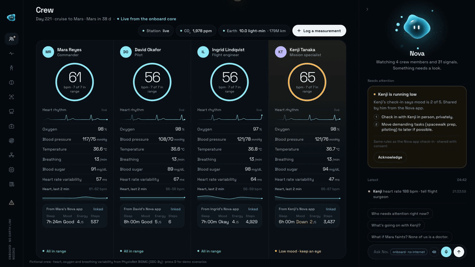
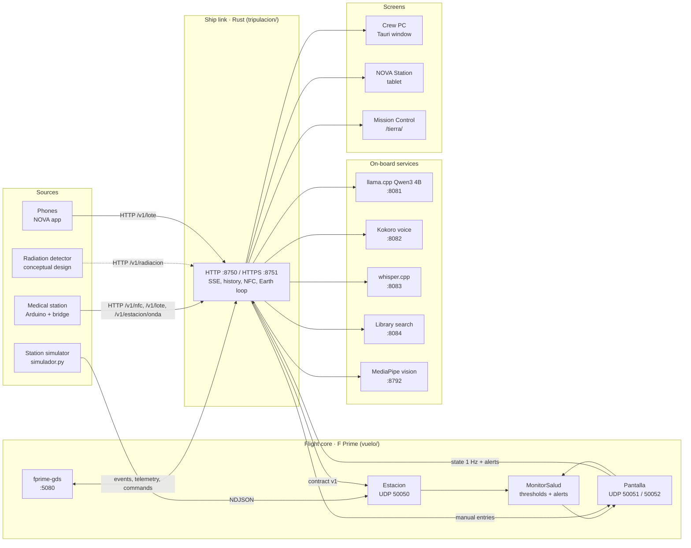
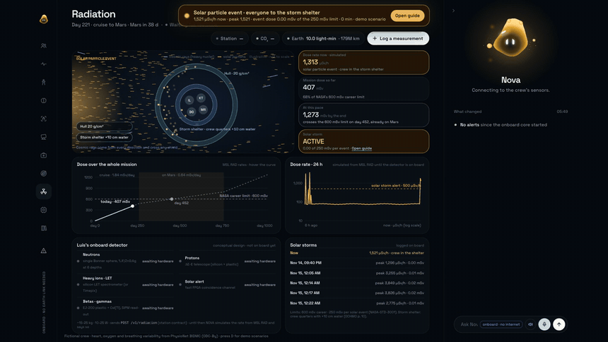
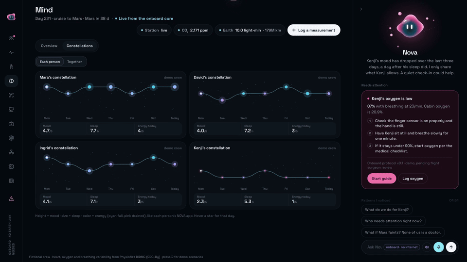
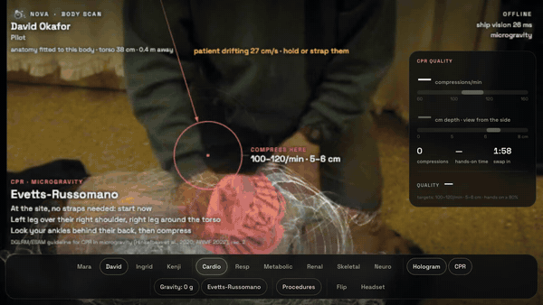

<div align="center">

# NOVA · The Ship

**Everything that flies: the F Prime flight core, the ship link, the crew screens, the on-board AI and the medical station.**


</div>

<p align="center"></p>

`nave/` (Spanish for *ship*) is the half of NOVA that runs inside the spacecraft. Nothing here needs the internet or
Earth: vital signs, alerts, emergency protocols, the medical library, the language model, voice and vision all run on
the ship's own computer. Earth is reached only through a light-delayed link, the way it would be on the way to Mars.

## What it does

- **Watches four crew members and the cabin, once per second.** A flight core built on NASA's F Prime receives every
  measurement, checks it against physical limits and two tiers of thresholds, and raises alerts with hysteresis so a
  noisy sensor does not flicker.
- **Separates "the crew handles it" from "call the flight surgeon".** Every indicator has an *attention* level and an
  *Earth notice* level. The thresholds are F Prime parameters, so Earth can change them without recompiling.
- **Guides emergencies step by step.** Thirteen protocols (cardiac arrest, fainting, hypoglycemia, fever, low oxygen,
  CO₂, sleep and mood, anaphylaxis, choking, bleeding, seizure, decompression, solar particle event) live in a fixed
  file, each with its sources. The language
  model explains and accompanies; it never writes the medical steps.
- **Answers questions on board.** *Ask NOVA* runs Qwen3 4B Instruct through llama.cpp with the ship's data, the
  approved protocols and a cited medical library (42 open sources) in context.
- **Talks and listens.** Kokoro-82M for voice and whisper.cpp for speech recognition, both local.
- **Sees.** MediaPipe pose and hand models on the ship's GPU drive the AR CPR guide and the live body scanner. The
  scanner also records eye checks (eye opening, eyelids, blinking) per crew member to compare with their baseline;
  it is not a diagnosis.
- **Watches radiation.** Mission dose against the 600 mSv career limit (NASA-STD-3001), a dose rate that is simulated
  from MSL RAD measurements until a detector reports, and solar storm detection that sends the whole crew to the
  shelter with the `tormenta_solar` guide. The detector interface is ready for Luis González's
  [active detector](../research/radiation-detector) (a conceptual design).
- **Reads a real heart.** The NOVA Station's AD8232 heart board streams a live ECG to the tablet and the PC; pulse and
  HRV from it are saved as real data for the crew member holding the session ([`hardware/`](../hardware)).
- **Keeps the medical kit honest.** 42 supplies in 6 drawers, with counts, locations and expiry against the mission
  timeline.
- **Lives with the light delay.** Mission geometry (a Hohmann transfer computed from JPL planetary elements) gives the
  real Earth–ship distance, one-way light time and solar conjunction. Reports down and updates up travel with it.
- **Learns every night, safely.** The ship sends a nightly report; the flight surgeon answers with a package signed
  with ed25519. A tampered package is rejected and logged. See [`tierra/`](tierra).

## Architecture



## How it works

1. **A measurement enters.** The station simulator sends NDJSON straight to the flight core on UDP 50050. Phones and
   the physical station post to the ship link over HTTP (`/v1/lote`); the link rewrites each reading into the same
   data contract and forwards it to UDP 50050. One contract for every source:
   [`estacion/CONTRATO.md`](estacion/CONTRATO.md).
2. **The flight core decides.** `Estacion` validates the message (contract version, crew member, sensor, unit).
   `MonitorSalud` drops physically impossible values and low-quality readings (`calidad < 0.5`), classifies the rest
   against its parameters and emits an F Prime event only when a level changes. Escalation is immediate; stepping
   down requires the lower level to hold for 10 s.
3. **The screens see it.** Once per second `Pantalla` sends the full crew state (values, per-sensor levels, data age
   and the thresholds in force) as one JSON line to UDP 50051. The ship link relays it to every screen over
   Server-Sent Events and stores it: 1 Hz for 6 hours, per-minute summaries for 30 days, written to disk as daily
   NDJSON so a restart loses nothing.
4. **Real data wins.** The link records which crew member and sensor have a real source (phone, station, manual
   entry). The simulator asks `GET /v1/fuentes` every 5 s and stops inventing those signals.
5. **Earth stays in the loop, with delay.** The link reads the F Prime ground system (events, telemetry, command
   history) through its REST API on :5080. Commands from Mission Control, such as a new pulse threshold, wait for the
   real light time and are then delivered to the core through the GDS.

## Run it

Everything below is taken from the scripts in this folder. Paths are relative to `nave/`.

**One command.** The ship link starts and supervises every service it needs (flight core with GDS on :5080, station
simulator, language model, voice, speech recognition, library search and vision; see
[`tripulacion/src-tauri/src/servicios.rs`](tripulacion/src-tauri/src/servicios.rs)). A service that is already
running is not duplicated, one that crashes is restarted, and each writes its log to `~/.nova-pc/logs/`.

```sh
cd tripulacion && npm install && npm run dev      # Tauri window + all services
cd tripulacion && npm run enlace                  # no window: open http://127.0.0.1:8750
```

| Variable | Effect |
|---|---|
| `NOVA_SIN_SIMULADOR=1` | do not start the simulator (the physical station is connected) |
| `NOVA_SIN_SERVICIOS=1` | start nothing; run each piece by hand as below |
| `NOVA_TOKEN` | require the `x-nova-token` header on writes from phones and devices |
| `NOVA_LANZAMIENTO`, `NOVA_ESTADIA_DIAS` | launch date (Unix seconds) and days on Mars; defaults 8 April 2026 and 500 |

**Piece by piece** (`NOVA_SIN_SERVICIOS=1`):

```sh
# 1. Flight core, with the F Prime ground system on http://127.0.0.1:5080
cd vuelo/Nova/Nave && source ../../fprime-venv/bin/activate && fprime-gds -g html --gui-port 5080

# 2. Medical station simulator (or the real station). Seed two weeks of demo check-ins first, for the Mind view.
python3 estacion/simulador/sembrar_diarios.py
python3 estacion/simulador/simulador.py

# 3. On-board language model and voice (models in ~/.nova-pc/modelos and ~/.nova-pc/voz)
llama-server -m ~/.nova-pc/modelos/Qwen3-4B-Instruct-2507-Q4_K_M.gguf --host 127.0.0.1 --port 8081 -c 16384 -np 2 -fa on -b 2048 -ub 1024 --cache-reuse 256 -ngl 99 --jinja
cd voz && uv venv --python 3.12 .venv && uv pip install --python .venv/bin/python -r requirements.txt && .venv/bin/python servidor.py

# 4. Speech recognition (brew install whisper-cpp; model ggml-large-v3-turbo-q5_0.bin from huggingface.co/ggerganov/whisper.cpp)
whisper-server -m ~/.nova-pc/modelos/ggml-large-v3-turbo-q5_0.bin --host 127.0.0.1 --port 8083 -l auto -t 8 -nt

# 5. Library search (embeddings)
llama-server -m ~/.nova-pc/modelos/nomic-embed-text-v2-moe.Q4_K_M.gguf --host 127.0.0.1 --port 8084 --embedding -ngl 99

# 6. Crew screen (Tauri window + link on :8750)
cd tripulacion && npm install && npm run dev
```

On the crew screen, the **D** key opens the demo scenarios (fainting, hypoglycemia, fever, hypoxia, CO₂, normal).

**Build the flight core** (needed once, before step 1):

```sh
git submodule update --init --recursive
cd vuelo && python3.12 -m venv fprime-venv && source fprime-venv/bin/activate
pip install -r requirements.txt
cd Nova/Nave && fprime-util generate && fprime-util build -j
```

Details in [`vuelo/README.md`](vuelo/README.md).

## Screens served by the ship

| URL | Who uses it |
|---|---|
| `http://<ship>:8750/` | crew PC: Crew, Vitals, Body twin, Mind, Live body scan, NOVA Station hardware, Medical kit, Mission, Radiation, Onboard systems, Medical library, and Ask NOVA |
| `http://<ship>:8750/station.html` | NOVA Station, the shared tablet; personal space opens with an NFC card |
| `https://<ship>:8751/escaner.html` | phone body scanner (HTTPS so the browser grants the camera) |
| `https://<ship>:8751/guia-ar.html` | AR CPR guide: finds the patient's torso and the rescuer's hands, counts compressions and coaches the 100–120/min rate (`localhost` also works on the ship PC) |
| `http://<ship>:8750/tierra/` | Mission Control and flight surgeon console (Earth side of the demo) |

<p align="center">
  
  
  
</p>

## Ports

| Port | Traffic |
|---|---|
| UDP 50050 | medical station, simulator and phones (via the link) → flight core ([contract](estacion/CONTRATO.md)) |
| UDP 50051 | flight core → ship link (state at 1 Hz and alerts), loopback |
| UDP 50052 | ship link → flight core (manual entries), loopback |
| UDP 50053 | ship link → simulator (demo scenarios), loopback |
| TCP 8750 | ship link, HTTP: screens (SSE), tablet, phones with the NOVA app, Earth console |
| TCP 8751 | ship link, HTTPS with the ship's own certificate (`~/.nova-pc/tls`), for camera pages |
| TCP 8081 | language model (llama.cpp, Qwen3-4B-Instruct-2507 Q4_K_M), local only |
| TCP 8082 | voice (Kokoro-82M ONNX: `af_heart` in English, `ef_dora` in Spanish), local only |
| TCP 8083 | speech recognition (whisper.cpp, large-v3-turbo, multilingual), local only |
| TCP 8084 | library search (llama.cpp `--embedding`, nomic-embed-text-v2-moe), local only |
| TCP 8792 | vision (MediaPipe pose heavy + hand landmarker, WebSocket), local only; bridged at `/v1/vision/ws` |
| TCP 5080 | F Prime GDS: technical console and the REST API used by the Systems view |

## File map

| Folder | What it is | Technology |
|---|---|---|
| [`vuelo/`](vuelo) | Flight core: four NOVA components on an F Prime deployment | F Prime v4.4.2 (NASA JPL), C++, FPP |
| [`tripulacion/`](tripulacion) | Ship link and every screen: crew PC, NOVA Station tablet, scanner, AR guide, Mission Control | Rust (Tauri 2, axum, tokio, ed25519-dalek), HTML/JS, three.js |
| [`estacion/`](estacion) | Station data contract, NFC contract and the station simulator | NDJSON over UDP, Python |
| [`tierra/`](tierra) | Earth side: family message relay; the nightly loop itself lives in the link | Python, Rust |
| [`voz/`](voz) | On-board voice server | Kokoro-82M, ONNX Runtime |
| [`vision/`](vision) | On-board vision server and a CPU/GPU benchmark | MediaPipe, OpenCV, websockets |
| [`biblioteca/`](biblioteca) | Medical library catalog (42 sources) and the indexer that chunks and embeds them | Python, pypdf, llama.cpp embeddings |
| [`docs/`](docs) | [Starting thresholds and their sources](docs/umbrales.md) and the technical reports (PDF) | |

Inside `tripulacion/src-tauri/src/`: `main.rs` (link and HTTP API), `nova.rs` (Ask NOVA), `cerebro.rs` (model
client), `biblioteca.rs`, `kit.rs`, `historia.rs`, `mision.rs`, `tierra.rs` (GDS bridge and light-delayed uplink),
`aprende.rs` (signed nightly updates), `casa.rs` (family messages), `nfc.rs` (cards and tablet sessions),
`radiacion.rs` (dose, solar storms, detector input), `escaner.rs`, `ojos.rs` (eye checks), `diario.rs` (each
person's daily check-ins), `fuentes.rs`, `tripulacion.rs`, `servicios.rs`.

## Principles

1. **Everything on board.** Nothing the crew uses depends on the internet or on Earth.
2. **Protocols dictate medical steps, the model does not.** NOVA explains, asks and accompanies; the protocol decides.
3. **Every threshold has a source** ([`docs/umbrales.md`](docs/umbrales.md)).
4. **Each astronaut decides who sees what.** Mood and energy reach the crew only if the person shares them; private
   data sent with consent (`/v1/privado`) goes only to the flight surgeon's report and never into the core, the crew
   screen or NOVA's answers.
5. **Updates from Earth arrive signed.** The ship verifies the ed25519 signature before applying anything, and
   emergency protocols are never part of an update.

## Status

| Works today | Next stage |
|---|---|
| F Prime core with 4 custom components, 31 parameters, alerts with hysteresis and stale-data warnings | Flight-expected ranges (`ESPERADO_VUELO` exists in the model but no rule sets it yet) |
| Station simulator driven by real PhysioNet variability, 6 demo scenarios | Personal baselines for HRV and resting heart rate; trend detection over days |
| Ship link with SSE, 30-day history, NFC sessions, live ECG relay, phone ingestion, family relay | Serial (USB) input directly into the core; today serial goes through the bridge in [`hardware/`](../hardware) |
| On-board LLM, voice, speech recognition, cited library search, pose and hand vision | Rollback of an applied update; clinical validation of every threshold |
| Nightly report, light-delayed uplink of F Prime commands, ed25519-signed knowledge packages | Telemetry packetizer (`NavePackets.fppi` is present but not included in the topology) |
| Radiation: simulated MSL RAD rate, mission dose, solar storm alert and shelter guide, detector endpoint | The physical detector; radiation readings through the F Prime core |

## Credits and sources

- F Prime flight software framework, NASA Jet Propulsion Laboratory (Apache 2.0).
- Kokoro-82M (Apache 2.0), whisper.cpp and llama.cpp (MIT), Qwen3 (Apache 2.0), nomic-embed-text-v2-moe, MediaPipe (Apache 2.0).
- BIDMC PPG and Respiration Dataset, PhysioNet (ODC-By 1.0); see [`estacion/simulador/datos/bidmc/LEEME.md`](estacion/simulador/datos/bidmc/LEEME.md).
- Reference anatomy: BodyParts3D 4.0 and the NIH Human Reference Atlas female set, both CC BY 4.0; credits and
  adaptations in [`tripulacion/ui/anatomia/CREDITOS.md`](tripulacion/ui/anatomia/CREDITOS.md). The female set is
  regenerated with `node anatomia/convertir-mujer.mjs <glb> anatomia/mujer` (needs `@gltf-transform/core` and `meshoptimizer`).
- Planetary positions: E. M. Standish, JPL, *Keplerian Elements for Approximate Positions of the Major Planets*.

The crew in the demo (Mara, David, Ingrid, Kenji) is fictional.

---

[Back to the main README](../README.md) · NOVA is a concept by Team B&N for the NASA International Space Apps
Challenge 2026. It is not affiliated with or endorsed by NASA.
