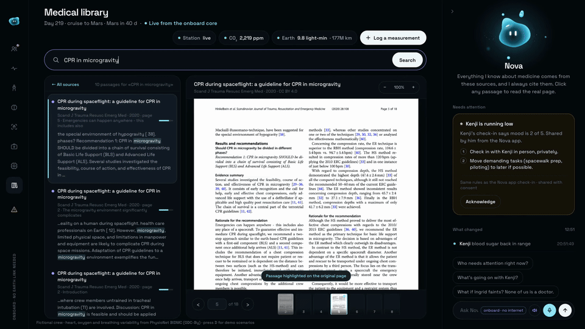
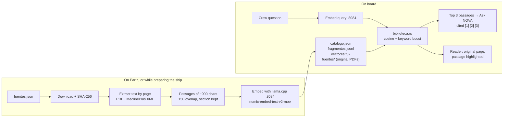

<div align="center">

# NOVA · Medical Library

**41 open medical and spaceflight sources and 35,830 passages, searchable on board. Every answer cites its page.**


</div>

<p align="center"></p>

A small onboard model should not answer medical questions from memory. NOVA takes all of its medical knowledge from this
library. The model receives the most relevant passages for each question, must cite them as `[1]`, `[2]`, and must say
when the library does not cover a question. A click on a citation opens the **original document at the cited page** with
the passage highlighted, so the crew can check the source themselves.

## What's inside

| Group | Sources | Passages | Examples |
|---|---:|---:|---|
| NASA (HRP, OCHMO, JSC) | 26 | 5,940 | 13 Human Research Program evidence reports (renal stones, SANS, bone fracture, cardiovascular, decompression sickness and hypoxia, behavioral health, sleep, radiation carcinogenesis, acute radiation syndromes, pharmacology, immune…), NASA-STD-3001 Vol. 1 Rev C and Vol. 2 Rev E, 8 OCHMO technical briefs, ISS medical hardware catalog (CHeCS), Space Shuttle Medical Checklist, ISS medical kit evaluation |
| OpenStax (Rice University) | 4 | 19,150 | Anatomy and Physiology 2e, Medical-Surgical Nursing, Pharmacology for Nurses, Clinical Nursing Skills |
| WHO and WHO/ICRC | 4 | 2,339 | Basic Emergency Care, Model List of Essential Medicines (24th), mhGAP training manuals, *Doing What Matters in Times of Stress* |
| Peer-reviewed, open access | 4 | 332 | CPR in microgravity guideline (Hinkelbein et al. 2020), women in space reviews (2016, 2024, 2025) |
| Reference | 3 | 8,069 | MedlinePlus Health Topics (NLM), Gray's *Anatomy of the Human Body* (1918), TCCC Guidelines 2026 (US DoD) |
| **Total** | **41** | **35,830** | |

The full catalog, with URL, license and license page for each source, is in [`fuentes.json`](fuentes.json). It has 42
entries: OpenStax *Anatomy and Physiology* 1st edition is listed but disabled (`"usar": false`), replaced by the 2nd
edition. Licenses include US Government works (NASA, DoD), NTRS public use, CC BY 4.0, CC BY-NC-SA 3.0 IGO (WHO),
CC BY-NC-SA 4.0 (OpenStax) and the public domain.

Counts are from the index the team built on 2026-11-10 (`catalogo.json`: 41 sources, 35,830 passages, 768-dimension
vectors).

## How it works



**Indexing** ([`indexar.py`](indexar.py), runs on Earth):

1. Downloads each enabled source and fingerprints it with SHA-256. MedlinePlus is resolved to its latest daily archive.
2. Extracts text page by page (pypdf for PDFs, English health topics for MedlinePlus), repairs hyphenation, and detects
   section titles. Passages that are mostly bibliography are dropped.
3. Splits text into passages of about 900 characters with a 150-character overlap, keeping paragraphs whole and tagging
   each passage with its source, **page** and **section**.
4. Embeds `search_document: <section>. <text>` with nomic-embed-text-v2-moe through a local `llama-server --embedding`, in
   batches of 32. If the 512-token limit is exceeded, the input is retried shorter, while the stored passage stays whole.
   Vectors are L2-normalized.
5. Writes the output atomically: `catalogo.json` (sources, license, SHA-256, passage count, index date),
   `fragmentos.jsonl` (one passage per line) and `vectores.f32` (an 8-byte header `n, dim` followed by `n × dim` float32).
   The original files are kept in `fuentes/` for the onboard reader.
6. **Incremental.** A source with an unchanged SHA-256 reuses its vectors, so adding a source only embeds the new one.

**Search on board** ([`../tripulacion/src-tauri/src/biblioteca.rs`](../tripulacion/src-tauri/src/biblioteca.rs)):

- The question is embedded as `search_query: <text>` by the same model, and each passage is scored by its dot product with
  the query vector (cosine similarity, since vectors are normalized). This is an exact search over all 35,830 vectors, in
  Rust, in memory.
- **Keyword boost:** +0.03 for each query word of 5 or more letters found in the passage, up to 4 words.
- **Never cite filler:** the indexer drops passages that are mostly citations (dense with `et al.`, DOIs, years, URLs).
  The ship also skips tables of contents, indexes, reference lists and author lists at search time, so they are never
  returned.
- **Variety:** at most 2 passages from the same page of the same source.
- Ask NOVA takes the top **3**. A short follow-up question is combined with the previous one before searching. Questions
  about the crew's current status skip the library entirely.
- The library view (`/v1/biblioteca/buscar?q=…&k=5`) shows results, and the reader opens the original PDF from
  `/v1/biblioteca/pdf/<id>.pdf` with pdf.js, entirely offline, and highlights the passage on the page.

## Run it

```sh
# 1. embeddings server (the ship starts this one on its own if the model is present)
llama-server -m ~/.nova-pc/modelos/nomic-embed-text-v2-moe.Q4_K_M.gguf --host 127.0.0.1 --port 8084 --embedding -ngl 99

# 2. build the index (downloads the sources the first time)
cd nave/biblioteca
uv venv --python 3.12 .venv
uv pip install --python .venv/bin/python pypdf
.venv/bin/python indexar.py                          # → ~/.nova-pc/biblioteca
.venv/bin/python indexar.py --solo who_eml_2025      # rebuild only some sources
.venv/bin/python indexar.py --rehacer                # re-embed everything

# 3. tell a running ship to reload the index
curl -X POST http://127.0.0.1:8750/v1/biblioteca/recargar
```

| Option or variable | Default | Effect |
|---|---|---|
| `--catalogo` | `fuentes.json` | Source catalog |
| `--salida` | `~/.nova-pc/biblioteca` | Output folder (what goes up to the ship) |
| `--solo id1,id2` | all | Process only these sources |
| `--rehacer` | off | Re-embed even unchanged sources |
| `NOVA_EMBED` | `http://127.0.0.1:8084` | Embeddings server |
| `NOVA_BIBLIOTECA` (ship) | `~/.nova-pc/biblioteca` | Where the ship loads the index from |

The built index (about 1.2 GB with the original documents) is not committed. Rebuild it with the command above.

### Ship endpoints

| Endpoint | Returns |
|---|---|
| `GET /v1/biblioteca` | Index version and the list of sources with license and passage counts |
| `GET /v1/biblioteca/buscar?q=…&k=5` | Top passages with source, page, section, license and URL |
| `POST /v1/biblioteca/recargar` | Reloads the index after an update |
| `GET /v1/biblioteca/pdf/<id>.pdf` | The original document, served from the ship (range requests supported) |

## Files

| Path | Purpose |
|---|---|
| `fuentes.json` | Catalog: id, title, publisher, year, URL, format, license, license page, topic, enabled flag |
| `indexar.py` | Download, extract, split, embed and write the index |

## Status

**Works today:** 41 sources and 35,830 passages indexed. Offline semantic search in the ship. Cited answers in Ask NOVA.
The original page opens with the passage highlighted.

**Design rule:** emergency steps never come from the library. They come only from the fixed protocols in
[`../tripulacion/ui/protocolos.json`](../tripulacion/ui/protocolos.json), and the model is told never to use library
excerpts for emergency steps.

**Updates:** the index is built on Earth, and the output folder is what goes up to the ship. A running ship picks it up
with `/v1/biblioteca/recargar`, without a restart.

## Credits

All content belongs to its publishers and is used under the license recorded for each source in `fuentes.json`:
NASA (Human Research Program, Office of the Chief Health and Medical Officer, Johnson Space Center), OpenStax at Rice
University, the World Health Organization and ICRC, the US National Library of Medicine (MedlinePlus), the US Department
of Defense Joint Trauma System, and the authors of the open-access articles listed. Embeddings:
[nomic-embed-text-v2-moe](https://huggingface.co/nomic-ai/nomic-embed-text-v2-moe) (Apache 2.0) on llama.cpp. Reader:
pdf.js (Apache 2.0).

---

<p align="center">
  <a href="../../README.md">← Back to NOVA</a> · <a href="../tripulacion">Crew app</a> · <a href="../vision">Vision</a> · <a href="../voz">Voice</a>
</p>
