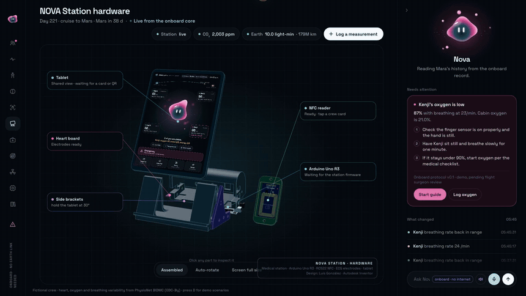
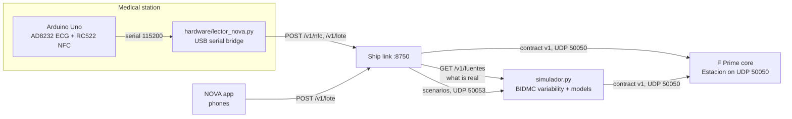
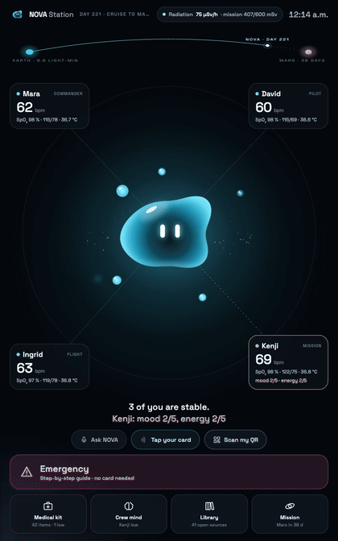

<div align="center">

# NOVA Medical Station

**One data contract for every sensor on board, plus a simulator built on real physiology.**


</div>

<p align="center"></p>

`estacion/` (Spanish for *station*) defines how any medical device talks to NOVA. The flight core never needs to know
which board or sensor sits behind a message: if the message follows the contract, the core understands it. The same
contract is spoken by the physical station, the simulator and, through the ship link, the phones.

## What it does

- **[`CONTRATO.md`](CONTRATO.md)** · the station → core data contract: transport, the four message types
  (`medicion`, `onda`, `latido`, `evento`), the sensor and unit table with accepted ranges, crew identification, the
  phone batch endpoint and the radiation detector message.
- **[`NFC.md`](NFC.md)** · the NFC reader contract for NOVA Station, the shared tablet: a reader posts a card UID and
  the ship opens, switches or closes that person's session.
- **[`simulador/`](simulador)** · a station simulator that streams realistic vitals for the four demo crew members
  and the cabin, and plays medical scenarios on demand.

## Architecture



## How the simulator works

[`simulador/simulador.py`](simulador/simulador.py) sends one contract message per measurement to UDP 50050, as if it
were the physical station (`"est":"simulador"`).

**Where the numbers come from.**

| Signals | Source |
|---|---|
| Pulse, SpO₂, respiratory rate | Real second-by-second variability from four ICU records of the BIDMC PPG and Respiration Dataset (PhysioNet, ODC-By 1.0), one per crew member, as deviations from each record's mean laid over that person's baseline. Absolute values are never used. |
| Blood pressure, temperature, glucose, HRV, cabin CO₂, O₂ and temperature | Simple models around each baseline (marked as modeled) |
| Sleep, mood, energy | Fixed, repeatable demo story ([`diarios.py`](simulador/diarios.py)): Mara and David stable, Ingrid's mood slowly declining (isolation), Kenji sleeping worse for six days with mood following a day later |

**Sampling.** Pulse and SpO₂ every 1 s, respiratory rate 2 s, HRV and temperature 10 s, blood pressure 15 s,
glucose 30 s, cabin 5 s, check-in 60 s, and a `latido` heartbeat every 5 s.

**Real data wins.** Every 5 s the simulator asks the ship link `GET /v1/fuentes` which crew member and sensor already
have a real source (a linked phone, the physical station, a manual entry) and stops simulating those. It also reads
`/tripulacion.json` and skips empty seats. Without the link it simulates everything.

**Scenarios.** Typed in the simulator's terminal, sent as JSON to UDP 50053 (`{"escenario":"desmayo","trip":"T3"}`),
triggered from the crew screen (**D** key) or scheduled on the command line:

| Scenario | Effect on the chosen crew member |
|---|---|
| `desmayo` (fainting) | vasovagal syncope: pulse −26, systolic −48, diastolic −34 within ~20 s, recovery over ~2 min |
| `hipoglucemia` | glucose −46 mg/dL and pulse +38 over 2 min, HRV drops |
| `fiebre` (fever) | temperature +2.0 °C, pulse +22, breathing +5 over 2.5 min |
| `hipoxia` | SpO₂ −11, pulse +30, breathing +10 over 1 min |
| `co2` | cabin CO₂ +1500 ppm |
| `normal` | clears every scenario |

## Run it

From `nave/`:

```sh
python3 estacion/simulador/sembrar_diarios.py     # once: 14 days of demo check-ins in ~/.nova-pc/historia (restart the link after)
python3 estacion/simulador/simulador.py           # stream to 127.0.0.1:50050
python3 estacion/simulador/simulador.py --escenario "desmayo T3@60" --escenario "co2@120"
```

Options: `--nucleo <ip>` (flight core address, default `127.0.0.1`), `--enlace <url>` (ship link, default
`http://127.0.0.1:8750`), `--escenario "<type> <trip>@<seconds>"` (repeatable). `sembrar_diarios.py` accepts
`--dias 14` and `--forzar`, and honors `NOVA_DATOS`. No third-party packages are needed.

The ship link starts the simulator automatically unless `NOVA_SIN_SIMULADOR=1` is set (use that when the physical
station is connected).

Try the NFC contract without a reader:

```sh
curl -X POST http://127.0.0.1:8750/v1/nfc -H 'content-type: application/json' -d '{"uid":"04A1B2C3","lector":"station"}'
```

<p align="center"></p>

## Data contract at a glance

```json
{"v":1,"tipo":"medicion","est":"estacion-1","t":1763164800123,"trip":"T2","sensor":"spo2","valor":97,"unidad":"%","calidad":0.92}
{"v":1,"tipo":"medicion","est":"estacion-1","t":0,"trip":"T1","sensor":"pa","valor":88,"unidad":"mmHg","extra":{"sis":116,"dia":74}}
{"v":1,"tipo":"latido","est":"estacion-1","t":0,"sensores":["spo2","pulso","temp","pa"],"bateria":0.81}
```

Rules the core enforces: contract version must be `1`; `trip` must be a tracked crew member (`T1`…`T4`) or `CABINA`;
the unit must match the table; blood pressure needs `extra.sis` and `extra.dia`; values outside the physical range are
logged and discarded; readings with `calidad` below 0.5 are not used for alerts; 15 s without any message marks the
station as lost.

## File map

| Path | Contents |
|---|---|
| [`CONTRATO.md`](CONTRATO.md) | station → core data contract v1 |
| [`NFC.md`](NFC.md) | NFC reader contract v1 for NOVA Station |
| [`simulador/simulador.py`](simulador/simulador.py) | station simulator and scenario engine |
| [`simulador/diarios.py`](simulador/diarios.py) | deterministic daily check-ins for the fictional crew |
| [`simulador/sembrar_diarios.py`](simulador/sembrar_diarios.py) | writes the previous two weeks of check-ins into the ship history |
| [`simulador/datos/bidmc/`](simulador/datos/bidmc) | four BIDMC numeric records (481 seconds each) and their [attribution](simulador/datos/bidmc/LEEME.md) |

## Status

| Works today | Next stage |
|---|---|
| Contract v1 over UDP, validated by the F Prime `Estacion` component | Serial input straight into the core (today via the bridge in [`hardware/`](../../hardware)) |
| Simulator with real BIDMC variability, 6 scenarios, real-data override | `onda` waveforms and `evento` messages used by the core, not only as signs of life |
| NFC sessions on NOVA Station over `/v1/nfc`, with a demo mode | `peso`, `ecg` and `ppg` sensors in the core |
| Phone batches over `/v1/lote`; radiation readings over `/v1/radiacion`, simulated from MSL RAD until a detector exists | The radiation detector itself (conceptual design in [`research/radiation-detector/`](../../research/radiation-detector)) |

## Credits

Contract designed with Luis González (hardware and robotics), who builds the physical station; see
[`hardware/`](../../hardware). BIDMC data by Pimentel et al. (2016) on PhysioNet. The crew is fictional.

---

[Ship overview](../README.md) · [Back to the main README](../../README.md)
