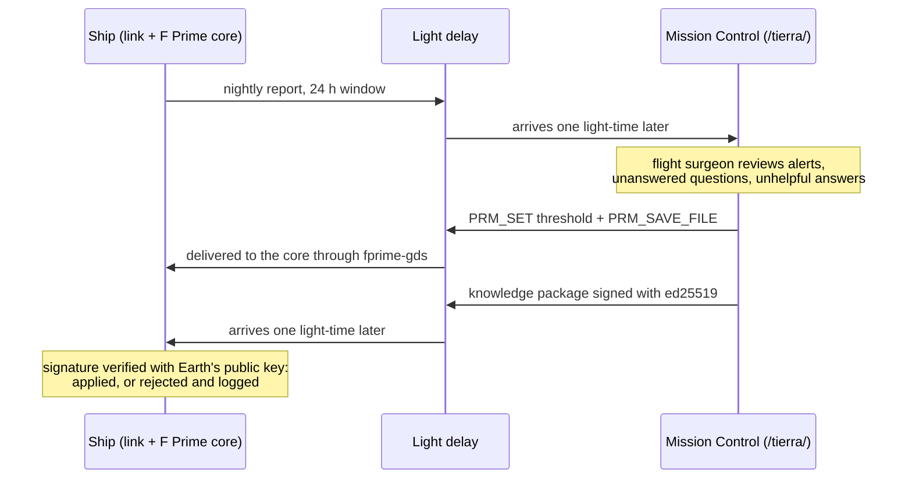
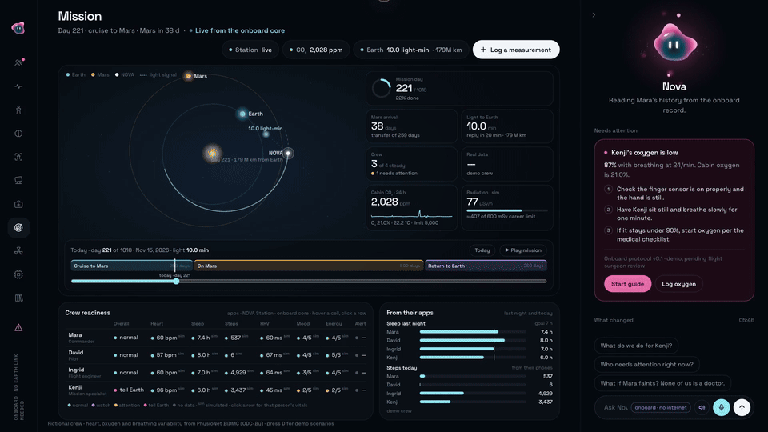

<div align="center">

# NOVA · Earth Loop

**What goes down every night, what comes up signed, and how both wait for the speed of light.**


</div>

On the way to Mars a message to Earth takes minutes, and around solar conjunction the link is gone for weeks. NOVA is
built so the crew never waits for Earth, but Earth is still part of the system: the flight surgeon receives a report
every night, can retune the ship's thresholds, and can teach NOVA new answers. Every one of those exchanges travels
with the real one-way light time of the day.

`tierra/` (Spanish for *Earth*) holds the Earth-side relay script for family messages. The loop itself is implemented
in the ship link ([`../tripulacion/src-tauri/src/`](../tripulacion/src-tauri/src)), and the Earth console is a page
the link serves at `/tierra/`.

## What it does

| Direction | What travels | Implemented in |
|---|---|---|
| Ship → Earth | **Nightly report**: the last 24 h per crew member (mean, min, max of 11 vitals), alerts, emergency sessions, questions asked to NOVA, consented private summaries, family mailbox counts, uplink status, and what NOVA needs to improve | `GET /v1/tierra/informe` in `main.rs` |
| Ship → Earth | **Delayed state**: the crew state as the ship sent it one light-time ago | `GET /v1/tierra/estado` |
| Earth → Ship | **F Prime commands**, e.g. a new threshold, held for the light time and then delivered to the flight core through the GDS | `POST /v1/sistemas/comando`, `tierra.rs` |
| Earth → Ship | **Signed knowledge packages**: flight surgeon notes and validated answers for NOVA, ed25519-signed, verified on arrival | `POST /v1/tierra/actualizar`, `aprende.rs` |
| Both ways | **Messages from home**: family texts and photos up, the astronaut's replies down | `casa.py`, `casa.rs` |

## Architecture



## How it works

**The light delay is computed, not configured.** [`mision.rs`](../tripulacion/src-tauri/src/mision.rs) places Earth
and Mars with the J2000 mean orbital elements and their per-century rates (E. M. Standish, JPL), launches the ship
from Earth's real position on launch day along a Hohmann transfer ellipse, and returns the distance to Earth, the
one-way light time and whether the Sun blocks the link. Defaults: launch on 8 April 2026, 500 days on Mars
(`NOVA_LANZAMIENTO`, `NOVA_ESTADIA_DIAS`).

**The nightly report.** `GET /v1/tierra/informe` builds the report as of one light-time ago, so Earth sees what the
ship knew when the signal left. It includes a learning section that tells the flight surgeon where NOVA fell short:

- questions whose answer said the library does not cover them;
- answers the crew marked as not useful (`POST /v1/opinion`);
- alerts that returned to normal within 60 s (a loose sensor or a threshold set too fine).

**Commands up.** Mission Control posts a command name and arguments to `POST /v1/sistemas/comando`. The link checks
the name against the F Prime command dictionary it loaded from the GDS, stamps it `en_vuelo` with its arrival time,
and once that time has passed delivers it with `PUT /commands/<name>` on the GDS REST API (port 5080). Each command
ends `entregado` (delivered), `rechazado` (rejected) or `error`, and the console shows the state. For thresholds the
console follows the `_PRM_SET` with `FileHandling.prmDb.PRM_SAVE_FILE` so the new limit survives a restart.

**Knowledge up, signed.** The flight surgeon writes notes (optionally addressed to one crew member) and validated
question–answer pairs, up to 10 of each. The Earth side signs the package with an ed25519 private key; the ship holds
only the public key. When the package arrives, the ship verifies the signature and either applies it (NOVA then reads
the notes as *Earth guidance* and the answers as *validated answers from Earth*) or rejects it with
`signature does not match Earth's key: not applied`. Emergency protocols are never part of a package.

In the demo both sides run on one computer with separate keys: the private key lives in `~/.nova-pc/tierra/clave`
(Earth side) and the ship reads only `~/.nova-pc/clave-tierra.pub`. Setting `"alterar": true` on a package simulates
tampering in transit: the content is replaced after signing and the ship rejects it. A unit test covers both cases
(`firma_valida_se_aplica_y_alterada_se_rechaza` in `aprende.rs`).

**Messages from home.** [`casa.py`](casa.py) is the Earth relay for the crew's families. It compresses photos to
1280 px JPEG (with `sips` on macOS; otherwise the file is sent as is), posts them to the ship, and reports the light
delay and when the message will arrive. The ship shows a message only after its arrival time. Replies wait in a
downlink queue until Earth collects them.

<p align="center"></p>

## Run it

The Earth console is part of the ship link. With the ship running (`cd ../tripulacion && npm run dev`), open:

```
http://127.0.0.1:8750/tierra/
```

It has *Tonight's report*, *Emergencies*, *Private summaries*, *Ask NOVA log* and *Teach NOVA* tabs, plus panels to
update the ship's F Prime limits, follow what is on the way up, and send a message from home.

Family relay from the command line (from `nave/tierra/`):

```sh
python3 casa.py enviar --trip T2 --de "Ana" --relacion "wife" --texto "We miss you!" --foto playa.jpg
python3 casa.py bajar        # collect the astronauts' replies (and photos) into ./bajada/
```

Common options: `--nave http://127.0.0.1:8750` (or `NOVA_NAVE`) and `--token` (or `NOVA_TOKEN`). `--hace <minutes>`
backdates a message for tests and demos.

The same loop over HTTP:

```sh
# nightly report
curl http://127.0.0.1:8750/v1/tierra/informe

# raise the high-pulse attention threshold to 115 bpm; delivered after the light delay
curl -X POST http://127.0.0.1:8750/v1/sistemas/comando -H 'content-type: application/json' \
  -d '{"nombre":"Nova.monitorSalud.PULSO_ALTO_ATENCION_PRM_SET","argumentos":["115"],"motivo":"Resting heart rate runs high"}'

# signed knowledge package
curl -X POST http://127.0.0.1:8750/v1/tierra/actualizar -H 'content-type: application/json' \
  -d '{"notas":[{"trip":"T4","texto":"Check sleep before the spacewalk."}],"respuestas":[],"motivo":"Flight surgeon review"}'

# what arrived, what is still in flight
curl http://127.0.0.1:8750/v1/aprende
```

Writes require the `x-nova-token` header when the ship sets `NOVA_TOKEN`.

## Data examples

Package as signed on Earth (the `sobre`, or envelope, carries the exact text that was signed):

```json
{"paquete":"{\"autor\":\"Flight surgeon, Mission Control\",\"creado\":1794233520,\"id\":\"UP-3352001\",\"motivo\":\"Flight surgeon review\",\"notas\":[{\"texto\":\"Check sleep before the spacewalk.\",\"trip\":\"T4\"}],\"respuestas\":[]}","firma":"<base64 ed25519 signature, 64 bytes>"}
```

Uplink command record:

```json
{"id":"u19a2f3c01","nombre":"Nova.monitorSalud.PULSO_ALTO_ATENCION_PRM_SET","argumentos":["115"],"motivo":"Resting heart rate runs high","enviado":1794233520000,"llega":1794233796000,"luz_ms":276000,"estado":"en_vuelo"}
```

A collected reply, as stored by `casa.py bajar` in [`bajada/`](bajada):

```json
{"a":"Yui","archivo":null,"estado":"enviado","id":"r1a1c0a6d122fb55","texto":"It is! I can see the Moon from my window too.","trip":"T4"}
```

## File map

| Path | Contents |
|---|---|
| [`casa.py`](casa.py) | Earth relay for family messages: `enviar` (send) and `bajar` (collect replies) |
| [`bajada/`](bajada) | replies collected from the ship (sample) |
| [`../tripulacion/src-tauri/src/tierra.rs`](../tripulacion/src-tauri/src/tierra.rs) | bridge to the F Prime GDS: dictionaries, events, telemetry, light-delayed command uplink |
| [`../tripulacion/src-tauri/src/aprende.rs`](../tripulacion/src-tauri/src/aprende.rs) | signed knowledge packages: signing (Earth), verification and application (ship) |
| [`../tripulacion/src-tauri/src/mision.rs`](../tripulacion/src-tauri/src/mision.rs) | mission geometry, distance, light time, solar conjunction |
| [`../tripulacion/src-tauri/src/casa.rs`](../tripulacion/src-tauri/src/casa.rs) | family mailbox on the ship (`~/.nova-pc/casa`, 3 MB per photo) |
| [`../tripulacion/ui/tierra/`](../tripulacion/ui/tierra) | Mission Control and flight surgeon console |

## Status

| Works today | Next stage |
|---|---|
| Nightly report computed as of one light-time ago, with a learning section | A scheduled downlink window; today Earth pulls the report on request |
| F Prime command uplink with real light delay, delivered through the GDS | Commands and messages held during solar conjunction until the link returns (today only the light time is applied) |
| ed25519-signed knowledge packages, tamper demo, unit test | Signed threshold and software updates with automatic rollback if they fail |
| Family messages with light delay, photo compression, reply downlink | Earth and ship on separate machines with real key distribution |

---

[Ship overview](../README.md) · [Back to the main README](../../README.md)
