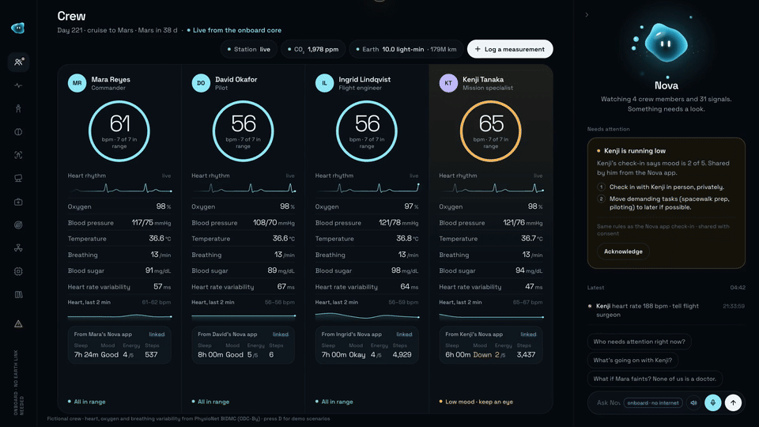
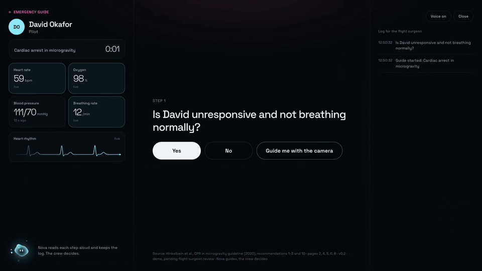
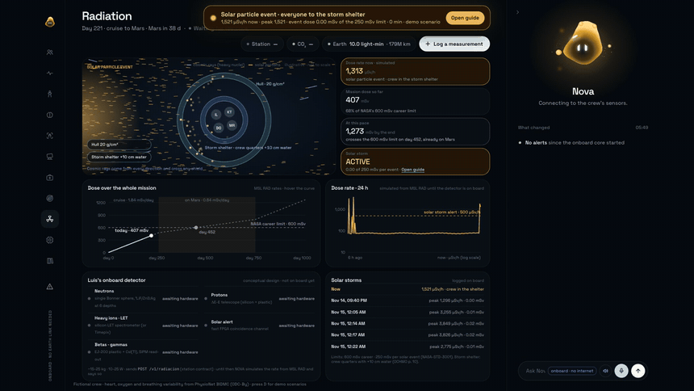
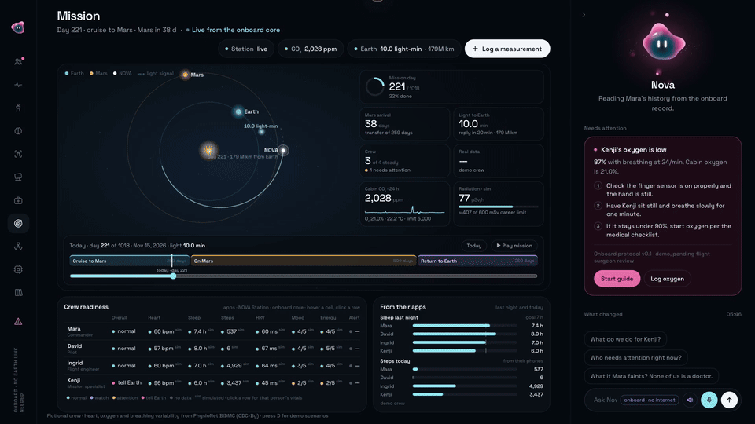
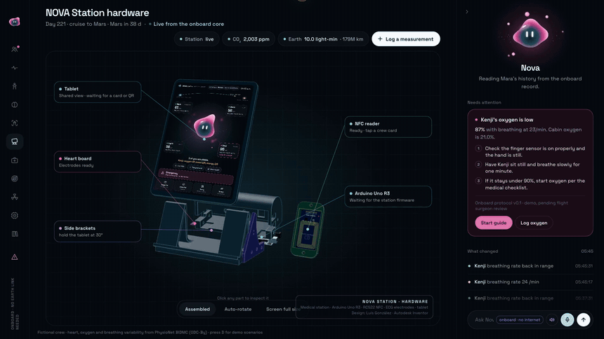
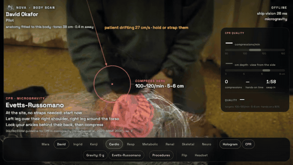
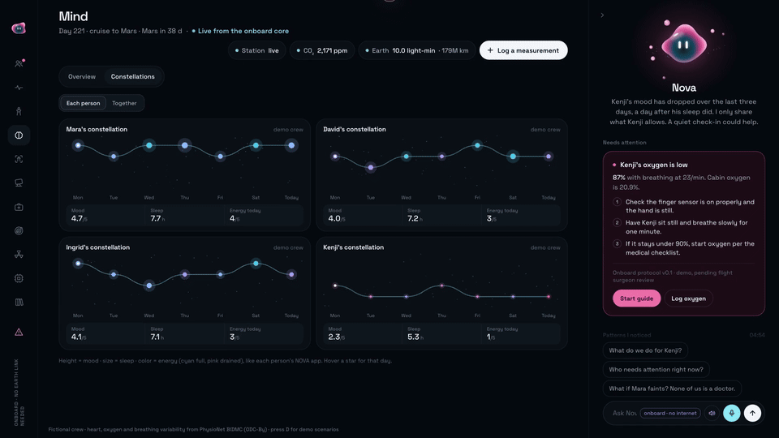
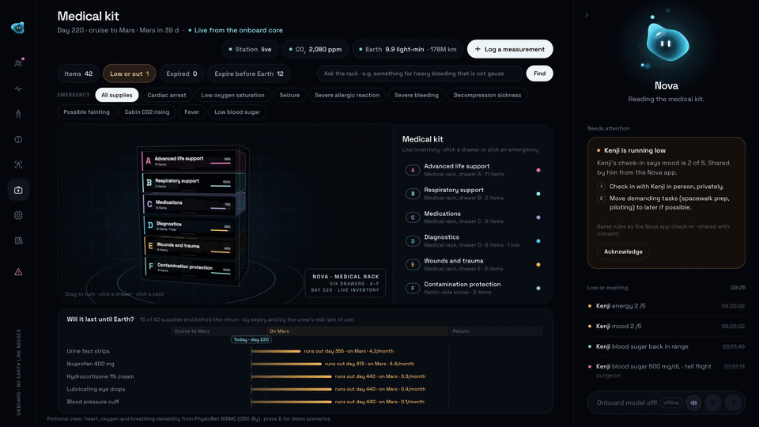
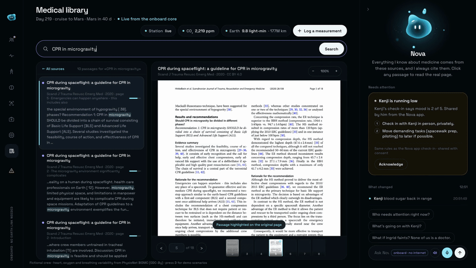
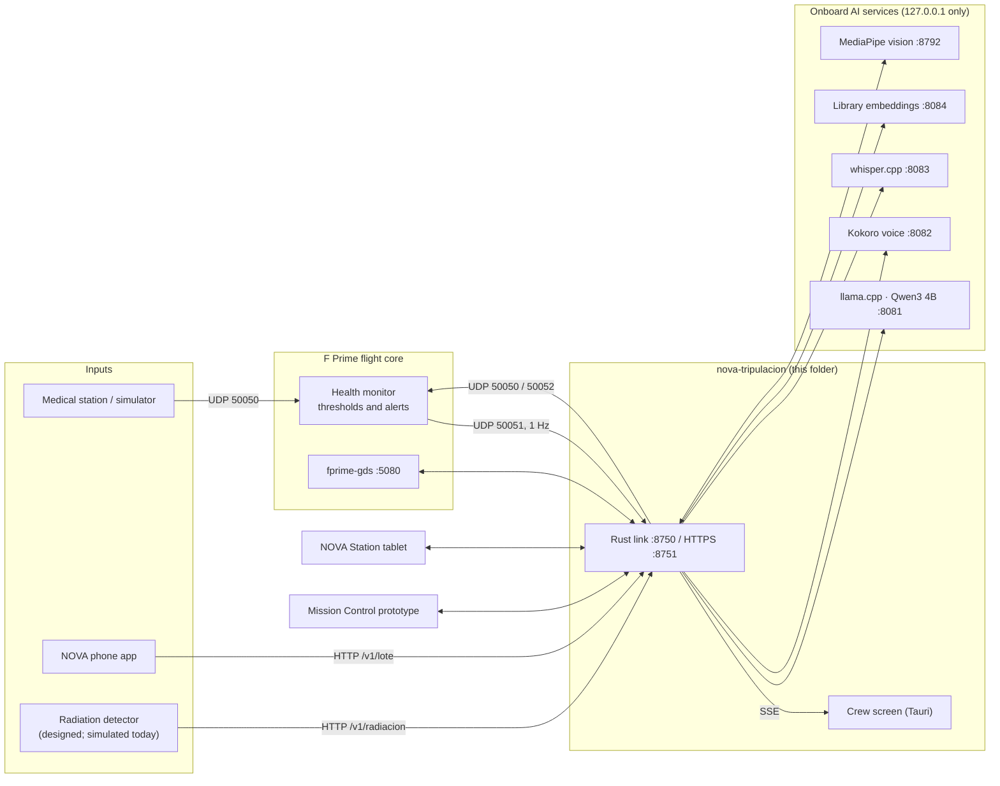

<div align="center">

# NOVA · Crew

**The ship's health screen. It runs entirely on board, with no link to Earth required.**


</div>

<p align="center"></p>

This folder is the ship's main computer application. A single Rust process opens the crew screen (a Tauri window) and the
ship's local link on port `8750`. It relays the F Prime flight core to every screen, receives readings from the phones and
the medical station, and starts and supervises the onboard AI services (language model, voice, speech recognition, library
search and vision). The phone app, the NOVA Station tablet, the AR body scanner and the Mission Control prototype all
connect to this one process.

> **Safety rule, enforced in code.** When a question matches an emergency, NOVA answers with the approved protocol text,
> word for word, and **the language model is never called** (`preguntar` in [`src-tauri/src/main.rs`](src-tauri/src/main.rs),
> `emergencia` and `respuesta_emergencia` in [`src-tauri/src/nova.rs`](src-tauri/src/nova.rs)). Threshold checks are made by
> the flight core, and the crew cards come from fixed rules. The language model explains, cites and answers questions. It
> never chooses a medical step.

---

## What it does

| View | What the crew sees | Where it lives |
|---|---|---|
| **Crew** | Four crew members with live vitals, alert level and NOVA's cards ("what changed, why it matters, what to do"), generated by fixed rules that can be reviewed | `ui/app.js` |
| **Vitals** | One person's history, from 10 minutes to 7 days, with the core's current thresholds drawn on each chart. Each signal is grouped under one of NASA HRP's five spaceflight hazards, and the mission's radiation dose is estimated from MSL RAD rates | `ui/vitals.js` |
| **Body twin** | A 3D anatomical twin (BodyParts3D male, NIH HuBMAP female). Organs are colored by live data. Touching a structure opens a card with its NASA source. A timeline projects bone and muscle loss to the return, with and without exercise | `ui/gemelo3d.mjs`, `ui/gemelo-fichas.js` |
| **Mind** | A 3D brain whose state (resting, focused, stressed, fatigued…) is chosen by fixed rules from live signs and the daily check-in. The view also has 14 days of mood, sleep and energy, and **constellations**: each person's week as in their phone app, or the whole crew in one interactive sky. Only people who share their day appear. The brain is a conceptual visualization, not an EEG | `ui/mente.js`, `ui/cerebro.mjs`, `ui/constelaciones.js` |
| **Live body scan** | AR on a phone or this screen. The reference anatomy is fitted to a real body, the ship's GPU does the heavy vision, and procedures are guided on the patient's own body. Includes the **Eyes** check: eye opening and signs of sleepiness measured with the camera | `ui/escaner.js`, `ui/procedimientos.js`, `ui/ojos.mjs` |
| **NOVA Station hardware** | The physical medical station in 3D, with the live NOVA Station interface on its tablet screen and an exploded view in which each part shows its live state | `ui/estacion3d.mjs`, `ui/estacion/` |
| **Mission** | The solar system with the ship on its real Hohmann transfer and the light signal traveling with its delay. A 1,018-day timeline can be dragged or played. Shows crew readiness from each phone and the station, with source and age, and does not invent missing values. Also shows 24 h of cabin CO₂ | `ui/panorama.js` |
| **Radiation** | Ship cross-section showing the hull and the storm shelter. Shows the current dose rate, mission dose against the 600 mSv career limit, the day the limit would be crossed, the last 24 h with the 500 µSv/h alert line, the detector channels and a log of solar storms | `ui/radiacionvista.js`, `ui/radiacion.js`, `src-tauri/src/radiacion.rs` |
| **Medical kit** | A 3D rack with 6 drawers and 42 supplies, each with a real photo. Shows what expires before Mars and before the return. Supports logging a use or correcting a count, and free-text search ("something for bleeding that is not gauze") | `ui/kit.js`, `ui/kit3d.mjs`, `src-tauri/src/kit.rs` |
| **Onboard systems** | The F Prime core seen through its own ground system: events in plain language, telemetry, current thresholds, and commands from Earth arriving after the real light delay | `ui/sistemas.js`, `src-tauri/src/tierra.rs` |
| **Medical library** | 41 open sources, searchable offline. Opens the **real page** of the original PDF with the passage highlighted | `ui/biblioteca.js`, `ui/lector.mjs` |
| **Ask NOVA** | Typed or spoken questions, answered by the onboard model with live ship data and cited library excerpts, streamed word by word and read aloud | `ui/chat.js`, `ui/escucha.js`, `ui/voz.js` |
| **Emergency** | A guided protocol, one step at a time: in large type, read aloud, with timers, branches decided by the live measurement, and every step logged for the flight surgeon | `ui/guia.js`, `ui/protocolos.json` |

That makes **11 views** in the side bar. The same process also serves **NOVA Station** (the shared tablet:
`ui/station.html`, with NFC card sessions, a live ECG from the station's heart board, and a live mirror on the PC), the
**AR camera guide for CPR** (`ui/guia-ar.html`) and a **Mission Control prototype** for the flight surgeon (`ui/tierra/`).

### Emergencies

<p align="center"></p>

[`ui/protocolos.json`](ui/protocolos.json) holds **13 protocols** in English and Spanish (version `0.2`, marked
*demo, pending flight surgeon review*):

| Guided, step by step (11) | Short protocol only (2) |
|---|---|
| Cardiac arrest in microgravity · Possible fainting · Low blood sugar · Fever · Low oxygen saturation · Severe allergic reaction · Choking · Severe bleeding · Seizure · Decompression sickness · Solar particle event (to the storm shelter) | Cabin CO₂ rising · Short sleep, low mood or low energy |

How a question becomes a protocol:

1. `nova::emergencia` lowercases the question, strips accents, and checks it against fixed English and Spanish keywords for
   10 protocols ("not breathing", "no respira", "bleeding", "atragant"…). Knowledge questions ("why", "what is", "cómo
   funciona") are excluded on purpose.
2. On a match, `nova::respuesta_emergencia` builds the answer from the protocol's own title and steps, numbered and
   unchanged. The kit adds where each needed supply is and how many are left (`Kit::para_protocolo`).
3. The answer streams to the screen with the protocol id, so the UI can open the guided version. The conversation is
   logged. No model is involved at any step.

The solar-storm guide is not opened by keywords. The radiation monitor opens it automatically when a storm is declared
(see [Radiation](#radiation-and-solar-storms)).

Each guided protocol is a small graph of `pregunta` (question) and `accion` (action) steps. The steps include timers,
crew-name and pronoun templates, the vital signs to watch, and the branch to take for each answer. Sources are cited per
protocol and down to the page where available: the microgravity CPR guideline (Hinkelbein et al. 2020), WHO/ICRC Basic
Emergency Care (2018), ADA's 15-15 rule, the NASA HRP decompression sickness report with OCHMO technical briefs, and for
the solar storm the OCHMO Radiation Protection brief (NASA-STD-3001) and the HRP acute radiation syndromes report.

### Radiation and solar storms

<p align="center"></p>

Radiation is the one hazard with no sensor on the body. [`src-tauri/src/radiacion.rs`](src-tauri/src/radiacion.rs)
monitors it on board:

- **Source.** The team's active detector design ([`../../research/radiation-detector/`](../../research/radiation-detector))
  posts its readings to `POST /v1/radiacion`: dose rate, solar-event flag, LET, neutrons and protons (contract in
  [`../estacion/CONTRATO.md`](../estacion/CONTRATO.md)). When no reading has arrived for 2 minutes, the rate is simulated
  from what MSL RAD measured: about 1.84 mSv/day in cruise (Zeitlin et al. 2013) and 0.64 mSv/day on the surface of Mars
  (Hassler et al. 2014). Every screen labels the rate as simulated.
- **Solar particle event.** An event is declared when the detector's fast channel raises `alerta_spe` or the rate stays at or
  above 500 µSv/h for 30 s. It ends after 5 minutes below 200 µSv/h. When it starts, every screen shows a banner, NOVA says
  it aloud, and the "everyone to the storm shelter" guide opens. Start and end go to the onboard log with the peak rate and
  the event dose.
- **Limits** (NASA-STD-3001 Vol. 1, OCHMO Radiation Protection brief): 600 mSv for a career and 250 mSv per solar event.
- **Ask NOVA** receives the current rate, its source and the mission dose in its context, and is told when a storm is in
  progress.
- **Demo:** `POST /v1/radiacion/demo {"spe": true}` starts a simulated storm of about 4 minutes, labeled as a demo
  everywhere.

### Mission

<p align="center"></p>

The Mission view ([`ui/panorama.js`](ui/panorama.js)) brings the mission and the crew together on one screen. It ports
the same orbital model as `mision.rs` to the browser, so the timeline can be dragged to any of the 1,018 days or played
end to end. Crew readiness shows what actually arrived from each phone and from the station, including heart rate, sleep,
steps, HRV, shared mood and energy, and the latest Eyes check. Each value shows where it came from and how old it is.
Daily check-ins from real crew members are kept per day and per person (`diario.rs`, `/v1/diario`), so a new person in a
seat does not inherit the previous person's week.

### NOVA Station hardware

<p align="center"></p>

The physical medical station (CAD assembly exported to `ui/estacion/estacion.glb`) is rendered in 3D. The real NOVA Station
interface runs live on its tablet screen: `station.html` in mirror mode, placed with CSS3D on the exact screen plane from
`ui/estacion/pantalla.json`. **Exploded** separates the parts, and each part is labeled with its live state:

- **NFC reader:** whose card was tapped.
- **Heart board:** the pulse of the person at the station.
- **Arduino:** whether station data is reaching the ship.
- **Tablet:** the open session.

The station's ECG board streams its waveform to `POST /v1/estacion/onda`. The ship relays it live to the tablet and the PC
without storing it, and the pulse derived from it enters the core as a real reading. The tablet also publishes what it is
showing to `/v1/station/pantalla`, which feeds the live mirror on the PC. Hardware files are in
[`../../hardware/`](../../hardware).

### AR procedures on the body

<p align="center"></p>
<p align="center"><sub>Background footage: "RCP.ogv" by Primerosauxilios, CC BY-SA 3.0, via Wikimedia Commons.</sub></p>

`ui/escaner.js` turns a phone (or this screen) into an AR scanner. Its design works like a headset tethered to a computer:

- The phone shows its own camera at full frame rate. Each frame also goes to the ship over `/v1/vision/ws`, where
  [`../vision/`](../vision) runs MediaPipe Pose (heavy) and Hands on the GPU and returns only the landmarks and a small body
  mask.
- The phone hides the round trip. Each result carries its frame's timestamp, the landmarks are predicted forward to the
  present, and the gyroscope corrects for the phone turning in the meantime (timewarp).
- If the ship's vision is unreachable, the phone runs lighter MediaPipe models itself and says so.
- The procedure changes with gravity. The accelerometer measures local g, and the mission phase sets the mode (cruise =
  microgravity, Mars = 0.38 g). CPR coaching follows the DGLRM/ESAM microgravity guideline: Evetts-Russomano at the site,
  reverse bear hug as fallback, handstand once the patient is on the restraint system, and defibrillation only on a
  restrained, isolated patient. In microgravity NOVA also watches for patient drift.
- `ui/procedimientos.js` places each step of each protocol on the fitted body. Examples are the CPR point, the outer
  mid-thigh for epinephrine, and AED pad sites. Feedback uses short spatial phrases ("a little higher, toward the head").
  *Everything a step shows comes from the protocol text. The AR only places it on the body.*
- The CPR camera guide (`ui/guia-ar.js`) counts compressions from hand motion and coaches the 100–120/min rate and the
  2-minute rescuer swap. It states that compression depth cannot be measured from one camera.
- The fitted anatomy is an estimate from body proportions, not an image of the inside, and the screen says so.
- **Eyes check** ([`ui/ojos.mjs`](ui/ojos.mjs), [`src-tauri/src/ojos.rs`](src-tauri/src/ojos.rs)). It runs on the
  device itself, at full camera resolution, with MediaPipe Face Landmarker (478 points with iris), and no image leaves the
  device. The method comes from the team's eye-health study ([`../../research/eye-health-cv/`](../../research/eye-health-cv)).
  - **Guided check:** 20 seconds looking at a dot, gated by a stillness check. It measures eye opening and lid positions
    in iris diameters, plus blink rate.
  - **Baseline:** the median is stored on the ship (`/v1/ojos`) and compared with that person's own baseline. A follow-up
    is suggested only when the change is larger than the minimum detectable change the study measured.
  - **Sleepiness:** measured with PERCLOS, long eye closures and yawns. NOVA does **not** read emotions from faces. The
    result reaches Ask NOVA's context for 72 hours. It is not a diagnosis.

Phone browsers only allow the camera on secure pages, so the link also serves HTTPS on port `8751` with a self-signed
certificate generated by the ship (`~/.nova-pc/tls`). Frames from every viewer are mirrored live to NOVA Station
(`/v1/escaner/flujo`).

### Mind and medical kit

<p align="center">
  
  
</p>

Mood and check-in data are shared by each crew member with consent ("Share my day" in the phone app). The constellations
show only the people who allow it. The kit starts from [`ui/kit/inicial.json`](ui/kit/inicial.json): 6 packs modeled on the
ISS medical kit, with 42 items. Each item has a quantity, location, expiry day, linked protocols and a photo credited to its
Wikimedia Commons author and license. Every change is saved to `~/.nova-pc/kit.json`, and NOVA reads it before naming a
supply. Free-text kit search sends the rack to the model as an object graph (after ConceptGraphs, Gu et al. 2023). Only
item ids that really exist in the rack are returned.

### Medical library

<p align="center"></p>

The library view lists the 41 sources by publisher. A click opens the original PDF stored on board (pdf.js, no
network), at the cited page, with the passage highlighted. Indexing and search are documented in
[`../biblioteca/`](../biblioteca).

---

## Architecture



## How it works

**One process, three jobs** ([`src-tauri/src/main.rs`](src-tauri/src/main.rs)):

1. It listens to the flight core on UDP `50051` (1 Hz state and alerts) and re-broadcasts each message to every screen
   over Server-Sent Events (`/v1/flujo`).
2. It forwards manual readings from the crew to the core on UDP `50052`.
3. It acts as the gateway for phones on the ship's network. Their readings arrive over HTTP (`/v1/lote`) and enter the core
   on UDP `50050` with the same contract as the medical station ([`../estacion/CONTRATO.md`](../estacion/CONTRATO.md)).
   Simulation fills gaps: real readings always take priority, and a sensor stops being simulated while real data keeps
   arriving (`fuentes.rs`).

**Ask NOVA** (`POST /v1/preguntar`, streamed over SSE):

1. **Emergency check first.** If the question matches a protocol, the answer is the fixed protocol text (see above).
2. **Live context.** `nova::contexto` builds the onboard data: mission day, light delay, each crew member's live values,
   1-hour and 24-hour history for the person named, alerts, and which limit each flagged value crossed (the ship does the
   comparison, not the model).
3. **Library retrieval.** The question is embedded locally (`nomic-embed-text-v2-moe`) and the top 3 passages are added
   with title, publisher, year, page and section. Questions about the crew's current status skip the library on purpose.
4. **Prompt layout for speed.** The fixed parts (rules, all protocols, live kit inventory, notes validated by the flight
   surgeon) go first so llama.cpp can reuse its prefix cache. The live data and the question go last.
5. **Rules the model receives.** Use only onboard data and never invent readings. For any medical action, use only protocol
   steps. Take medical knowledge only from the cited excerpts, cite them as `[1]`, and otherwise say the library does not
   cover it. Answer in at most 5 short sentences, in the crew's language.
6. **Hard length cap.** `nova::corte_de_largo` stops the stream after 5 sentences, or 7 lines for a list. Small models can
   run past the rule. Sources go to the screen as clickable citations, and every exchange is logged on board.

Generation settings: temperature `0.2`, `max_tokens` `400`. llama.cpp runs with flash attention, prefix cache reuse and
full GPU offload (`servicios.rs`).

**Voice in and out.** The screen records the microphone with simple voice activity detection: 0.3 s of pre-roll, and a cut
after about 0.9 s of silence. It sends WAV to `/v1/oir` (whisper.cpp, language auto-detected), and filters the phrases
whisper invents on silence. Compressed tablet audio is converted with ffmpeg. NOVA's reply is split into sentences and
synthesized one by one through `/v1/decir` (Kokoro), so speech starts after the first sentence. Listening is half-duplex,
so NOVA does not hear itself. See [`../voz/`](../voz).

**Earth loop** ([`src-tauri/src/aprende.rs`](src-tauri/src/aprende.rs)). The nightly report for the flight surgeon
(`/v1/tierra/informe`) collects the last 24 hours, including questions the library did not cover and answers the crew
marked as unhelpful (`/v1/opinion`). The flight surgeon replies with a package of notes and validated answers. Earth signs
it with **Ed25519**, and it travels with the **real light delay** for the current mission geometry. The ship verifies the
signature against Earth's public key before applying it. A tampered package is rejected and logged (`"alterar": true`
demonstrates this). These packages add context that NOVA reads. They do not change model weights, and **they never change
the emergency protocols.**

**Mission geometry** ([`src-tauri/src/mision.rs`](src-tauri/src/mision.rs)). Earth and Mars are computed from JPL's mean
J2000 orbital elements (Standish). The ship follows a Hohmann transfer from Earth's real position at launch. The model gives
mission day, phase (cruise, Mars, return), distance to Earth, one-way light delay and solar conjunction (elongation under
2°). With the defaults (launch 8 April 2026, 500 days at Mars) the mission is 1,018 days. Commands from Earth and family
messages are delivered only after the light delay has passed.

**Self-supervising services** ([`src-tauri/src/servicios.rs`](src-tauri/src/servicios.rs)). At startup, with or without
a window, the ship opens each service in its own thread: the flight core GDS, the station simulator, the language model,
voice, speech recognition, library search and vision. A service already running is not started twice, and one that
crashes is restarted (backoff after repeated failures). A missing binary or model is reported once and the ship continues
without it. Each service writes its log to `~/.nova-pc/logs/`.

**History on board** ([`src-tauri/src/historia.rs`](src-tauri/src/historia.rs)). Each crew member and sensor series is kept
at 1 Hz for 6 hours and as per-minute summaries for 30 days. Data is written to disk as daily NDJSON and reloaded on
restart, so restarting the screen loses nothing.

---

## Run it

Requirements: Rust (stable), Node.js (for the Tauri CLI), and, for the AI services, Homebrew's `llama.cpp`, `whisper-cpp`
and `ffmpeg`, plus Python 3.12 virtual environments in `../voz` and `../vision`. Model files live in `~/.nova-pc/modelos`
and `~/.nova-pc/voz`.

```sh
cd nave/tripulacion
npm install
npm run dev        # Tauri window "NOVA · Crew" + ship link on http://127.0.0.1:8750, starts every service it finds
npm run enlace     # no window: the link only, open http://127.0.0.1:8750 in a browser
npm run build      # macOS .app bundle
```

| Address | What opens there |
|---|---|
| `http://127.0.0.1:8750/` | Crew screen (same UI as the window) |
| `http://127.0.0.1:8750/station.html` | NOVA Station, the shared tablet |
| `http://127.0.0.1:8750/tierra/` | Mission Control prototype for the flight surgeon |
| `https://<ship-ip>:8751/escaner.html` | AR body scanner for a phone on the ship's network |

Press **D** on the crew screen to open the demo scenarios: *Ingrid faints*, *Mara: low sugar*, *David: fever*, *Kenji:
low oxygen*, *Cabin CO₂*, *Reset*.

Files the services expect (the ship starts without any that are missing):

| Service | Port | File |
|---|---|---|
| Language model (`llama-server`) | 8081 | `~/.nova-pc/modelos/Qwen3-4B-Instruct-2507-Q4_K_M.gguf` |
| Voice (`../voz/servidor.py`) | 8082 | `~/.nova-pc/voz/kokoro-v1.0.onnx`, `voices-v1.0.bin` |
| Speech recognition (`whisper-server`) | 8083 | `~/.nova-pc/modelos/ggml-large-v3-turbo-q5_0.bin` |
| Library search (`llama-server --embedding`) | 8084 | `~/.nova-pc/modelos/nomic-embed-text-v2-moe.Q4_K_M.gguf` |
| Vision (`../vision/servidor.py`) | 8792 | `../vision/modelos/*.task` (in the repo) |
| Flight core GDS (`fprime-gds`) | 5080 | `../vuelo/build-artifacts` (see [`../vuelo/`](../vuelo)) |
| Station simulator | UDP 50053 | `../estacion/simulador/simulador.py` |

### Environment variables

| Variable | Default | Effect |
|---|---|---|
| `NOVA_SIN_SERVICIOS=1` | off | Start no services; run every piece by hand |
| `NOVA_SIN_SIMULADOR=1` | off | Do not start the simulator (when the real medical station is connected) |
| `NOVA_PUERTO_ENLACE` | `8750` | Run a second test ship without stopping the first |
| `NOVA_MODELO` · `NOVA_VOZ` · `NOVA_OIDO` · `NOVA_EMBED` | `127.0.0.1:8081` · `:8082` · `:8083` · `:8084` | Service URLs |
| `NOVA_GDS` | `http://127.0.0.1:5080` | F Prime ground system |
| `NOVA_TOKEN` | none | Require an `x-nova-token` header on write endpoints from phones and Earth |
| `NOVA_BIBLIOTECA` | `~/.nova-pc/biblioteca` | Library index folder |
| `NOVA_LANZAMIENTO` · `NOVA_ESTADIA_DIAS` | `1775606400` · `500` | Launch time (Unix seconds) and days at Mars |
| `NOVA_DEPURAR_PROMPT` | none | Write the exact prompt of each question to this file |
| `NOVA_CEREBRO=claude` + `ANTHROPIC_API_KEY` | off | Optional **demo brain** for presentations (see below) |

**Demo brain.** The flight architecture is the onboard model. For live demos, `cerebro.rs` can route Ask NOVA to Claude
through the Anthropic API, but only when both variables are set. `demo-claude.sh` reads the key from the macOS Keychain, so
it is never written to a file. If the API does not answer, NOVA falls back to the onboard model on its own, and the screen
always shows which brain is active. Emergency answers are unaffected, because they never reach any model.

### Data on disk

Everything the ship writes stays in `~/.nova-pc/`: `historia/` (vitals, alerts, logs), `kit.json`, `tripulacion.json`
(who sits in each seat), `tarjetas.json` (NFC cards), `casa/` (family messages), `tls/` (HTTPS certificate),
`tierra/clave` (Earth's private signing key, in the demo only) and `clave-tierra.pub` (the public key the ship trusts),
`ojos.json` (Eyes checks), `diario.json` (daily check-ins) and `logs/`.

---

## File map

| Path | Purpose |
|---|---|
| `src-tauri/src/main.rs` | Entry point. Tauri window or `--sin-ventana`, the axum router (all `/v1/*` routes), UDP relay to and from the core, Ask NOVA |
| `src-tauri/src/nova.rs` | Ask NOVA: live context, system rules, emergency matching, fixed protocol answers, length cap |
| `src-tauri/src/cerebro.rs` | Pluggable language brain: onboard llama.cpp by default, optional demo brain |
| `src-tauri/src/servicios.rs` | Starts, supervises and restarts every onboard service |
| `src-tauri/src/biblioteca.rs` | Loads the library index. Semantic search with a keyword boost, citation filtering |
| `src-tauri/src/aprende.rs` | Ship–Earth improvement loop with Ed25519-signed packages |
| `src-tauri/src/mision.rs` | Hohmann transfer, distance, light delay, solar conjunction |
| `src-tauri/src/tierra.rs` | Bridge to `fprime-gds`: events, telemetry, commands delayed by light time |
| `src-tauri/src/historia.rs` | 6 h at 1 Hz plus 30 days per minute, NDJSON on disk |
| `src-tauri/src/kit.rs` | Live medical kit inventory, expiries against the mission timeline |
| `src-tauri/src/escaner.rs` | AR scanner frames, live mirror, HTTPS on 8751, WebSocket bridge to vision |
| `src-tauri/src/nfc.rs` | NFC card sessions and single-use QR login for NOVA Station |
| `src-tauri/src/tripulacion.rs` | Four seats (T1–T4). A paired phone puts a real person in a seat |
| `src-tauri/src/fuentes.rs` | Tracks which readings are real and which are simulated |
| `src-tauri/src/casa.rs` | Family messages and photos, delivered after the light delay |
| `src-tauri/src/radiacion.rs` | Dose rate (detector or MSL RAD model), solar-storm detection, limits, demo storm |
| `src-tauri/src/ojos.rs` | Eyes check history per crew member (`~/.nova-pc/ojos.json`) |
| `src-tauri/src/diario.rs` | Each real crew member's daily check-ins, per day and per person (`~/.nova-pc/diario.json`) |
| `ui/index.html`, `ui/app.js` | Crew screen shell and Crew view |
| `ui/protocolos.json` | The 13 approved protocols, guided steps and sources |
| `ui/escaner.js`, `ui/procedimientos.js`, `ui/guia-ar.js` | AR body scan, procedures on the body, CPR camera guide |
| `ui/gemelo3d.mjs`, `ui/gemelo-fichas.js`, `ui/anatomia/` | Body twin and its open anatomy ([credits](ui/anatomia/CREDITOS.md)) |
| `ui/mente.js`, `ui/cerebro.mjs`, `ui/constelaciones.js` | Mind view |
| `ui/kit.js`, `ui/kit3d.mjs`, `ui/kit/` | Medical kit and its photos |
| `ui/biblioteca.js`, `ui/lector.mjs` | Library and PDF reader with passage highlighting |
| `ui/chat.js`, `ui/escucha.js`, `ui/voz.js` | Ask NOVA, listening, speaking |
| `ui/guia.js` | Guided emergency mode |
| `ui/sistemas.js` | Onboard systems (F Prime) |
| `ui/panorama.js` | Mission view |
| `ui/radiacionvista.js`, `ui/radiacion.js` | Radiation view, and the storm alert shown in every view |
| `ui/ojos.mjs` | Eyes check (Face Landmarker, on device) |
| `ui/estacion3d.mjs`, `ui/estacion/` | NOVA Station hardware in 3D |
| `ui/station.html`, `ui/station.js` | NOVA Station tablet |
| `ui/tierra/` | Mission Control prototype |
| `ui/lib/` | Local copies of three.js (with GLTFLoader and CSS3DRenderer), MediaPipe Tasks Vision and its models, pdf.js, a QR library. Nothing loads from a CDN |
| `demo-claude.sh` | Starts the debug build with the optional demo brain |

---

## Status

**Works today**

- All 11 views run on one laptop with no internet: Crew, Vitals, Body twin, Mind, Live body scan with Eyes, NOVA Station
  hardware, Medical kit, Mission, Radiation, Onboard systems and Medical library. Ask NOVA works by text and voice, and
  emergencies are guided step by step.
- Radiation monitoring with automatic solar-storm detection, the shelter guide and event dose. A demo storm is available.
- Live ECG from the station's heart board on the tablet and the PC, and the tablet mirrored live on the PC.
- Live connection to the F Prime core (UDP and GDS), the phone app and the station simulator. Real readings replace
  simulated ones automatically.
- Emergency answers taken from fixed protocols, without any model. Cited library answers. Live kit inventory.
- Ed25519-signed Earth packages, applied after the real light delay, with tampered packages rejected.
- AR scanning with GPU vision offloaded to the ship and a phone-only fallback.

**Next stage**

- The radiation detector is a design (see [`research/radiation-detector`](../../research/radiation-detector)). The ship is
  ready for its readings. Until it is built, the dose rate is simulated from MSL RAD data and labeled as simulated.

- Clinical review of the protocols by a flight surgeon. They are labeled *demo, pending flight surgeon review* on every
  screen.
- Compression depth for CPR (one camera cannot measure it), and smart glasses as the camera and display: the CPR guide
  already separates its frame source, vision and outputs so each can be replaced.
- A real Earth–ship network. In the demo, Earth and the ship run on the same computer with separate keys.

---

## Credits

- **Anatomy:** BodyParts3D 4.0 (© DBCLS, CC BY 4.0), NIH Human Reference Atlas / HuBMAP female organ set v1.5 (CC BY 4.0)
  and the MakeHuman base mesh (CC0). Full credits in [`ui/anatomia/CREDITOS.md`](ui/anatomia/CREDITOS.md).
- **Kit photos:** Wikimedia Commons. Author, source and license for each item are in [`ui/kit/inicial.json`](ui/kit/inicial.json).
- **Libraries:** Tauri, axum, tokio, rustls, ed25519-dalek, three.js, MediaPipe Tasks Vision, pdf.js.
- **Models:** Qwen3-4B-Instruct-2507 (llama.cpp), Kokoro-82M, Whisper large-v3-turbo (whisper.cpp),
  nomic-embed-text-v2-moe, MediaPipe Pose, Hands and Face Landmarker.
- **Medical and space sources:** NASA Human Research Program, NASA-STD-3001 and OCHMO briefs, WHO/ICRC Basic Emergency
  Care, Hinkelbein et al. 2020 (CPR in microgravity), MSL RAD (Zeitlin 2013, Hassler 2014), JPL Keplerian elements
  (Standish), and for sleepiness PERCLOS (Dinges and Grace, FHWA 1998) and Barrett et al. 2019 on reading emotions from
  faces.
- AR CPR footage in the GIF above: "RCP.ogv" by Primerosauxilios, CC BY-SA 3.0, Wikimedia Commons.

Demo crew names (Mara, David, Ingrid, Kenji) are fictional.

---

<p align="center">
  <a href="../../README.md">← Back to NOVA</a> · <a href="../vision">Vision</a> · <a href="../voz">Voice</a> · <a href="../biblioteca">Library</a>
</p>

<p align="center"><sub>NOVA is a concept by Team B&N for the NASA International Space Apps Challenge 2026. It is not affiliated with or endorsed by NASA.</sub></p>
