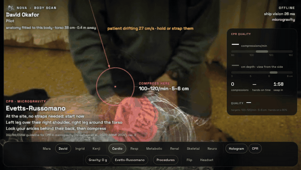
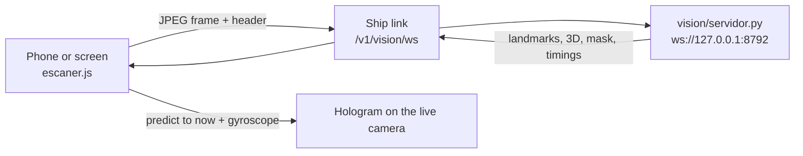
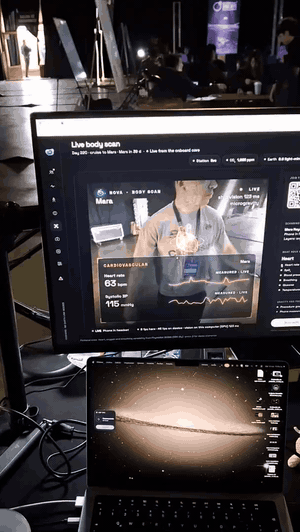

<div align="center">

# NOVA · Vision

**Body and hand tracking on the ship's GPU, for AR procedures guided on a real patient.**


</div>

<p align="center"></p>
<p align="center"><sub>Background footage: "RCP.ogv" by Primerosauxilios, CC BY-SA 3.0, via Wikimedia Commons.</sub></p>

A phone held up to a crew member, or carried in a headset, should not have to run the heaviest vision models itself. With
NOVA, it doesn't. The phone streams small JPEG frames to the ship's computer. This server runs MediaPipe's largest pose
model and the hand model on the GPU, and returns only the results: landmarks and a 1–3 KB body mask. The phone keeps showing
its own camera at full speed and draws the hologram on top.

## What it does

- **Pose, heavy model.** Up to 2 people, 33 image landmarks with visibility, plus 33 **world landmarks in meters (3D)**
  per person, and a segmentation mask of the body.
- **Hands.** Up to 2 hands, 21 landmarks each, with handedness. These show where the rescuer's hands are and are used to
  count chest compressions.
- **Patient first.** With two people in view, the person whose torso is most horizontal (lying down) is ranked first.
  Otherwise the largest is.
- **No queue.** If frames arrive faster than they can be processed, only the newest is processed and older ones are
  dropped, so latency stays bounded.
- **One tracker per device.** Each phone keeps its own MediaPipe tracker, so two cameras never mix one person's tracking.
  At most 4 trackers are kept, and the oldest is reused rather than opening more GPU models.
- **GPU first, CPU fallback.** Models are created with the GPU delegate (Metal on a Mac). If that fails, the CPU is used.
  The delegate in use is reported to the client.
- **Local only.** Binds to `127.0.0.1`. Phones reach it through the ship's link (`/v1/vision/ws` on `:8750`, or `:8751`
  over HTTPS), which bridges the WebSocket.
- **No orphans.** If the ship process that started it exits, the server exits too.

## How it fits



The client hides the round trip. Each result echoes the frame's capture time (`tc`, the phone's own clock). The phone predicts the landmarks
forward to the present from their motion, and corrects for its own rotation with the gyroscope, the same timewarp idea
headsets use. If this server is unreachable, the phone runs lighter MediaPipe models locally
(`../tripulacion/ui/lib/mediapipe/modelos/`) and tells the user. Client side:
[`../tripulacion/ui/escaner.js`](../tripulacion/ui/escaner.js).

<p align="center"></p>
<p align="center"><sub>Live test at the hackathon: a phone in a headset streams frames, and the ship computer runs the vision.</sub></p>

**What does not run here.** The scanner's **Eyes** check uses MediaPipe Face Landmarker on the device itself, at full
camera resolution, because at the 512 px sent to the ship the iris is too small to measure. No face image leaves the device.
Only the result goes to the ship (`/v1/ojos`). See [`../tripulacion/ui/ojos.mjs`](../tripulacion/ui/ojos.mjs).

## Protocol

**Client → server** (binary message): a 4-byte little-endian header length, a JSON header, then the JPEG bytes.

```text
[u32 LE n][ {"id": 42, "tc": 81234.5, "disp": "movil-ab12cd"} (n bytes) ][ JPEG, longest side 512 px ]
```

**Server → client** (JSON):

```jsonc
// on connect
{"tipo": "hola", "gpu": "GPU", "modelo": "MediaPipe Pose heavy + Hands", "equipo": "arm64"}
// per processed frame
{"tipo": "vision", "id": 42, "tc": 81234.5, "w": 512, "h": 384,
 "poses": [{"lm": [x, y, z, visibility, …33×], "mundo": [x, y, z, …33×, meters]}],
 "manos": [{"lado": "Left", "lm": [x, y, z, …21×]}],
 "mascara": "<base64 PNG, 96 px tall>",
 "ms_modelos": …, "ms": …}
```

`ms_modelos` is the time spent in the two models and `ms` is the total server time for that frame. Both are measured live
on every frame.

## Run it

The ship starts this service automatically when `vision/.venv` exists
([`../tripulacion/src-tauri/src/servicios.rs`](../tripulacion/src-tauri/src/servicios.rs)). To run it by hand:

```sh
cd nave/vision
uv venv --python 3.12 .venv
uv pip install --python .venv/bin/python mediapipe opencv-python-headless numpy websockets
NOVA_VISION_SOLO=1 .venv/bin/python servidor.py      # ws://127.0.0.1:8792
```

The package list is taken from the imports in `servidor.py`. The team's environment used Python 3.12 with mediapipe 1.2.3,
numpy 2.5.4 and websockets 17.4.

| Variable | Default | Effect |
|---|---|---|
| `NOVA_VISION_PUERTO` | `8792` | WebSocket port |
| `NOVA_VISION_SOLO` | unset | Keep running when not started by the ship (disables the parent-process watchdog) |

**Benchmark on your machine.** `bench.py` times Pose heavy and full on CPU and GPU, and Hands, on any image:

```sh
.venv/bin/python bench.py path/to/photo.jpg
```

## Files

| Path | Purpose |
|---|---|
| `servidor.py` | WebSocket server: decode, Pose + Hands, patient ranking, mask, per-device trackers |
| `bench.py` | Latency check for each model and delegate |
| `modelos/pose_landmarker_heavy.task` | MediaPipe Pose Landmarker, heavy (used by the server) |
| `modelos/pose_landmarker_full.task` | MediaPipe Pose Landmarker, full (for comparison in `bench.py`) |
| `modelos/hand_landmarker.task` | MediaPipe Hand Landmarker |

## Status

**Works today:** live pose, 3D world landmarks, body mask and both hands on the ship's GPU, bridged to phones on the ship's
network. This drives the AR body scan, procedures placed on the body, and CPR compression counting and rate coaching.

**Limits and next stage:** compression depth cannot be measured from a single camera, and the CPR guide says so. Smart
glasses as the camera and display are proposed: the client already separates frame source, vision and outputs so each
can be replaced.

## Credits

MediaPipe Tasks (Google, Apache 2.0) and its Pose Landmarker and Hand Landmarker models. OpenCV, NumPy, websockets.

---

<p align="center">
  <a href="../../README.md">← Back to NOVA</a> · <a href="../tripulacion">Crew app</a> · <a href="../voz">Voice</a> · <a href="../biblioteca">Library</a>
</p>
