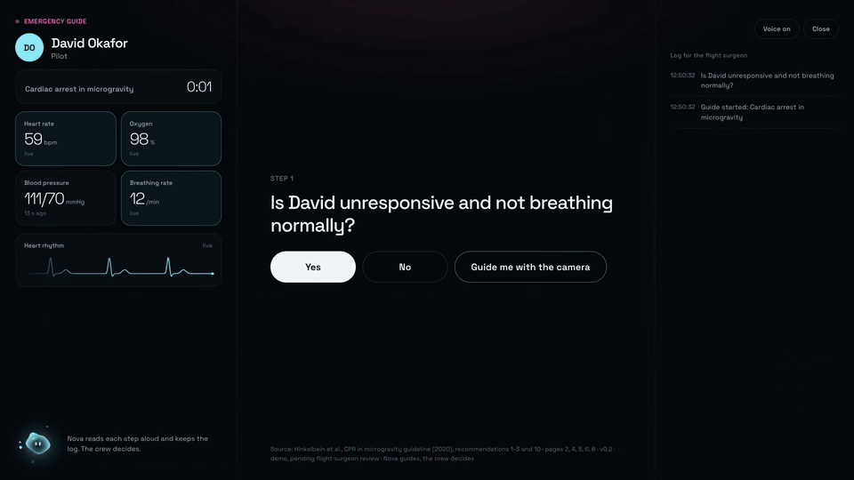
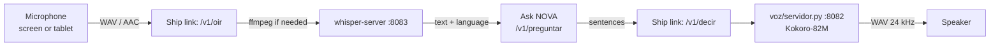

<div align="center">

# NOVA · Voice

**NOVA hears and speaks on board, with no internet: whisper.cpp for the crew's voice, Kokoro for NOVA's own voice.**


</div>

<p align="center"></p>

In an emergency, the person helping a crewmate needs both hands free. NOVA reads each protocol step aloud, and the crew
can ask NOVA a question by speaking from across the module. Both directions run on the ship's computer. No audio
leaves the ship.

## What it does

| Direction | Engine | Port | Model |
|---|---|---|---|
| **Speak** (text → speech) | Kokoro-82M via `kokoro-onnx` (this folder, `servidor.py`) | `8082` | `kokoro-v1.0.onnx` + `voices-v1.0.bin` |
| **Hear** (speech → text) | `whisper-server` from whisper.cpp | `8083` | `ggml-large-v3-turbo-q5_0.bin`, multilingual, language auto-detected |

- **Two voices, chosen by the team:** `af_heart` for English, the voice closest to NOVA in the phone app, and `ef_dora` for
  Spanish. Output is 16-bit PCM WAV at 24 kHz.
- **Speech starts fast.** The screen splits NOVA's reply into sentences and requests them one at a time, queuing the next
  while the current one plays, so speech begins after the first sentence is synthesized
  ([`../tripulacion/ui/voz.js`](../tripulacion/ui/voz.js)). The audio level also drives NOVA's mouth on screen.
- **Synthesis on the main thread.** HTTP threads queue requests and Kokoro runs on the main thread. The team measured that
  synthesizing from a new thread per request on macOS is about 3 times slower (0.34 s versus 0.95 s per sentence). Only
  one synthesis runs at a time, because the model is not reentrant.
- **Hands-free listening** ([`../tripulacion/ui/escucha.js`](../tripulacion/ui/escucha.js)). The microphone level is checked
  on every block. When speech starts, recording keeps the previous 0.3 s. It stops after about 0.9 s of silence, with
  utterances between 0.35 s and 20 s. Listening is half-duplex: while NOVA thinks or speaks it does not listen, so it never
  hears itself.
- **Robust transcription** (`/v1/oir` in [`../tripulacion/src-tauri/src/main.rs`](../tripulacion/src-tauri/src/main.rs)).
  WAV goes straight to whisper. Compressed audio from the Android tablet (AAC/M4A) is converted to 16 kHz mono WAV with
  ffmpeg first. Phrases whisper is known to invent on silence ("Thank you.", "[BLANK_AUDIO]", "Subtítulos realizados por
  la comunidad de Amara.org"…) are discarded. The detected language decides NOVA's answer language.

## How it fits



Both services bind to `127.0.0.1` only. Screens reach them through the ship's link on `:8750`.

## API

```http
POST http://127.0.0.1:8082/decir
Content-Type: application/json

{"texto": "Press Emergency to open the step-by-step guide.", "idioma": "en"}
```

Returns `audio/wav`. `idioma` is `"en"` or `"es"`, and anything else falls back to English. Text is capped at 600
characters. `GET /salud` returns `{"ok": true, "voz": {...}}`.

The ship exposes the same thing to its screens as `POST /v1/decir`. It exposes `POST /v1/oir` (raw audio body, up to
4 MB), which returns `{"texto": "...", "idioma": "en" | "es"}`.

## Run it

The ship starts both services automatically when their files are present
([`../tripulacion/src-tauri/src/servicios.rs`](../tripulacion/src-tauri/src/servicios.rs)). To run them by hand:

```sh
# NOVA's voice (Kokoro)
cd nave/voz
uv venv --python 3.12 .venv
uv pip install --python .venv/bin/python -r requirements.txt
.venv/bin/python servidor.py                     # http://127.0.0.1:8082

# NOVA's hearing (whisper.cpp)
brew install whisper-cpp
# model: ggml-large-v3-turbo-q5_0.bin from huggingface.co/ggerganov/whisper.cpp → ~/.nova-pc/modelos/
whisper-server -m ~/.nova-pc/modelos/ggml-large-v3-turbo-q5_0.bin --host 127.0.0.1 --port 8083 -l auto -t 8 -nt
```

Place `kokoro-v1.0.onnx` and `voices-v1.0.bin` (the `model-files-v1.0` release of
[kokoro-onnx](https://github.com/thewh1teagle/kokoro-onnx/releases)) in `~/.nova-pc/voz/`.

| Variable | Default | Effect |
|---|---|---|
| `NOVA_VOZ_DIR` | `~/.nova-pc/voz` | Folder with the Kokoro model and voices |
| `NOVA_VOZ_PUERTO` | `8082` | Port |
| `NOVA_VOZ_VELOCIDAD` | `1.0` | Speaking rate |

Pinned dependencies ([`requirements.txt`](requirements.txt)): `kokoro-onnx 0.6.1`, `onnxruntime 1.31.1`, `numpy 2.5.4`,
`soundfile 0.14.0`.

## Files

| Path | Purpose |
|---|---|
| `servidor.py` | Kokoro HTTP server: `/decir`, `/salud`, main-thread synthesis queue, model warm-up at start |
| `requirements.txt` | Pinned Python dependencies |

## Status

**Works today:** spoken questions in English or Spanish, transcribed on board. NOVA's answers and every emergency step are
read aloud in the crew's language, including on the NOVA Station tablet.

**Current limits:** listening is half-duplex, and the crew taps NOVA to interrupt it while it speaks. Only two languages
are wired (English and Spanish), each with a single voice.

## Credits

- [Kokoro-82M](https://huggingface.co/hexgrad/Kokoro-82M) (Apache 2.0), run through
  [kokoro-onnx](https://github.com/thewh1teagle/kokoro-onnx) (MIT) and ONNX Runtime.
- [whisper.cpp](https://github.com/ggerganov/whisper.cpp) (MIT) with OpenAI Whisper large-v3-turbo weights (MIT).

---

<p align="center">
  <a href="../../README.md">← Back to NOVA</a> · <a href="../tripulacion">Crew app</a> · <a href="../vision">Vision</a> · <a href="../biblioteca">Library</a>
</p>
