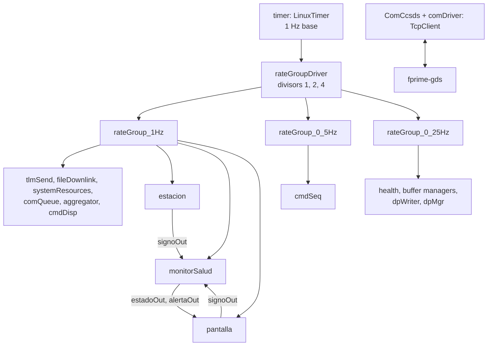

<div align="center">

# Deployment `Nave`

**The F Prime deployment that runs NOVA's crew health monitor on the ship.**


</div>

`Nave` (Spanish for *ship*) is the single deployment of the `Nova` F Prime project. It combines the F Prime core
subtopologies with NOVA's three runtime components (`Estacion`, `MonitorSalud`, `Pantalla`) and wires them into one
binary. For what the components do, see the [flight core README](../../README.md).

## Topology



Core subtopologies imported in [`Top/topology.fpp`](Top/topology.fpp):

| Subtopology | Provides |
|---|---|
| `CdhCore` | command dispatcher, event manager, telemetry, text logger, health, fatal handling |
| `ComCcsds` | CCSDS framing, uplink and downlink queues, router, com stub |
| `FileHandling` | file uplink and downlink, parameter database (`PrmDb.dat`) |
| `DataProducts` | data product catalog, writer and manager |

The NOVA-specific wiring is the `connections Nave` block:

```
estacion.signoOut      -> monitorSalud.signoIn
monitorSalud.estadoOut -> pantalla.estadoIn
monitorSalud.alertaOut -> pantalla.alertaIn
pantalla.signoOut      -> monitorSalud.signoIn
```

Project configuration in [`Top/NaveTopology.cpp`](Top/NaveTopology.cpp): the command sequencer gets a 5 KB buffer,
the parameter database reads `PrmDb.dat`, `estacion` listens on UDP 50050, and `pantalla` sends to UDP 50051 and
listens on UDP 50052. Parameters are read from the file and loaded before the tasks start, so thresholds changed from
Earth and saved with `PRM_SAVE_FILE` survive a restart.

## Build and run

From this folder, with the F Prime virtual environment active (see the [flight core README](../../README.md#run-it)
for setting it up):

```sh
fprime-util generate
fprime-util build -j
```

Start the ground system together with the binary. This is what the ship link does automatically:

```sh
fprime-gds -g html --gui-port 5080
```

Ground system only, without starting the app:

```sh
fprime-gds --no-app
```

Then run the binary on its own from the build output and point it at the GDS:

```sh
cd build-artifacts/<platform>/bin/
./Nave -a 127.0.0.1 -p 50000
```

`Main.cpp` accepts `-a` (GDS host) and `-p` (port). Without both, the TCP link is not opened and the deployment runs
standalone: it still listens for the station and still feeds the crew screen. `Ctrl-C` stops the rate groups and
tears the topology down cleanly.

## Files

| File | Contents |
|---|---|
| `Main.cpp` | command-line entry: options, signal handling, topology setup and teardown |
| `Top/topology.fpp` | instances, subtopology imports, all connections |
| `Top/instances.fpp` | instance types, base IDs, queue sizes, priorities |
| `Top/NaveTopology.cpp` | rate group timing and project-specific configuration (ports, buffers, parameter file) |
| `Top/NavePackets.fppi` | telemetry packet definitions, kept for a future `TlmPacketizer` (not included today) |
| `fprime-gds.yml` | default GDS options (none set) |
| `CMakeLists.txt` | registers the deployment and its topology |

---

[Flight core](../../README.md) · [Ship overview](../../../README.md) · [Back to the main README](../../../../README.md)
