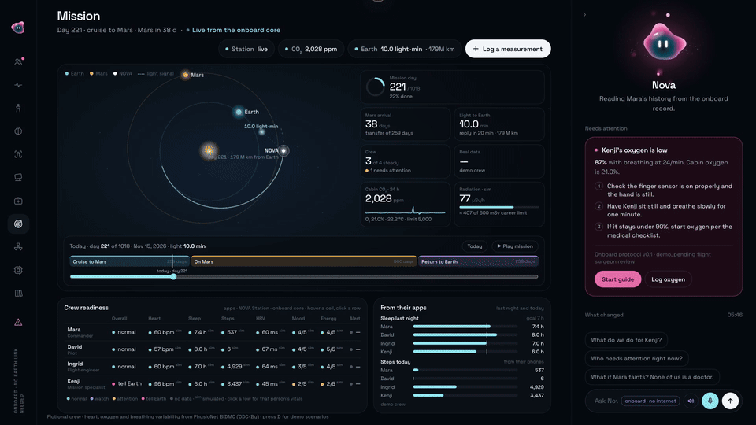
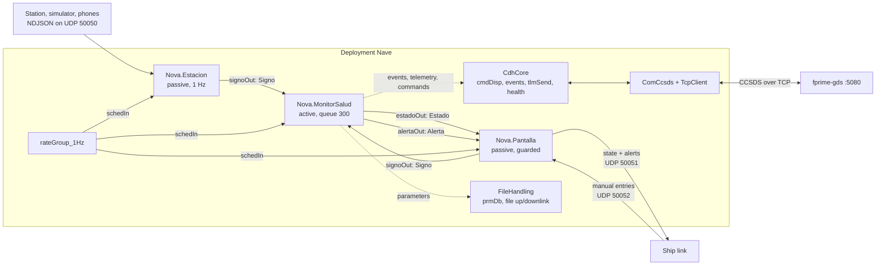

<div align="center">

# NOVA Flight Core

**The crew health monitor as flight software: four NOVA components on a NASA F Prime deployment.**


</div>

<p align="center"></p>

`vuelo/` (Spanish for *flight*) is the F Prime project `Nova`. It holds the part of NOVA that a spacecraft would treat
as flight software: it takes every vital sign and cabin reading, decides how serious it is, and reports through the
same commands, events, telemetry and parameters that F Prime missions use. The crew screens, the AI and the Earth
console are all clients of this core; none of them decides an alert.

## What it does

- Receives measurements as NDJSON over UDP 50050 and validates them against a versioned
  [data contract](../estacion/CONTRATO.md).
- Tracks **18 sensors** for **4 crew members** plus the cabin: pulse, SpO₂, systolic and diastolic pressure,
  temperature, respiratory rate, glucose, HRV (RMSSD), cabin CO₂, O₂ and temperature, sleep hours, mood, energy,
  steps, resting heart rate, light and noise.
- Classifies each reading into `SIN_DATO`, `NORMAL`, `ESPERADO_VUELO`, `ATENCION` (the crew handles it) or
  `AVISO_TIERRA` (notify the flight surgeon), using **31 F Prime parameters** that Earth can change at runtime.
- Emits an F Prime event only when a level changes, so the downlink is not flooded.
- Publishes the full crew state once per second to the crew screen and accepts manual entries back.
- Runs under the F Prime ground system (`fprime-gds`), which gives the technical console and the REST API that the
  ship link reads.

## Architecture



## The four NOVA components

All live in [`Nova/Components/`](Nova/Components). The F Prime standard pieces (command dispatch, events, telemetry,
health, parameter database, file handling, CCSDS framing, data products) come from the core subtopologies imported in
[`Nova/Nave/Top/topology.fpp`](Nova/Nave/Top/topology.fpp).

| Component | Kind | Role |
|---|---|---|
| `Salud` | types and ports only | Shared model: `Sensor` enum (18), `Nivel` enum (5), `Umbral` struct, `EstadoTripulacion` struct, ports `Signo`, `Alerta`, `Estado`; constant `TRIPULANTES = 4`. Also `JsonPlano.hpp`, a minimal NDJSON reader with no dynamic memory and no external dependencies. |
| `Estacion` | passive | Binds UDP 50050 (all interfaces, non-blocking). Each 1 Hz tick it drains up to 256 datagrams of up to 1024 bytes, checks contract version, crew id, sensor and unit, splits blood pressure into systolic and diastolic, and forwards valid readings. Declares the station lost after 15 s without any message. |
| `MonitorSalud` | active (queue 300) | Keeps the latest value, level and timestamp for each crew member × sensor. Rejects physically impossible values and readings with quality below 0.5, classifies against parameters, applies hysteresis (escalation is immediate, de-escalation needs 10 s), warns when a sensor that was reporting goes silent, and publishes telemetry and the full state at 1 Hz. |
| `Pantalla` | passive (guarded ports) | Serializes the state into one JSON line (bounded 8 KB buffer, dropped if it would overflow) and sends it with every alert to UDP 50051 on loopback. Reads manual entries from UDP 50052 on loopback and forwards them to the monitor with quality 1.0. |

### Instances

From [`Nova/Nave/Top/instances.fpp`](Nova/Nave/Top/instances.fpp):

| Instance | Type | Base ID | Notes |
|---|---|---|---|
| `monitorSalud` | `Nova.MonitorSalud` | `0x10005000` | queue 300, priority 39 |
| `estacion` | `Nova.Estacion` | `0x10015000` | passive |
| `pantalla` | `Nova.Pantalla` | `0x10016000` | passive |
| `rateGroup_1Hz` / `0_5Hz` / `0_25Hz` | `Svc.ActiveRateGroup` | `0x10001000` / `2000` / `3000` | 1 Hz base clock, divisors 1, 2, 4 |
| `cmdSeq` | `Svc.CmdSequencer` | `0x10004000` | on the 0.5 Hz group |
| `comDriver` | `Drv.TcpClient` | `0x10014000` | link to the GDS |

The 1 Hz rate group drives, in order: telemetry send, file downlink, system resources, com queue, aggregator,
command dispatcher, then `estacion`, `monitorSalud` and `pantalla`.

## How it works

**Classification.** For each sensor the monitor reads up to four parameters: high attention, high Earth notice, low
attention, low Earth notice (a value ≤ 0 means "does not apply"). Earth notice is checked first:

```
value >= highEarth  or  value <= lowEarth      -> AVISO_TIERRA
value >= highAttn   or  value <= lowAttn       -> ATENCION
otherwise                                      -> NORMAL
```

Mood never escalates to Earth on its own: it has only an attention threshold, and the crew sees it only if the person
shares it. HRV, resting heart rate, steps, light, noise, cabin O₂ and cabin temperature have no fixed threshold yet;
they are meant to be compared with each person's baseline.

**Physical plausibility.** Values outside these ranges are discarded as sensor errors (event `SIGNO_DESCARTADO`,
throttled), never treated as emergencies: pulse 20–250, SpO₂ 50–100, systolic 50–250, diastolic 30–150,
temperature 30–43 °C, respiratory rate 4–60, glucose 20–600, HRV 5–250 ms, cabin CO₂ 0–10000 ppm, cabin O₂ 0–30 %,
cabin temperature 0–50 °C, sleep 0–16 h, mood and energy 1–5, steps 0–100000, resting heart rate 25–130, light
0–150000 lux, noise 0–140 dB.

**Stale data.** A sensor that has reported before and then stays silent for `SEGUNDOS_SIN_DATOS` (default 120 s)
returns to `SIN_DATO` with a `SIN_DATOS` event. Daily signals (sleep, mood, energy, steps, resting heart rate) are
exempt because they arrive a few times a day.

**Commands, events, telemetry.**

| Kind | Name |
|---|---|
| Command | `INGRESAR_SIGNO(trip, sensor, valor)`: enter a measurement by hand (crew keyboard or a test from Earth) |
| Events | `ALERTA_ATENCION` (warning low), `ALERTA_TIERRA` (warning high), `VUELVE_NORMAL`, `SIGNO_DESCARTADO`, `SIN_DATOS`; station `ESCUCHANDO`, `CONECTADA`, `PERDIDA`, `MENSAJE_INVALIDO`; screen `LISTA`, `INGRESO`, `INGRESO_INVALIDO` |
| Telemetry | per crew member: `Pulso`, `SpO2`, `PaSis`, `PaDia`, `Temp`, `Fr`, `Glucosa`, `Vfc`, `Sueno`, `Animo`, `Energia`, `Nivel`; plus `Co2Cabina`, `SignosRecibidos`, `MensajesRecibidos`, `MensajesInvalidos`, `Conectada`, `MensajesEnviados`, `IngresosTripulacion` |
| Parameters | 31, listed in [`../docs/umbrales.md`](../docs/umbrales.md); each has the standard F Prime `_PRM_SET` / `_PRM_SAVE` commands |

**Changing a threshold from Earth.** The Mission Control console sends, for example,
`Nova.monitorSalud.PULSO_ALTO_ATENCION_PRM_SET 115` and then `FileHandling.prmDb.PRM_SAVE_FILE` so the change
survives a restart. The ship link holds each command for the real one-way light time before delivering it through the
GDS. See [`../tierra/README.md`](../tierra/README.md).

## Data on the wire

Into the core (UDP 50050), one reading per datagram:

```json
{"v":1,"tipo":"medicion","est":"estacion-1","t":1763164800123,"trip":"T2","sensor":"spo2","valor":97,"unidad":"%","calidad":0.92}
```

Out of the core (UDP 50051), once per second. Shortened here to one crew member and two sensors; the real line has
all 4 crew members and all 18 sensors. `umbrales` is `[highAttn, highEarth, lowAttn, lowEarth]`:

```json
{"tipo":"estado","t":1763164800,"trip":[{"pulso":62.0,"spo2":98.0,"pa_sis":116.0,"pa_dia":74.0,"temp":36.70,"fr":13.0,"glucosa":92.0,"vfc":62.0,"sueno_h":7.10,"animo":4,"energia":4,"pasos":0,"fc_reposo":0.0,"nivel":"normal","niveles":{"pulso":"normal","spo2":"normal"},"edades":{"pulso":1,"spo2":1}}],"umbrales":{"pulso":[110,140,45,35],"spo2":[-1,-1,94,90]},"cabina":{"co2":2100,"o2":21.00,"temp":22.4,"nivel_co2":"normal"}}
```

Each level change, the moment it happens (`trip` is 1–4, 0 for the cabin):

```json
{"tipo":"alerta","t":1763164861,"trip":3,"sensor":"pulso","valor":34.0,"nivel":"aviso_tierra"}
```

Manual entry into the core (UDP 50052):

```json
{"tipo":"ingreso","trip":"T1","sensor":"glucosa","valor":64}
```

## Run it

Requirements: Python 3.12, CMake ≥ 3.24.2, a C++ toolchain (Linux or macOS).

```sh
# from nave/
git submodule update --init --recursive          # brings lib/fprime (nasa/fprime)
cd vuelo && python3.12 -m venv fprime-venv && source fprime-venv/bin/activate
pip install -r requirements.txt
cd Nova/Nave && fprime-util generate && fprime-util build -j
fprime-gds -g html --gui-port 5080               # starts the GDS and the Nave binary
```

Open `http://127.0.0.1:5080` for the F Prime console. With the core running, start the simulator from `nave/`
(`python3 estacion/simulador/simulador.py`) and the telemetry starts moving. In normal use you do not need any of this
by hand: `npm run dev` in [`../tripulacion`](../tripulacion) starts and supervises the GDS for you.

Deployment-level notes (running the binary on its own, subtopologies) are in
[`Nova/Nave/README.md`](Nova/Nave/README.md).

## File map

| Path | Contents |
|---|---|
| `CMakeLists.txt`, `settings.ini`, `CMakePresets.json` | F Prime project setup; framework at `lib/fprime` |
| `requirements.txt` | Python tooling, pinned to the framework's requirements (F Prime v4.4.2) |
| `lib/fprime/` | NASA F Prime, as a git submodule |
| `Nova/Components/Salud/` | shared types and ports (`Salud.fpp`), NDJSON reader (`JsonPlano.hpp`) |
| `Nova/Components/Estacion/` | station input component |
| `Nova/Components/MonitorSalud/` | rules, levels, alerts, parameters |
| `Nova/Components/Pantalla/` | crew screen bridge |
| `Nova/Nave/` | the deployment: `Main.cpp`, `Top/` (topology, instances, wiring), `fprime-gds.yml` |

## Status

| Works today | Next stage |
|---|---|
| Contract v1 parsing for `medicion`; `latido`, `evento` and `onda` count as signs of life | Use `onda` (ECG, PPG) and `evento` messages inside the core |
| 18 sensors × 4 crew + cabin, two-tier thresholds, hysteresis, stale-data detection | Flight-expected ranges that set `ESPERADO_VUELO` |
| Thresholds as parameters, changed from Earth through the GDS with light delay | Per-person baselines and multi-day trends |
| Full-state broadcast to the crew screen at 1 Hz | Sensors `peso`, `ecg`, `ppg` from the contract are not yet known to the core |

## Credits

Built on [F Prime](https://github.com/nasa/fprime) by NASA JPL (Apache 2.0). The deployment skeleton (`Main.cpp`,
rate groups, core subtopologies) was generated with the F Prime tools; the `Nova` components, the `Nave` connections
and their configuration are Team B&N's work.

---

[Ship overview](../README.md) · [Back to the main README](../../README.md)
