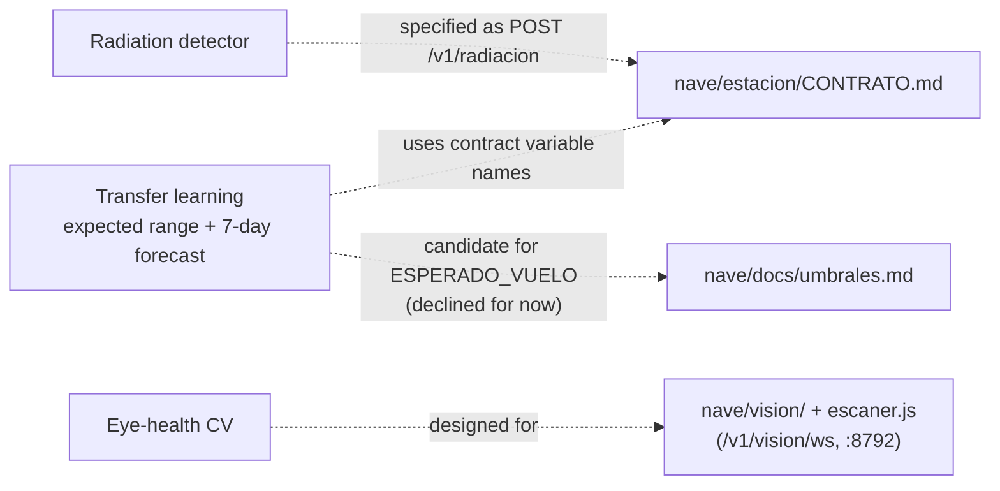

# NOVA · Research

**Team B&N research tracks behind NOVA, the on-board medical system built around NASA's F Prime**

[Back to the main README](../README.md)

This folder holds the team's research: work that informs the ship but is not (yet) part of the running system in
[`nave/`](../nave). Each track states its status plainly, and the connections to the ship listed below are only the
ones that exist in this repository today.

| Track | Author | Status | Language of the source documents |
|---|---|---|---|
| [Earth → space transfer learning](transfer-learning/) | Benjamín Campos ([@B3njjaman](https://github.com/B3njjaman)) | Working end to end (third kernel run); v4 planned | English (README, plan, decisions) |
| [Transfer learning report](transfer-learning-report/) | Benjamín Campos ([@B3njjaman](https://github.com/B3njjaman)) | Compiled, 65 pages | Report in Spanish |
| [Eye health with computer vision](eye-health-cv/) | Nicolás Richardson ([@xSempiternus](https://github.com/xSempiternus)) | Design + measurement spike; not integrated | English docs; design PDF in Spanish |
| [Active radiation detector](radiation-detector/) | Luis González | Conceptual design; not built | Spanish |

Dashed arrows are designed connections; none of these tracks is wired into the ship's code yet.

## Earth → space transfer learning

**Benjamín Campos ([@B3njjaman](https://github.com/B3njjaman)) · [`transfer-learning/`](transfer-learning/)**

NOVA should learn each crew member's Earth baseline and adapt to their "new normal" with the few days collected in
flight. The track tests this on real NASA −6° head-down bed-rest data (29 subjects, NLSP/LSDA campaigns 1 and 3 and
CFT70 at UTMB; an Earth analog of microgravity, not flight data), with LifeSnaps (71 people) as the Earth
pre-training set. The strongest result is an adapted expected range (personal baseline + a ridge corrector learned from
other subjects + the person's first 28 days in bed): at the same 5 % daily false-alarm rate it halves the weight range
(1.9 kg vs. 3.8 kg) and raises 3-day step detection from 10 % to 26 %, while the uncalibrated Earth monitor flags 52 %
of normal in-bed weight days. A PatchTST forecast (Hugging Face `transformers`, trained on Kaggle) beats the 7-day mean
by a small margin (relative MAE 0.793 vs. 0.807); whether Earth pre-training helps is still open. 27 tests pass. Run v4
(pulse and blood pressure only, 3 seeds, per-person adaptation) is decided but not yet run.

**Connection to the ship (verified):**
- Variables use the sensor names of [`nave/estacion/CONTRATO.md`](../nave/estacion/CONTRATO.md) (`pulso`, `pa_sis`,
  `pa_dia`, `fr`, `temp`, `peso`); `diuresis` and `agua` are not in the contract and v4 drops them.
- [`nave/docs/umbrales.md`](../nave/docs/umbrales.md) lists `ESPERADO_VUELO` (marking a change as expected in
  microgravity) as pending. The adapted range is a natural candidate, but the team decided **not** to propose it for
  now (decision 15 in [`PREGUNTAS.md`](transfer-learning/PREGUNTAS.md)); the fixed emergency thresholds stay as they
  are.
- On board it is designed as one more local Python service on :8793, next to the services that
  `nave/tripulacion/src-tauri/src/servicios.rs` already supervises (:8081–:8084 and vision on :8792). Nothing in
  `nave/` uses :8793 yet.

## Transfer learning report

**Benjamín Campos ([@B3njjaman](https://github.com/B3njjaman)) · [`transfer-learning-report/`](transfer-learning-report/)**

A 65-page LaTeX report ([`informe.pdf`](transfer-learning-report/informe.pdf), in Spanish, 91 references) on the same
work: the history of transfer learning from Thorndike (1901) to time-series foundation models, the data, both models,
the third-run results, the audit of 14-11-2026, how it would fit into the ship and the 26 decisions. Every result
figure is generated by script from the kernel output (`herramientas/construir_cifras.py`), and references were resolved
against Crossref, DBLP, OpenAlex, arXiv and Semantic Scholar rather than written from memory. Status: compiled; it
states that the ship connection is designed, not built, and that v4 is planned, not run.

## Eye health with computer vision

**Nicolás Richardson ([@xSempiternus](https://github.com/xSempiternus)) · [`eye-health-cv/`](eye-health-cv/)**

Camera-only eye monitoring (no soft sensors): the phone looks at the face, measures blinking, PERCLOS, lower-eyelid
position and screen distance, compares them with each person's baseline and issues a follow-up alert, never a
diagnosis. The spike measured MediaPipe Face Landmarker on a 640×480 webcam with one person: 478 landmarks, 100 %
detection and iris at 512 px with JPEG, 7.76 ms median latency, and a noise floor giving a minimum detectable change
(MDC95 with repositioning) of ~1.8 to 2.2 mm for eye opening [INF]. The pupil-to-brow distance did not meet its
≤ 2.3 mm target (3.3 mm [INF]), so it is not usable for subtle changes with this camera. Includes a background review
with primary sources and verification tags, a phased plan and a pytest suite. Status: design and measurement spike;
phases 1–3 (module, measurements, QA) are pending.

**Connection to the ship (verified):** designed to run inside the ship's vision bridge — the phone scanner
(`nave/tripulacion/ui/escaner.js`) streams frames to `/v1/vision/ws`, which the ship link forwards to
[`nave/vision/servidor.py`](../nave/vision/servidor.py) on port 8792. That server currently runs MediaPipe pose and hand
models only; no eye-health code is integrated yet.

## Active radiation detector

**Luis González (hardware) · [`radiation-detector/`](radiation-detector/)**

A conceptual design (9-page proposal, in Spanish) for an on-board active radiation detector: ⁶LiF/ZnS:Ag neutron
screens in a single Bonner sphere, a ΔE-E proton telescope, a silicon LET spectrometer for heavy ions, and a fast
solar-particle-event alert channel in the FPGA, with mass (~15–25 kg) and power (10–25 W) budgets, a simulation and
calibration plan and a four-phase roadmap. Status: conceptual design, not built.

**Connection to the ship (verified):** the "Radiación" section of
[`nave/estacion/CONTRATO.md`](../nave/estacion/CONTRATO.md) specifies the message the detector would send
(`POST /v1/radiacion` with `tasa_usv_h`, `alerta_spe`, `let_kev_um`, `neutrones_usv_h`, `protones_cm2_s`). The handler
that contract refers to is not part of this repository; the crew interface currently shows an estimated mission dose
computed from MSL RAD rates (`dosisMision()` in `nave/tripulacion/ui/vitals.js`). Luis's physical medical station
(Arduino with an RC522 RFID reader and an AD8232 ECG) connects to the ship through [`hardware/`](../hardware), which
is part of the running system rather than research.
