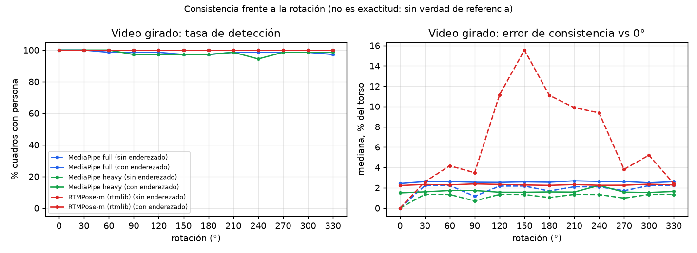

# Línea base: robustez a la rotación

Generado por `python -m pose_twin bench` el 2026-11-26 18:28. Equipo: Intel64 Family 6 Model 141 Stepping 1, GenuineIntel, Python 3.13.12, mediapipe 1.2.3, OpenCV 5.0.0.

**Qué mide.** Consistencia, no exactitud. Cada modelo se compara consigo mismo a 0°: la entrada se gira, los puntos predichos se devuelven a coordenadas originales y se mide la distancia a lo que el mismo modelo predijo sin girar. No hay verdad de referencia anotada, así que un modelo puede ser consistente y aun así equivocarse igual en todos los ángulos.

- *Detección*: % de entradas con una persona encontrada.
- *Error puntos*: mediana de la distancia media de los 17 puntos COCO (con confianza en ambos) dividida por el largo del torso de referencia.
- *Error ángulos 2D*: mediana del error absoluto medio de los 8 ángulos (codos, hombros, caderas, rodillas) en la imagen.
- *ms/cuadro*: tiempo de pared de la inferencia, incluido el giro y, con enderezado, las pasadas extra.
- *Enderezado*: gira la entrada según el torso del cuadro anterior (video) o de una primera pasada (imagen); si no hay persona prueba 0/90/180/-90°.

## Video girado (seguimiento cuadro a cuadro)

Fuente: `sentadilla.webm`, 71 cuadros (1 de cada 3, ancho 640 px, 10.0 cps efectivos), rotaciones 0–330° cada 30°. MediaPipe en modo video (usa el seguimiento por recorte, como en vivo).

| Modelo | Enderezado | Detección | Error puntos (mediana, % torso) | Error ángulos 2D (mediana, °) | ms/cuadro | Delegado |
|---|---|---|---|---|---|---|
| MediaPipe full | sin | 100% | 2.1 | 2.4 | 17.6 | CPU |
| MediaPipe full | con | 98% | 2.6 | 2.9 | 18.6 | CPU |
| MediaPipe heavy | sin | 100% | 1.3 | 1.2 | 49.0 | CPU |
| MediaPipe heavy | con | 98% | 1.6 | 1.7 | 50.7 | CPU |
| RTMPose-m (rtmlib) | sin | 100% | 4.7 | 5.2 | 252.6 | CPU (onnxruntime) |
| RTMPose-m (rtmlib) | con | 100% | 2.3 | 2.0 | 254.3 | CPU (onnxruntime) |

Promedio sobre todas las rotaciones (detección y ms) y mediana de las medianas por rotación (errores).

Detección por rotación:

| Modelo | Enderezado | 0° | 30° | 60° | 90° | 120° | 150° | 180° | 210° | 240° | 270° | 300° | 330° |
|---|---|---|---|---|---|---|---|---|---|---|---|---|---|
| MediaPipe full | sin | 100% | 100% | 100% | 100% | 100% | 100% | 100% | 100% | 100% | 100% | 100% | 100% |
| MediaPipe full | con | 100% | 100% | 99% | 99% | 99% | 97% | 97% | 99% | 99% | 99% | 99% | 97% |
| MediaPipe heavy | sin | 100% | 100% | 100% | 100% | 100% | 100% | 100% | 100% | 100% | 100% | 100% | 100% |
| MediaPipe heavy | con | 100% | 100% | 100% | 97% | 97% | 97% | 97% | 99% | 94% | 99% | 99% | 99% |
| RTMPose-m (rtmlib) | sin | 100% | 100% | 100% | 100% | 100% | 100% | 100% | 100% | 100% | 100% | 100% | 100% |
| RTMPose-m (rtmlib) | con | 100% | 100% | 100% | 100% | 100% | 100% | 100% | 100% | 100% | 100% | 100% | 100% |

Error de puntos por rotación (mediana, % del torso):

| Modelo | Enderezado | 0° | 30° | 60° | 90° | 120° | 150° | 180° | 210° | 240° | 270° | 300° | 330° |
|---|---|---|---|---|---|---|---|---|---|---|---|---|---|
| MediaPipe full | sin | 0.0 | 2.2 | 2.2 | 1.2 | 2.2 | 2.2 | 1.7 | 2.1 | 2.1 | 1.7 | 2.2 | 2.2 |
| MediaPipe full | con | 2.4 | 2.6 | 2.6 | 2.5 | 2.5 | 2.6 | 2.5 | 2.7 | 2.6 | 2.6 | 2.5 | 2.6 |
| MediaPipe heavy | sin | 0.0 | 1.4 | 1.3 | 0.7 | 1.3 | 1.3 | 1.0 | 1.3 | 1.3 | 1.0 | 1.3 | 1.3 |
| MediaPipe heavy | con | 1.5 | 1.6 | 1.7 | 1.7 | 1.6 | 1.6 | 1.6 | 1.6 | 2.2 | 1.6 | 1.5 | 1.6 |
| RTMPose-m (rtmlib) | sin | 0.0 | 2.6 | 4.2 | 3.5 | 11.1 | 15.6 | 11.1 | 9.9 | 9.4 | 3.8 | 5.2 | 2.4 |
| RTMPose-m (rtmlib) | con | 2.2 | 2.3 | 2.3 | 2.4 | 2.3 | 2.3 | 2.2 | 2.3 | 2.2 | 2.3 | 2.4 | 2.3 |

**Lectura automática (video).** Efecto del enderezado por modelo, sobre las rotaciones distintas de 0°:

- MediaPipe full: error mediano 2.2% → 2.6% del torso (peor rotación 2.2% → 2.7%), detección 100% → 98%: el enderezado empeora.
- MediaPipe heavy: error mediano 1.3% → 1.6% del torso (peor rotación 1.4% → 2.2%), detección 100% → 98%: el enderezado empeora.
- RTMPose-m (rtmlib): error mediano 5.2% → 2.3% del torso (peor rotación 15.6% → 2.4%), detección 100% → 100%: el enderezado mejora.

Con enderezado el error a 0° no es cero: la imagen se pone en un lienzo cuadrado (lado = diagonal), la persona queda más pequeña para el detector y la red ve una entrada distinta. MediaPipe ya corrige la inclinación dentro de su recorte (alinea caderas-hombros), por eso gana poco o nada; RTMPose recorta sin alinear y es el que más se beneficia.

## Imagen girada (cada ángulo independiente)

Fuente: `pose.jpg`, rotaciones cada 15°. MediaPipe en modo imagen.

| Modelo | Enderezado | Detección | Error puntos (mediana, % torso) | Error ángulos 2D (mediana, °) | ms/cuadro | Delegado |
|---|---|---|---|---|---|---|
| MediaPipe full | sin | 100% | 1.8 | 1.1 | 27.4 | CPU |
| MediaPipe full | con | 100% | 1.9 | 1.6 | 56.8 | CPU |
| MediaPipe heavy | sin | 100% | 1.3 | 0.8 | 60.3 | CPU |
| MediaPipe heavy | con | 100% | 1.5 | 1.0 | 117.3 | CPU |
| RTMPose-m (rtmlib) | sin | 100% | 4.6 | 3.7 | 239.6 | CPU (onnxruntime) |
| RTMPose-m (rtmlib) | con | 100% | 2.5 | 1.6 | 484.5 | CPU (onnxruntime) |

Detección por rotación (✓ = persona encontrada):

| Modelo | Enderezado | 0° | 15° | 30° | 45° | 60° | 75° | 90° | 105° | 120° | 135° | 150° | 165° | 180° | 195° | 210° | 225° | 240° | 255° | 270° | 285° | 300° | 315° | 330° | 345° |
|---|---|---|---|---|---|---|---|---|---|---|---|---|---|---|---|---|---|---|---|---|---|---|---|---|---|
| MediaPipe full | sin | ✓ | ✓ | ✓ | ✓ | ✓ | ✓ | ✓ | ✓ | ✓ | ✓ | ✓ | ✓ | ✓ | ✓ | ✓ | ✓ | ✓ | ✓ | ✓ | ✓ | ✓ | ✓ | ✓ | ✓ |
| MediaPipe full | con | ✓ | ✓ | ✓ | ✓ | ✓ | ✓ | ✓ | ✓ | ✓ | ✓ | ✓ | ✓ | ✓ | ✓ | ✓ | ✓ | ✓ | ✓ | ✓ | ✓ | ✓ | ✓ | ✓ | ✓ |
| MediaPipe heavy | sin | ✓ | ✓ | ✓ | ✓ | ✓ | ✓ | ✓ | ✓ | ✓ | ✓ | ✓ | ✓ | ✓ | ✓ | ✓ | ✓ | ✓ | ✓ | ✓ | ✓ | ✓ | ✓ | ✓ | ✓ |
| MediaPipe heavy | con | ✓ | ✓ | ✓ | ✓ | ✓ | ✓ | ✓ | ✓ | ✓ | ✓ | ✓ | ✓ | ✓ | ✓ | ✓ | ✓ | ✓ | ✓ | ✓ | ✓ | ✓ | ✓ | ✓ | ✓ |
| RTMPose-m (rtmlib) | sin | ✓ | ✓ | ✓ | ✓ | ✓ | ✓ | ✓ | ✓ | ✓ | ✓ | ✓ | ✓ | ✓ | ✓ | ✓ | ✓ | ✓ | ✓ | ✓ | ✓ | ✓ | ✓ | ✓ | ✓ |
| RTMPose-m (rtmlib) | con | ✓ | ✓ | ✓ | ✓ | ✓ | ✓ | ✓ | ✓ | ✓ | ✓ | ✓ | ✓ | ✓ | ✓ | ✓ | ✓ | ✓ | ✓ | ✓ | ✓ | ✓ | ✓ | ✓ | ✓ |

## Modelos y licencias

- MediaPipe Pose Landmarker full/heavy (BlazePose GHUM 3D), Apache-2.0, archivos `.task` de `nave/vision/modelos/` (Google).
- RTMPose-m (body7, 256×192) + detector YOLOX-m (HumanArt), vía `rtmlib` (Apache-2.0). Pesos ONNX descargados por rtmlib desde `download.openmmlab.com` (proyecto OpenMMLab MMPose, Apache-2.0). Solo 2D: no da puntos 3D.
- Todo se ejecutó en CPU (ver columna Delegado); el delegado GPU de MediaPipe no está disponible en Windows con esta versión, y onnxruntime instalado es la variante CPU.

## Límites

- Una sola persona por muestra, un video corto y una imagen: las cifras orientan, no generalizan.
- Las esquinas negras del giro y el reescalado cambian la entrada; parte del error viene de ahí, no del modelo.
- Los tiempos incluyen la primera inferencia (calentamiento) y dependen de la carga del equipo.
