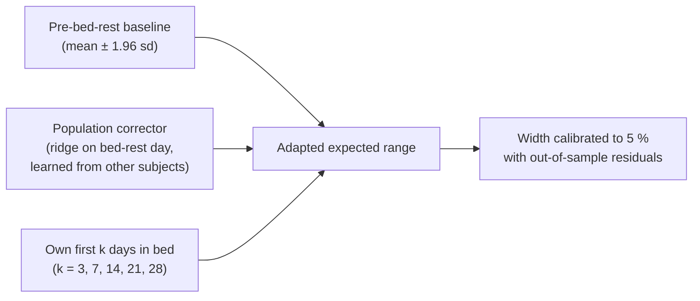
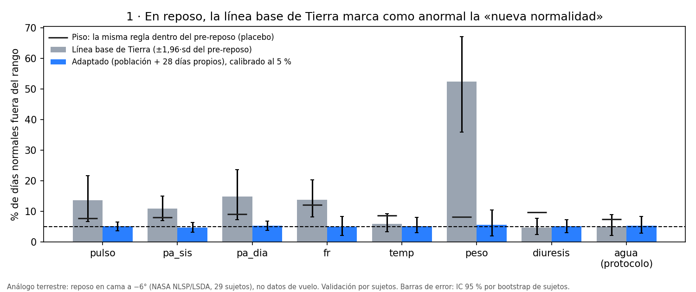
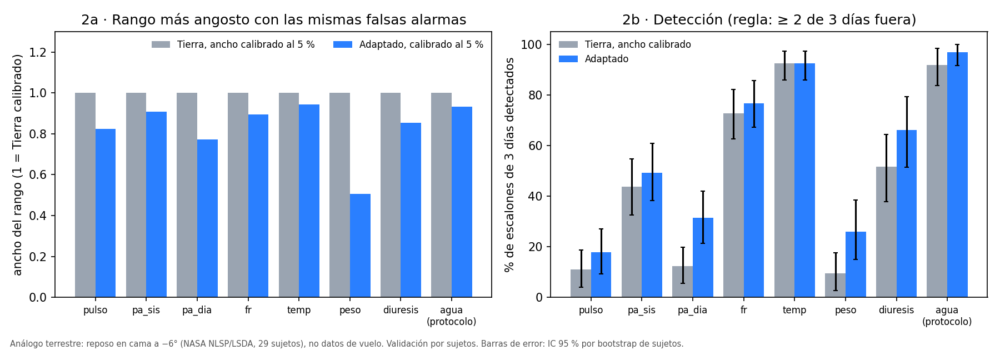
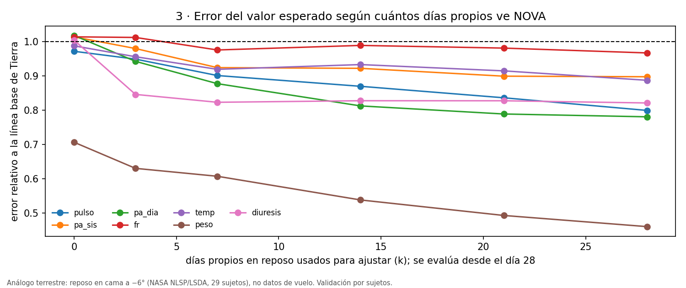
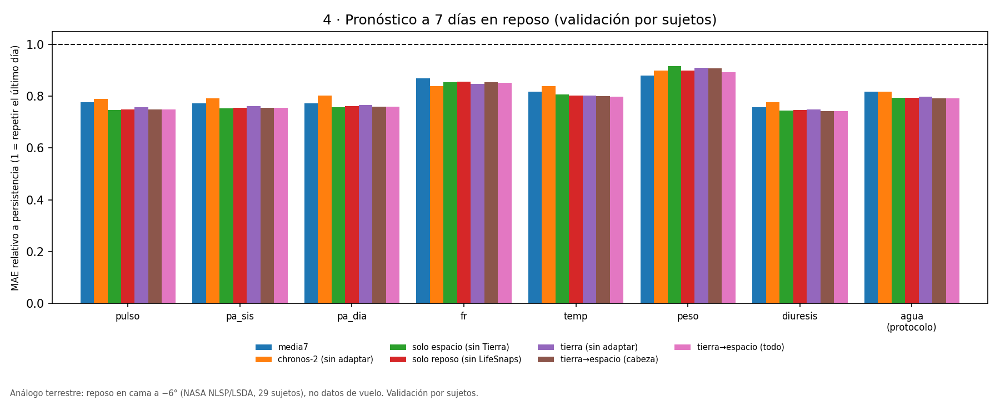

<div align="center">

# Earth → Space Transfer Learning

**Research by Benjamín Campos ([@B3njjaman](https://github.com/B3njjaman)) · data science**


</div>

Branch `transfer-learning`. The full write-up is the LaTeX report in
[`../transfer-learning-report/`](../transfer-learning-report) (report in Spanish).

NOVA learns what each person is like on Earth and adapts to their "new normal" using the few days of data collected
during the mission. This work tests that idea with 8 daily variables (pulse, systolic and diastolic blood pressure,
respiration, temperature, weight, urine output and water intake) and with real NASA bed-rest data, the Earth analog of
microgravity. **This is not flight data.** Adaptation to each individual happens in the expected range (section 1); the
forecast (section 2) adapts to bed rest in general.

Training runs on Kaggle (T4 GPU) and the models are stored on Hugging Face, in private repositories.

## Status (14-11-2026)

Works end to end: data → Kaggle → Hugging Face, with 27 passing tests. The numbers in this README come from the third
run of the kernel. The first run had the wrong loss scale. The second went through `ecc:python-reviewer` and
`ecc:mle-reviewer`, which found a pre-bed-rest leak in the forecast and an unfair comparison in the expected range. The
third fixes both. A later audit then reviewed the code and the output of the third run: the numbers add up and it found
no leakage between subjects. This README already includes its corrections. The next run focuses on pulse and blood
pressure: see [Next run (v4)](#next-run-v4).

Almost all numbers are in `resultados/metricas.json`. Three are not: the pairwise differences between full fine-tuning
and the from-scratch models, the false alarms per person, and the count of tensors that change. The audit recomputed
the first two from the per-subject tables in the kernel output, and the third from the published weights.

| File | What it is |
|---|---|
| [`PLAN.md`](PLAN.md) | goal, data, experiment design and what proves it is done |
| [`PREGUNTAS.md`](PREGUNTAS.md) | 26 decisions, with the answers of 14-11-2026 |
| `nova_tl/` | data, windows, expected range, PatchTST, intervals and plots |
| `kaggle/correr.py` | the complete kernel |
| `resultados/` | the 4 plots and `metricas.json` from the third run |

The starting point was the project brief; it is not included in this repository.

## Key findings

**The strong result uses neither PatchTST nor LifeSnaps.** It comes from the adapted expected range: each person's
baseline, their first 28 days in bed, and a corrector learned from the bed rest of *other* subjects. With the 28 own
days already included, that corrector improves the error by more than 0.02 only for weight and pulse; for the other
variables, the improvement comes from the person's own days.

The PatchTST forecast from Hugging Face beats the 7-day mean by a small margin. With full fine-tuning, Earth
pre-training beats the model trained from scratch by 0.004 or less. With a single seed and models trained under
different conditions, that is not yet enough to say whether pre-training helps (section 2).

Data: 29 subjects in −6° head-down bed rest (NASA NLSP/LSDA: campaigns 1 and 3 and CFT70 at UTMB), with 10 to 21
pre-bed-rest days and 42 to 91 days in bed (days with measured pulse). From day 28 in bed, within the same people,
weight drops 1.31 kg (95 % CI ±0.52; about 2 times its day-to-day variation) and pulse rises 2.6 bpm (±1.9). The other
variables change little, except water intake, which drops 104 g/day (±86), although it follows a protocol target.



## 1 · Expected range

The Earth monitor uses the pre-bed-rest mean ± 1.96 pre-bed-rest standard deviations. The adapted one adds a ridge
corrector per day in bed, learned from other subjects, and the mean of the person's first 28 days. Its width is
calibrated to 5 % with out-of-sample residuals. Everything is evaluated from day 28 in bed onwards, with
subject-wise validation and 95 % CIs from a subject bootstrap.

| Variable | Daily false alarms, Earth monitor | Floor of that rule (placebo, daily) | Width at 5 % false alarms, adapted / calibrated Earth | 3-day steps detected, Earth with calibrated width → adapted |
|---|---|---|---|---|
| weight | 52 % [36; 67] | 8 % | 0.51 (1.9 kg vs. 3.8 kg) | 10 % → 26 % (+16 pp [5; 30]) |
| pa_dia | 15 % [7; 24] | 9 % | 0.77 | 12 % → 31 % (+19 pp [9; 30]) |
| pulse | 14 % [7; 22] | 8 % | 0.82 | 11 % → 18 % (+7 pp [−1; 16]) |
| urine output | 5 % [2; 8] | 10 % | 0.85 | 52 % → 66 % (+15 pp [0; 29]) |
| fr | 14 % [8; 20] | 12 % | 0.89 | 73 % → 77 % (+4 pp [0; 10]) |
| pa_sis | 11 % [7; 15] | 8 % | 0.91 | 44 % → 49 % (+5 pp [−4; 16]) |
| temp | 6 % [3; 9] | 9 % | 0.94 | 92 % → 92 % |
| water (protocol target) | 5 % | 7 % | 0.93 | 92 % → 97 % |

Variable names follow the ship's contract: `pulso` (pulse), `pa_sis` / `pa_dia` (systolic / diastolic pressure), `fr`
(respiratory rate), `temp`, `peso` (weight), `diuresis` (urine output) and `agua` (water intake).

How to read the table:
- **Column 2.** The Earth monitor leaves out 52 % of normal in-bed weight days. These are daily false alarms: one day
  outside is enough.
- **Column 3.** The same rule applied within the pre-bed-rest period, leaving out the evaluated day, where there is no
  bed-rest effect at all. It already gives 8 to 12 % false alarms, because 10 to 21 days are not enough to estimate a
  person's variation well. Only weight is clearly above its floor; for pulse and pressure the excess is about 3 to 6
  points and their intervals overlap the floor.
- **The adapted model's 5 % holds by construction**, because the width is calibrated to that daily rate. It is not a
  finding in itself. It is also a population average: for weight, 18 of 29 people have no false alarms at all and one
  reaches 40.7 %.
- **Columns 4 and 5: the fair comparison.** If the Earth monitor's width is also calibrated to 5 % (model
  `tierra (ancho calibrado)`), the adapted model achieves the same with a narrower range and detects more steps. For
  weight, the range is halved and detection rises from 10 to 26 %. The uncalibrated Earth monitor detects more (55 %
  for weight), but only because it alarms on 53 % of normal days under the same rule, so it is not a usable reference.
- **The steps.** These are synthetic anomalies injected on top of the real data, with random sign: pressure rises or
  falls 15/10 mmHg, weight 1.5 kg, respiration 4 rpm, temperature 0.8 °C, urine output 1,000 g and pulse 10 bpm. Only
  the pulse step comes from `nave/docs/umbrales.md`; the others are ASSUMPTIONS. An alarm counts when ≥ 2 of 3
  consecutive days fall outside. Under that same rule, the adapted model's false alarms range from 0.9 to 4.6 %
  depending on the variable; the ones in the table are daily.




**How many own days does NOVA need?** For weight, the error of the expected value drops to 0.71 of the Earth error
with only the corrector from other subjects (k = 0), and to 0.46 with 28 own days. For pulse and diastolic pressure it
reaches ~0.80. Adding the corrector to the 28 own days lowers the error by more than 0.02 only for weight
(0.59 → 0.46) and pulse (0.86 → 0.80). For water it raises it (0.78 → 0.80) and for the rest the difference is below
0.02. This curve is always evaluated from day 28 onwards, so it measures how useful it is for predicting what comes
next, not how fast it adapts in the first weeks.



## 2 · 7-day forecast (PatchTST from Hugging Face)

PatchTST from `transformers`, univariate and shared across variables, with 14 days of context. The Earth model is
trained in each validation fold on LifeSnaps (71 people, Fitbit watch, CC BY 4.0; 64 train and 7 are held out for
early stopping) and the pre-bed-rest data of the training subjects. It is then adapted to the bed rest of the training
subjects, tuning only the head or the whole model. The evaluated subject contributes none of their own days, so this is
adaptation to bed rest in general, not to each person.

"Head only" freezes the backbone weights, but trains with the model in `train()` mode: the BatchNorm statistics are
recomputed on the bed-rest data and dropout stays active. In practice it is head + normalization. Between the published
weights `nova-tierra` and `nova-espacio`, 20 of 71 tensors change: the 2 of the head and 18 of BatchNorm.

The metric is MAE relative to persistence (repeating the last day), averaged excluding water:

| Model | Relative MAE |
|---|---|
| mean of the last 7 days | 0.807 |
| Chronos-2, not adapted | 0.820 |
| bed rest only, from scratch | 0.797 |
| pre-bed-rest + bed rest from scratch, without LifeSnaps | 0.796 |
| Earth, not adapted | 0.799 |
| Earth → space, head only | 0.796 |
| Earth → space, full fine-tuning | 0.793 |

Paired per-subject differences (95 % CI):
- **Earth → space vs. the 7-day mean:** −0.011 [−0.016; −0.005] tuning only the head and −0.014 [−0.019; −0.008]
  tuning everything. The improvement is real but small: 1.1 and 1.4 points of the persistence error.
- **Earth → space vs. the models trained from scratch:**
  - Head only is a tie: −0.0008 [−0.0038; 0.0020] against bed rest from scratch and +0.0003 [−0.0020; 0.0027] against
    pre-bed-rest + bed rest without LifeSnaps.
  - Full fine-tuning wins by a small margin: −0.0038 [−0.0064; −0.0011] and −0.0027 [−0.0047; −0.0007].
  - **It is not yet possible to say whether Earth pre-training helps.** There is a single seed. The from-scratch models
    use lr 1e-3 and reach their best epoch between 3 and 17 of 60, while full fine-tuning uses lr 2e-4. "Head only" was
    cut off by the 30-epoch cap in 3 of 5 folds. Run v4 equalizes those conditions.
- **Chronos-2 not adapted vs. the 7-day mean:** +0.013 [0.007; 0.019]. It does worse, although it receives the context
  with gaps filled in, so it is only a reference.



## How cheating was avoided

- **Subject-wise validation.** 5 folds stratified by campaign; test subjects never enter any fitting.
- **No leakage in the forecast.** The Earth model is retrained in each fold, without the pre-bed-rest data of the test
  subjects.
- **Out-of-sample calibrated width.** It comes from subject-wise cross-validation within the training subjects.
- **Center and width kept separate.** The crossed models `tierra (ancho calibrado)` (Earth center, calibrated width)
  and `adaptado (ancho de Tierra)` (adapted center, Earth width) show how much is due to the center and how much is
  only calibration.
- **Placebo within the pre-bed-rest period.** Gives the false-alarm floor of the Earth rule.
- **Steps with random sign.** This way they do not always go in the direction of the bed-rest drift; detection with
  and against the drift is reported separately in `rango_esperado.csv`.
- **Subject bootstrap.** People are resampled, not days.

## Limitations

- It is an analog: −6° bed rest, not flight. With the NASA tables available in the folder, it cannot be validated with
  real flight data (question 5).
- 29 subjects, a single training seed and hand-set constants, with no sweep: day 28, KAPPA = 3, the ridge alpha and the
  step magnitudes.
- 2 of the 3 CFT70 subjects exercised as a countermeasure, and campaign 3 has groups A and B. The population corrector
  mixes them.
- LifeSnaps pulse, respiration and temperature come from a watch (temperature is skin temperature); in bed rest they
  are measured by nursing staff.
- Water follows a protocol target. It is shown separately and is not included in the averages.
- The range width is one for the whole population: the 5 % false-alarm rate holds on average, not for each person. For
  weight, the per-person median is 0 % and the maximum, 40.7 %.
- There are many comparisons (8 variables, several models and three kernel runs) with no multiplicity correction.

## Next run (v4)

Decided on 14-11-2026 (see [`PREGUNTAS.md`](PREGUNTAS.md)):
- **Only pulse, systolic pressure and diastolic pressure**, with the real bed-rest data. The synthetic steps are kept,
  and declared, because they are the only way to measure detection. The eight LifeSnaps channels stay in the shared
  pre-training; of the three variables, only pulse is also in LifeSnaps, and Earth blood pressure comes from each
  subject's pre-bed-rest period.
- **All models under equal conditions:** same lr and budget, 60 epochs or more for "head only", and 3 seeds.
- **True "head only"**, with the backbone in `eval()`, compared with the current version.
- **Forecast adapted to each person** with their first k = 7, 14 and 28 days in bed.
- **Per-person range width**, compared with the population width.
- LoRA, only if full fine-tuning still beats the from-scratch model with the 3 seeds.
- The demo uses blood pressure + pulse.

## Models on Hugging Face (private; public at the end of the hackathon)

- `Benjjaman/nova-tierra`: PatchTST trained on Earth with LifeSnaps and the pre-bed-rest data of 25 subjects.
- `Benjjaman/nova-espacio`: the previous one, adapted to bed rest in "head only" mode (head + BatchNorm statistics). It
  also ships `corrector_poblacion.json`, the coefficients of the expected-range corrector fitted on the 29 subjects.

None of the performance numbers in this README come from those published weights: all come from models trained within
each validation fold. Only the count of changing tensors (section 2) comes from those weights.

## Reproduce

```
python -m nova_tl.datos --reposo <carpeta nlsp_tablas> --lifesnaps <daily .csv|.parquet> --salida <carpeta>
python -m pytest tests
kaggle datasets version -p <carpeta con nova_tl/ y los parquet> -m "..." --dir-mode zip
kaggle kernels push -p kaggle --accelerator NvidiaTeslaT4
kaggle kernels output benjacampos/nova-transfer-learning -p <salida>
python -m nova_tl.graficos <salida>/salida      # rehace los gráficos desde las tablas, sin redes
```

Placeholders: `<carpeta nlsp_tablas>` is the folder with the NLSP bed-rest tables, `<carpeta>` the output folder,
`<carpeta con nova_tl/ y los parquet>` the folder holding `nova_tl/` and the parquet files, and `<salida>` the kernel
output folder. The last command rebuilds the plots from the tables, without running any network.

The expected range (task 1) is a ridge model on CPU and can run on a PC. The networks run only on Kaggle.

## How it connects to the ship

Designed, not built:
- The variables use the names and units of `nave/estacion/CONTRATO.md`. `diuresis` and `agua` are not in the contract,
  and v4 no longer uses them (question 18).
- On board it would run as one more local Python service, on :8793, like the ship's language, voice, hearing, search
  and vision models (question 13). The change to `nave/` goes in a separate PR.
- The corrector is a few coefficients per variable and can be refitted on board every day. Improvements to the base
  model would arrive from Earth as a signed package (`aprende.rs`).
- For now, the adapted range is not proposed as the `ESPERADO_VUELO` of `nave/docs/umbrales.md` (question 15). The
  fixed emergency thresholds are not touched.
- The forecast does not replace the Vitals cone: it sits separately, as a 7-day trend. The connection with Ask NOVA and
  what arrives through the station are defined by Nicolás Moreno.

Earth data: LifeSnaps, by Yfantidou et al., *Scientific Data* 2022 (doi:10.1038/s41597-022-01764-x, CC BY 4.0).
Analog: NASA Life Sciences Data Archive, UTMB bed-rest studies.
