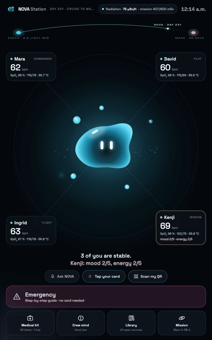
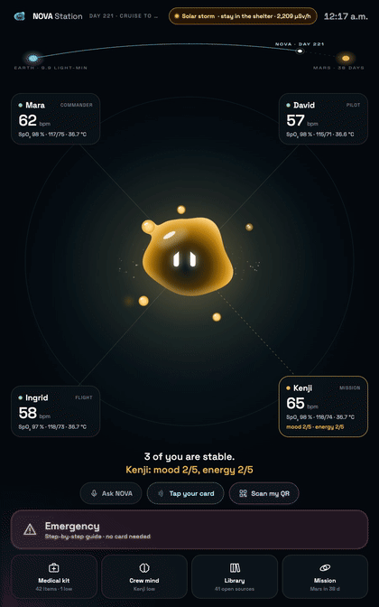
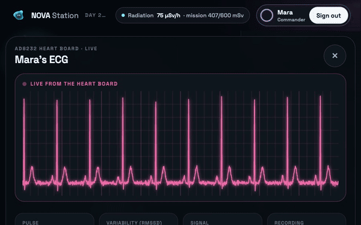
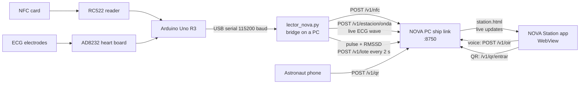
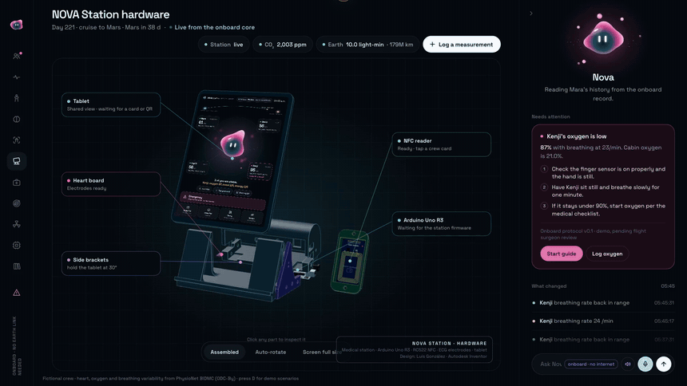

<div align="center">

# NOVA Station

**The shared tablet at the ship's medical station. Tap your card, and NOVA knows who is in front of her.**

<p>


</p>

</div>

<p align="center">

&nbsp;

&nbsp;

</p>
<p align="center"><sub>Home with the fictional demo crew · solar storm alert · live ECG from the heart board</sub></p>

---

## What it does

NOVA Station is a portrait Android tablet mounted at the medical station and shared by the whole crew. It is always
on, and anyone can use it without signing in.

**Without a card ("Orbit").** NOVA sits at the center with each crew member orbiting her, showing heart rate, SpO2,
blood pressure and temperature live from the flight core. Above them, the mission line (Earth, ship, Mars) with the
light delay. Below, what belongs to everyone: **Emergency** (never asks for a card), the 3D medical kit, the crew's
mind, the medical library and the mission. The buttons **Ask NOVA**, **Tap your card** and **Scan my QR** sit under
NOVA. Tapping a crew member opens only what that person shares.

**With a card ("Twin").** When an astronaut taps their NFC card, the ship opens their personal space: their body in
3D with each organ colored by their own data, and NOVA beside it. From there they can do the check-in, log a
measurement, record an ECG, read messages from home, use the medical kit and talk to NOVA, who already knows who is
speaking. Everything written in a session goes through `/v1/sesion/accion` and is recorded under that person's name;
the tablet cannot write on behalf of someone else.

The session closes with **Sign out**, by tapping the same card again, or after 2 minutes without touching the tablet.

**Live ECG.** Inside a personal space, the ECG button in the dock marks *live* when the heart board has electrode
contact. Opening the ECG sheet draws the trace in real time (the last 8 seconds) with pulse from the time between
beats, heart rate variability (RMSSD), signal quality and recording time; while the sheet is open, the values are
saved to that astronaut's record. With no electrodes, the sheet offers manual entry instead. Nothing opens or records
by itself.

**Solar storm.** A radiation chip in the header shows the current dose rate and the mission dose against the 600 mSv
limit, polled from the ship every 10 s (`/v1/radiacion`). When the ship flags a solar particle event, the chip turns
amber ("Solar storm · stay in the shelter", with the rate in µSv/h), the tablet vibrates and opens the step-by-step
shelter protocol for the whole crew, read aloud by NOVA and logged for the flight surgeon. When the event ends, the
tablet says the crew can leave the shelter.

**No card at hand?** The astronaut opens the station pass in the phone app. The ship issues a one-time QR code that
expires in 60 s; the tablet reads it with its front camera and opens that person's space.

## Architecture

The app is deliberately thin. It opens the NOVA Station interface served by the ship (`station.html`, from
[`../nave/tripulacion/ui/`](../nave/tripulacion/ui)) in a full-screen WebView, so every improvement on the ship reaches
the tablet with no reinstall. Native code only does what a web page cannot:

| Native piece | Why it is native |
|---|---|
| **Microphone** | Android does not give the microphone to an `http` page. When NOVA is asked to listen, the app records AAC, stops after 1.2 s of silence (or 20 s), uploads it to `/v1/oir` on the ship (whisper.cpp, on board) and hands the text back to the page. |
| **Front camera QR reader** | Reads a crew member's one-time QR and passes it to the page, which sends it to `/v1/qr/entrar`. The scanner closes itself after 40 s. |
| **Haptics** | A pulse when a card is read or when NOVA is lifted. |
| **Kiosk mode** | Screen always on, system bars hidden, portrait locked. |

The page and the app talk through `postMessage` (`escuchar`, `parar`, `vibrar`, `escanearQR`) and an injected
`window.novaApp(...)` callback (`oido`, `nivel`, `error`, `qrAbierto`, `qrCerrado`).



### Card reader and heart board

The NFC reader is a separate module that tells the ship which card it read and on which reader. Two options are
documented in [`../nave/estacion/NFC.md`](../nave/estacion/NFC.md): a networked board (ESP32, Pico W) that posts
`{"uid": "...", "lector": "station"}` to `/v1/nfc`, or a USB/Bluetooth reader in keyboard mode plugged into the tablet.

The station built by the team uses an **Arduino Uno R3 with an RC522 RFID reader and an AD8232 ECG board**
([`../hardware/estacion_nova/estacion_nova.ino`](../hardware/estacion_nova/estacion_nova.ino)). The ECG is sampled at a
steady 250 Hz (every 4 ms with `micros()`), the card reader is polled every 100 ms so it never stalls the ECG, and a
loose electrode is reported as `E:!`. The bridge [`../hardware/lector_nova.py`](../hardware/lector_nova.py) reads the
serial port and:

- forwards each card UID to `/v1/nfc`, so the ship opens that person's space on the tablet;
- streams the live wave to `/v1/estacion/onda` (batches of up to 400 samples, with the sample rate, contact state
  and seat); the ship relays it on its live stream to the tablet attached to that reader, which draws it;
- every 2 s, sends pulse and heart rate variability (RMSSD) to `/v1/lote` under the name of whoever has the session
  open, and only while that person has the ECG sheet open (the tablet reports what it shows through
  `/v1/station/pantalla`). With no session or with another screen open, nothing is saved.

<p align="center"></p>
<p align="center"><sub>Station hardware: tablet on side brackets at 30°, NFC reader, heart board and Arduino Uno R3. Design: Luis González, Autodesk Inventor.</sub></p>

## Run it

**1. Start the ship.** The tablet needs NOVA PC on the same network (see [`../nave/README.md`](../nave/README.md)):

```bash
cd nave/tripulacion && npm install && npm run enlace     # ship link on http://<ship>:8750
```

You can preview the interface without the APK by opening `http://<ship>:8750/station.html` in a browser. Voice input
from the page needs a secure origin; the APK handles the microphone natively.

**2. Install the app on the tablet.**

```bash
cd station
npm install
npx expo run:android                                      # development build on a connected tablet
npx eas-cli build --profile preview --platform android    # installable APK (your own EAS project and signing keys)
```

Signing credentials are not in the repository (`credentials.json` and `station/credenciales/` are ignored by git).
`npm run typecheck` checks the TypeScript.

**3. Point it at the ship.** On first launch the app asks for the ship's address (`192.168.1.20`, `ship.local:8750` or
a full URL; port 8750 is added if missing) and the reader name (default `station`, one reader per tablet). **Test** checks
the address against `/v1/sesion` and reports how many crew cards are linked. To change it later, tap the top-left corner five times within three
seconds.

**4. Connect the reader.** Flash `hardware/estacion_nova/estacion_nova.ino` to the Arduino, then run the bridge on the
PC it is plugged into:

```bash
pip install flask pyserial
NOVA_NAVE=http://<ship>:8750 NOVA_PUERTO=<serial-port> python hardware/lector_nova.py
```

Optional variables: `NOVA_BAUDIOS`, `NOVA_LECTOR` (must match the tablet's reader name) and `NOVA_TOKEN` if the ship
requires one. The bridge also serves a status page on port 5000. To test without hardware:

```bash
curl -X POST http://127.0.0.1:8750/v1/nfc -H 'content-type: application/json' -d '{"uid":"04A1B2C3","lector":"station"}'
```

An unknown card makes the tablet ask whose it is; the pairing is stored on the ship.

## File map

| Path | Contents |
|---|---|
| `App.tsx` | The whole app: setup screen, WebView, native microphone, QR reader, haptics, kiosk mode |
| `app.json` | Expo config: portrait, dark, package `solutions.bn.nova.station`, cleartext traffic for the local ship network |
| `eas.json` | Build profiles: `preview` (APK) and `production` (app bundle), local credentials |
| `assets/images/` | App icon and splash |
| `../nave/tripulacion/ui/station.html` | The station interface the tablet loads from the ship |
| `../nave/tripulacion/ui/station.js` | Station logic: Orbit and Twin, ECG sheet, solar storm alert, voice |
| `../nave/tripulacion/src-tauri/src/nfc.rs` | Ship side: cards, sessions, one-time QR codes, the station's current screen and the ECG relay |
| `../hardware/` | Arduino firmware and the USB bridge |

## Status

**Works today**

- Kiosk app that loads the ship's station interface, so updates on the ship reach the tablet with no reinstall.
- NFC sign-in through an RC522 reader, and one-time QR sign-in from the phone.
- Live ECG from the AD8232 board at 250 Hz, with pulse and RMSSD saved to the astronaut's record while the ECG sheet
  is open.
- Solar storm alert with the shelter protocol for the whole crew.
- Voice questions to NOVA, transcribed on board by whisper.cpp.
- Per-person sessions that close on sign-out, on the same card, or after 2 minutes idle.

**Next stage**

- More sensors on the station: oxygen, blood pressure, temperature, glucose, cognitive fatigue and gut microbiota.
  The hardware is not built yet. The ship already carries oxygen, blood pressure, temperature and glucose, and the
  tablet's **Log a measurement** sheet records them by hand under the astronaut's name.

## Credits

Station hardware designed and built by Luis González (Team B&N). App and station interface by Team B&N for the NASA
International Space Apps Challenge 2026. The crew and their numbers are fictional demo data. NOVA is not affiliated
with or endorsed by NASA.

<p align="center"><a href="../README.md">← Back to the NOVA repository</a></p>
