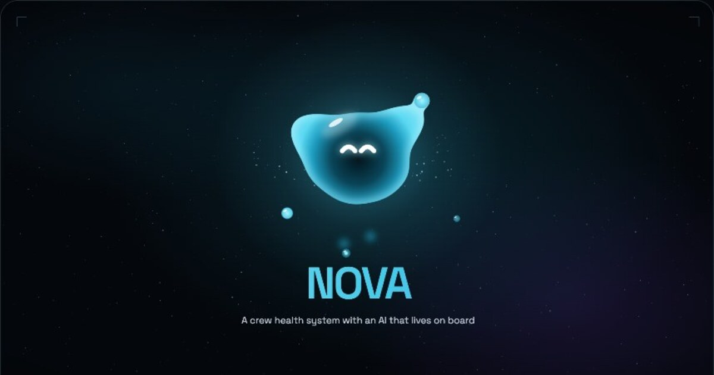
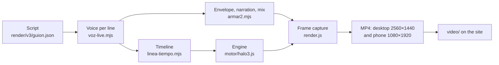

<div align="center">

# NOVA · Website and Story Engine

**The public face of NOVA: a bilingual site, a story video drawn entirely in code, and the architecture document.**

<p>
<a href="https://nova-spaceapps.vercel.app"></a>


</p>

</div>

<p align="center"><a href="https://nova-spaceapps.vercel.app"></a></p>

<p align="center">
<a href="https://nova-spaceapps.vercel.app"><b>English</b></a> ·
<a href="https://nova-spaceapps.vercel.app/es/"><b>Español</b></a> ·
<a href="docs/arquitectura/NOVA-arquitectura.pdf"><b>Architecture (PDF, Spanish)</b></a>
</p>

---

## What is here

| Piece | Path | What it does |
|---|---|---|
| **Website** | `index.html`, `es/` | The project site in English (`/`) and Spanish (`/es/`). Static HTML, CSS and JavaScript with no build step, deployed on Vercel. |
| **Story engine** | `motor/`, `motor-es/` | The presentation video as a single deterministic function, `render(t)`, drawn live in the browser at 1920×1080. |
| **Render pipeline** | `render/` | Voice, timeline, mix and frame capture that turn the engine into the MP4 videos on the site. |
| **Architecture document** | `docs/arquitectura/` | The 13-page technical document of the whole system, as HTML source and PDF. |

## The website

The page tells NOVA's story from top to bottom:

| Section | Content |
|---|---|
| **Story** | The full presentation video in the hero, with sound, pause and full-screen controls: a vertical cut on phones, 1440p on large screens. It pauses itself when scrolled out of view. |
| **How it works** | Everything runs on board: the F Prime flight core, the language model (Qwen3 4B on llama.cpp), speech and voice (whisper.cpp and Kokoro), vision (MediaPipe Pose and Hands), the medical library and the medical station, each with a small live signal drawn on canvas. |
| **Real screens** | 14 captures from NOVA running on the team's ship computer with the demo crew: the big screen, the phone, NOVA Station, emergencies, Mind, AR tested at the hackathon, CPR for every gravity, the medical kit, the solar storm and the library. |
| **Exercise** | The body twin with and without the exercise plan, with rates from the NASA Human Research Program. |
| **Women's health** | Private cycle care, jugular clot screening and supplies counted to the end of the mission, each with its source. |
| **Every night** | The nightly report to Earth and signed updates on the way back. |
| **Learning loop** | An interactive simulation of the proposed loop (`bucle.js`): move the ship farther from Earth, hide it behind the Sun, or try to slip a bad update past Mission Control. |
| **Radiation** | An interactive mission dose chart (`radiacion.js`): drag the mission day and trigger a solar storm with and without NOVA's shelter warning. Rates measured by MSL RAD: 1.84 mSv/day in cruise (Zeitlin et al. 2013) and 0.64 mSv/day on the surface (Hassler et al. 2014). |
| **Every number has a source** | Key figures and ten NASA and peer-reviewed references, then the roadmap: prototype, HERA, CHAPEA, space station, Artemis and Mars. |
| **Open the code** | A link to this repository. |
| **FAQ** | Six questions a judge or a flight surgeon would ask. |

NOVA floats in a corner of every page, drawn as SVG in real time, and opens a short chat. Its answers are written in
the page (`nova.js`); the site calls no model and no backend.

The Spanish page (`es/`) has its own `index.html`, `nova.js` and `radiacion.js`, and shares styles, images and the
learning loop. The page scripts check `prefers-reduced-motion` and hold their animations still when it is set.

## The story engine

`motor/motor.html` with `motor/halo3.js` is the whole presentation video written as code: every title, chart, phone
mock-up, 3D brain, NOVA's face and mouth is a pure function of time. Open it in a browser and it plays in a loop;
add `?render` and it waits to be driven frame by frame; add `&v=1` and it reflows for a vertical frame.

```
render(t)  →  the exact frame at second t     DUR = 364.96 s (English) · 301.675 s (Spanish, motor-es/)
```

- **Scenes** are placed on the timeline by `render/linea-tiempo.mjs`, which reads how long each narrated line lasts
  and writes the scene starts (`S`), line starts (`V`) and total length (`DUR`) into `halo3.js`.
- **NOVA's mouth** follows the real amplitude of the narration: `motor/voz/env-en.json` and
  `motor-es/voz/env-es.json` hold one envelope per line.
- **Clips** in `motor/clips/` are real captures of NOVA PC (the station and the body scanner), recorded with Puppeteer
  against the local ship in read-only mode.
- **Mascot and shapes**: `mascota-base.js` and `mascota-orbes.js` draw NOVA; `unir-degradados.js` runs one gradient across each animated title line;
  `motor/vendor/three.module.js` is three.js for the 3D scenes; `motor/ui/` holds the interface mock-ups.

## Render pipeline



1. **Voice.** English: `voz-live.mjs` voices each line of `render/v3/guion.json` with the voice Aoede through the
   Gemini Live API, one session per line, and saves the model's own transcript next to each take to check the reading.
   Spanish (`voz-es/`): one continuous take, split into lines by `cortar.mjs` (dynamic programming over the pauses)
   and checked line by line with `transcribir.mjs`.
2. **Timeline.** `linea-tiempo.mjs <voice folder>` fits the scenes to the voice.
3. **Mix.** `armar2.mjs en|es` builds the mouth envelope, the narration track and the final mix over the music;
   `voz-es/mezclar.sh` ducks the music under the Spanish voice to match the English loudness (-15 LUFS).
4. **Render.** `render.js` opens the engine in headless Chrome, calls `render(t)` for every frame at 30 fps and pipes
   JPEG frames to ffmpeg (x264, CRF 18 to 19) with the mixed audio. `render-todo.sh` renders the four versions
   (English and Spanish, desktop and phone) in parallel and compresses them for the web; `render-en.sh`,
   `render-pc.sh` and `render-movil.sh` render subsets, with retries.

```bash
cd web
python3 -m http.server 8931 --bind 127.0.0.1          # the render scripts expect the site here
AUD=render/mezcla-en.wav node render/render.js \
  "http://127.0.0.1:8931/motor/motor.html?render" 1920 1080 1.3333334 render/pc-en.mp4
DESDE=40 HASTA=60 AUD=<mix.wav> node render/render.js <url> 1920 1080 1 out.mp4   # a 20-second excerpt
node render/render.js <url> 1920 1080 1 still.mp4 12.5 80              # still PNGs at t = 12.5 s and 80 s
```

Requirements: Node, ffmpeg and Puppeteer. Two things are tied to the authors' machine and need adjusting before a
clean run: `render.js`, `armar2.mjs` and `voz-es/armar.mjs` import Puppeteer and an audio envelope helper from a local
checkout of [AMBAR Studio](https://github.com/4mser/ambar-studio), and the voice scripts read a Gemini API key from the
environment (`AMBAR_GEMINI_API_KEY`) or the macOS Keychain. Voice takes and audio mixes are not committed (see
`.gitignore`).

## The architecture document

[`docs/arquitectura/doc.html`](docs/arquitectura/doc.html) is the source and
[`NOVA-arquitectura.pdf`](docs/arquitectura/NOVA-arquitectura.pdf) the 13-page export, in Spanish:

| # | Chapter |
|---|---|
| 01–02 | Cover, three principles and contents |
| 03 | Overview: everything lives inside the ship |
| 04 | The path of one reading, from the station to the screen |
| 05 | Flight core (F Prime) |
| 06 | The ship link: one application, every screen, a swappable brain |
| 07 | On-board intelligence: small models, real data, cited sources |
| 08 | Emergencies and the AR scanner: anyone on board can help |
| 09 | The phone: each crew member, their own app |
| 10 | Women's health and exercise |
| 11 | Ship and Earth: learns on Earth, comes back signed |
| 12 | Security and status: what can go wrong, and what stops it |
| 13 | Reference: ports and glossary |

## Run it locally

```bash
cd web
python3 -m http.server 8931 --bind 127.0.0.1
# http://127.0.0.1:8931/          English
# http://127.0.0.1:8931/es/       Spanish
# http://127.0.0.1:8931/motor/motor.html     the story engine, playing live
```

The four long videos are not in the repository (see [`video/LEEME.md`](video/LEEME.md)), so locally the hero shows
its poster frame; everything else works offline. The live site serves the full videos.

**Deploy.** The folder deploys as-is to Vercel. `vercel.json` sets revalidation for HTML, CSS and JS and a one-day
cache for fonts, images and audio. `.vercelignore` keeps the render pipeline, the music stems, the Spanish engine,
the source clips and the architecture document out of the deployment.

## File map

| Path | Contents |
|---|---|
| `index.html`, `nova.css`, `nova.js` | English page, styles and behavior (hero video, floating NOVA and chat, live signals, reveals) |
| `es/` | Spanish page with its own `nova.js` and `radiacion.js` |
| `radiacion.js` | Interactive radiation dose chart |
| `bucle.js` | Interactive simulation of the proposed nightly learning loop |
| `img/real/` | 14 real captures of NOVA running |
| `motor/` | Story engine (English): `motor.html`, `halo3.js`, mascot, fonts, NASA images, clips, mouth envelopes, three.js |
| `motor-es/` | Story engine (Spanish) |
| `render/` | Render pipeline: voice, timeline, mix and frame capture scripts, vertical wrappers (`vertical.html`, `vertical-es.html`), English script (`v3/guion.json`) |
| `video/` | Posters for the long videos and the short gallery clips (`gal/`) |
| `musica/` | The music bed of the video and its credits |
| `docs/arquitectura/` | Architecture document, HTML and PDF |
| `equipo.js` | Interactive strange attractors for a team section (not loaded by the current page) |

## Status

| Works today | Illustrative or proposed |
|---|---|
| Live bilingual site at [nova-spaceapps.vercel.app](https://nova-spaceapps.vercel.app) | The learning loop is a simulation of the proposed design; report and update sizes, error rates and approvals are design targets and demo data |
| Story engine rendering the presentation video, English and Spanish, desktop and phone | The radiation mission is illustrative; the daily rates are measured values from MSL RAD |
| Real screen captures from NOVA running on the ship computer | The site chat uses fixed answers, it does not call a model |
| Architecture document, 13 pages | Roadmap beyond the prototype (HERA, CHAPEA, space station, Artemis and Mars) |

## Credits

- **Music:** "Future Technology" by The_Mountain, Pixabay Content License. Details in
  [`musica/CREDITOS.md`](musica/CREDITOS.md).
- **Space images:** NASA, public domain ([`motor/img/CREDITOS.txt`](motor/img/CREDITOS.txt) lists every image ID).
- **CPR footage under the body scan:** "RCP.ogv" by Primerosauxilios, CC BY-SA 3.0, Wikimedia Commons. The scenes
  that layer NOVA on top of it are a derivative work under the same license
  ([`motor/clips/CREDITOS.txt`](motor/clips/CREDITOS.txt)).
- **CPR guidelines:** DGLRM/ESAM (Hinkelbein et al. 2020, CC BY 4.0) and Sriharan et al. 2021.
- **Fonts:** Space Grotesk and IBM Plex Mono, SIL Open Font License.
- **Voice:** NOVA's voice is Aoede, generated with the Gemini API.

The crew, names and numbers in the interfaces are fictional demo data. NOVA is a Team B&N project for the NASA
International Space Apps Challenge 2026 and is not affiliated with or endorsed by NASA.

<p align="center"><a href="../README.md">← Back to the NOVA repository</a></p>
